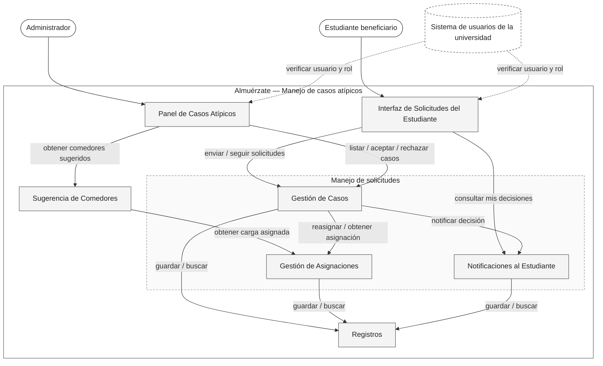
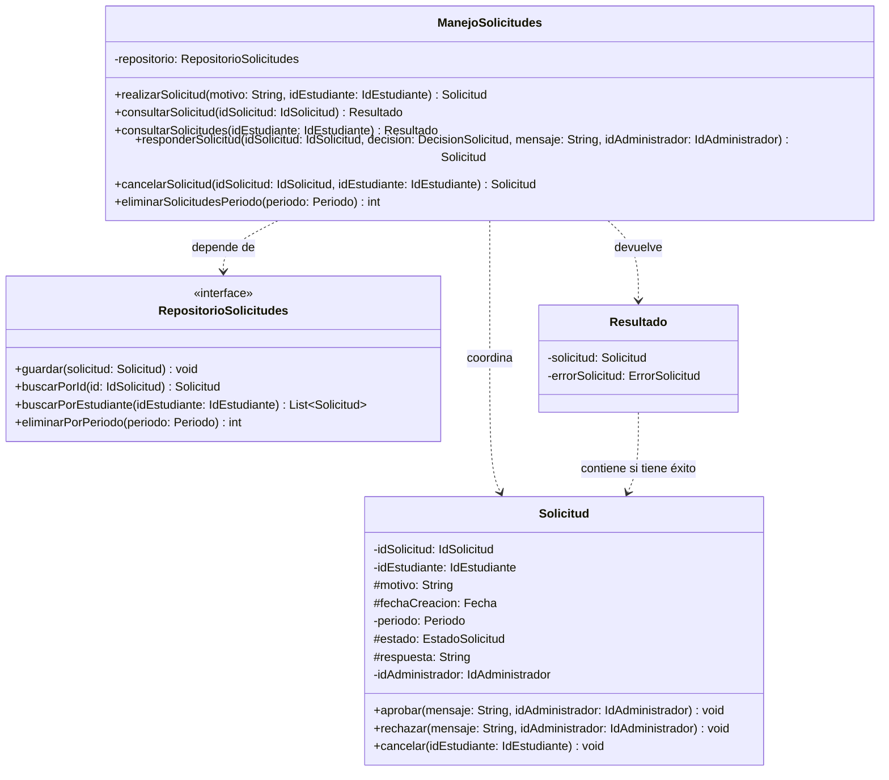

<!--
WORKED EXAMPLE — not a blank to fill in and not a project to reuse.
Food Delivery System, the running example from Classes 8 to 11. It covers three requirements
only (REQ-07, REQ-12, REQ-13) so it stays readable. Your deliverable must cover YOUR whole
system and YOUR own project. Use this for level of detail and for how the sections connect.
-->

# Sistema de manejo de casos especiales — Architectural & Detailed Design v1.0

| | |
|---|---|
| **Team** | Equipo Almuerzate |
| **Members** | Brayan Santiago Amado Mejia, Diego Alejandro Gaviria Sabogal, Julian Camilo Londoño Zarate, Juan Felipe Pineda Gonzalez, Jose Alfredo Quevedo Suarez.   |
| **Status** | Ready for review |
| **Date** | 2026-10-19 |
| **Inputs** | `docs/REQ-01-Sistema-de-manejo-de-casos-especiales.md` |

---

## 1. System Overview & Design Drivers

**Proposito del requerimiento**

Permitir a los administradores del servicio asignar un comedor diferente a los estudiantes beneficiarios, y a los estudiantes beneficiarios hacer una solicitud de cambio de comedor, bajo razones de fuerza mayor que requieran un cambio de comedor y hayan presentado una solicitud valida a través de la plataforma.

| Requirement / Use Case ID | Why it shapes the structure | Quality attribute, constraint or business rule involved |
|---|---|---|
| REQ-01 / UC-2 |	Un cambio aprobado debe sobrevivir a la reasignación periódica del RFC (Entrega 2). El recálculo y REQ-01 escriben sobre las mismas asignaciones, así que cada una registra su origen (automática o manual). El recálculo no modifica las manuales y las cuenta en la ocupación de cada comedor. Esa regla vive en el Servicio de asignación y casos, no en el cliente. | Regla de dominio: R-4 y R-3. Atributo de calidad: integridad de datos. Dependencia: R1 / Entrega 2. |
| REQ-1 / UC-3 y UC-5 | Si falla un envío, la solicitud del estudiante (UC-5) y el motivo de rechazo del administrador (UC-3) se guardan en el Cliente PWA. Este es el único responsable de recuperarlos y reintentar mediante una cola de sincronización. La interfaz solo encola y no decide cuándo reintentar. Cada envío lleva un identificador generado en el cliente para que un reintento no duplique la solicitud. En UC-3 (caso administrador) el reenvío lo confirma el administrador. | Regla de dominio: R-6. Atributo de calidad: fiabilidad (no perder lo que el usuario escribió) y cohesión del cliente. Restricción: PWA (Progressive Web App) (L4) | 
| REQ-01 / UC-1 a UC-5 | Dos roles (estudiante y administrador) con operaciones distintas sobre los mismos datos. Un único control de acceso en el Servicio de asignación y casos verifica en cada operación el rol, tomado de la cuenta guardada en el servidor y no de lo que envía el cliente. También verifica la propiedad del dato en las consultas del estudiante (UC-4). | Regla de dominio: R-1. Dependencia: cuentas y roles simulados. Atributos de calidad: control de acceso. |
| REQ-01 / UC-2, UC-3 y UC-4  | Toda decisión se guarda en un historial interno (quién, cuándo, resultado, motivo). El estudiante no lee ese historial. UC-4 consulta el estado de su caso (estado, motivo, comedor asignado), que el servicio entrega con un contrato JSON estable. Así el historial puede cambiar por auditoría sin romper la vista del estudiante. Como las notificaciones son solo dentro de la PWA (L9), no hay envío: el estudiante consulta. | Regla de negocio: R-9 y R-10. Restricción: L9. Calidad: auditabilidad y ocultamiento de información. |

 
---

## 2. Architectural Design
 
### 2.1 System Context & Boundary
 
| Outside the system | Type | How the system interacts with it |
|---|---|---|
| Estudiante beneficiario | Actor | Reporta un caso atípico, consulta el estado de sus solicitudes y ve la decisión tomada |
| Administrador del servicio de alimentación | Actor | Revisa los casos pendientes, acepta o rechaza cada uno y elige el comedor de reasignación |
| Sistema de usuarios de la universidad | External system (simulado con datos de prueba en el demo) | Le pedimos confirmar quién es el usuario y qué rol tiene. No controlamos su disponibilidad ni su formato |
 
*(La asignación base de comedores (R1 / Entrega 1) vive dentro del sistema, pero su cálculo con el árbol de decisión no se detalla aquí: REQ-01 solo necesita leerla y modificarla.)*
 
### 2.2 Components, Responsibilities & Capabilities
 

 
| Component | Main responsibility | Requirements / use cases supported | Provided capabilities | Required capabilities | Main dependencies |
|---|---|---|---|---|---|
| Interfaz de Solicitudes del Estudiante | Muestra al estudiante el formulario de solicitud, el estado de sus casos y la decisión, y reenvía sus acciones | REQ-01: US-05, US-06, UC-4, UC-5, AC-09, AC-10, AC-11 | Reportar un caso, consultar mis solicitudes y su decisión | Verificar usuario y rol (externo), enviar solicitud, consultar mis solicitudes, obtener opciones de solicitud, consultar mis decisiones | Gestión de Casos, Notificaciones al Estudiante, Sistema de usuarios |
| Panel de Casos Atípicos | Muestra al administrador los casos pendientes y la lista de comedores sugeridos, y reenvía su decisión | REQ-01: US-01 a US-04, UC-1, UC-2, UC-3, AC-01 a AC-07 | Mostrar y resolver casos pendientes | Verificar usuario y rol (externo), listar casos pendientes, aceptar caso, rechazar caso, obtener comedores sugeridos | Gestión de Casos, Sugerencia de Comedores, Sistema de usuarios |
| Gestión de Casos | Aplica las reglas de las solicitudes (justificación obligatoria, una pendiente por estudiante, motivo en todo rechazo, decisión registrada) y controla el estado de cada caso | REQ-01: US-01, US-02, US-03, US-05, UC-1 a UC-5, AC-01, AC-02, AC-04, AC-05, AC-09, AC-10; R-5, R-6, R-7, R-9 | Enviar solicitud, consultar mis solicitudes, obtener opciones de solicitud, listar casos pendientes, aceptar caso, rechazar caso | Reasignar estudiante, obtener asignación del estudiante, notificar decisión, buscar / guardar casos y decisiones | Gestión de Asignaciones, Notificaciones al Estudiante, Registros |
| Sugerencia de Comedores | Ordena los comedores alternativos de mejor a peor según la ocupación proyectada, o responde explícitamente que no pudo hacerlo (árbol de decisión en el backend, ADR-0004) | REQ-01: US-04, UC-2, AC-03, AC-06, AC-07; R-3, R-8 | Obtener comedores sugeridos | Obtener carga asignada por comedor | Gestión de Asignaciones |
| Gestión de Asignaciones | Entrega la asignación vigente de un estudiante, aplica la reasignación y la marca como manual para que ningún recálculo la pise | REQ-01: US-02, UC-2, UC-5, AC-04; R-4 | Obtener asignación del estudiante, reasignar estudiante, obtener carga asignada por comedor | Buscar / guardar asignaciones, obtener capacidades | Registros |
| Notificaciones al Estudiante | Deja disponible dentro de la PWA la decisión de cada caso (aceptado con nuevo comedor, o rechazado con motivo) | REQ-01: US-06, UC-2, UC-3, UC-4, AC-08; R-10, L9 | Notificar decisión, consultar mis decisiones | Buscar / guardar notificaciones | Registros |
| Registros | Guarda y entrega casos, decisiones, asignaciones, capacidades de los comedores y notificaciones | REQ-01: todos los anteriores; R-9 | Buscar / guardar casos y decisiones, buscar / guardar asignaciones, obtener capacidades, buscar / guardar notificaciones | none | none |
 
**Pendientes que afectan este diseño** (vienen de las *Open Questions* del REQ-01):
- La definición del estimado de ocupación (pregunta 3) no está cerrada. Mientras tanto, `Sugerencia de Comedores` usa lo que `Gestión de Asignaciones` le entrega (estudiantes asignados por comedor frente a su capacidad).
- No se decidió dónde se guardan los adjuntos de evidencia (pregunta 5), así que no hay un componente para ellos.
- Falta el ADR nuevo que defina qué parte pasa por la API en C++ (pregunta 8).

---

## 3. Detailed Design

### 3.1 Components selected

| Component | Why it was selected |
|---|---|
| Solicitud de restitucion | Considerando la R-01 es relevante garantizar que los estudiantes beneficiarios puedan realizar solicitudes, en la que estos tengan en cuanta la R-05 |
| Manejo de solicitudes  | Los administradores del servicio deben realizar una evaluación de las solicitudes considerando la R-07. Para posteriormente notificar al estudiante beneficiario que realizo la solicitud de la decisión siguiendo a las R-09 y R-10 |


### 3.2 Class Diagram



*(Tanto EstadoSolicitud como DecisionSolicitud son ennumeaciones. Sin embargo, una se enfoca en la solicitud y la otra en la desicion tomada)*

### 3.3 Class Responsibilities

| Class | Component | Responsibility | Key collaborators |
|---|---|---|---|
| `ManejoSolicitudes` | Manejo de solicitudes | Coordina la gestión de las solicitudes, permite consultar su información y facilita que el administrador las evalúe y registre una decisión. También gestiona la eliminación de solicitudes correspondientes a períodos finalizados y el manejo de errores en las consultas. | `Solicitud`, `RepositorioSolicitudes`, `DecisionSolicitud`, `Resultado` |
| `Solicitud` | Solicitud de restitución | Representa una solicitud realizada por un estudiante. Mantiene su información, estado y respuesta administrativa, y controla las transiciones válidas entre estados. | `ManejoSolicitudes` |
| `RepositorioSolicitudes` | Manejo de solicitudes | Define las operaciones para almacenar, consultar y eliminar solicitudes, permitiendo mantener los datos persistentes sin acoplar la lógica del sistema a una implementación concreta de almacenamiento. | `Solicitud` |
| `DecisionSolicitud` | Manejo de solicitudes | Representa las decisiones que puede tomar el administrador al evaluar una solicitud, como aprobarla o rechazarla. | `ManejoSolicitudes` |
| `Resultado` | Manejo de solicitudes | Representa el resultado de una operación, permitiendo devolver una solicitud o una lista de solicitudes cuando la operación es exitosa, o un error cuando no puede completarse. | `Solicitud`, `ManejoSolicitudes` |


### 3.4 Behavior of one key operation

```text

+consultarSolicitud(idSolicitud: IdSolicitud): Resultado<Solicitud, ErrorSolicitud>
    solicitud = RepositorioSolicitudes.buscarPorId(idSolicitud)

    Si solicitud no existe:
        Retornar Resultado<NULL,ErrorSolicitud.NO_EXISTE>

    Si solicitud.motivo está vacío O solicitud.idEstudiante está vacío:
        Retornar Resultado<NULL,ErrorSolicitud.INFORMACION_INCOMPLETA>

    Retornar Resultado<solicitud,NULL>

```

---

## 4. Design Quality — Cohesion, Coupling, Information Hiding

| Question | Your answer, with evidence from your design |
|---|---|
| **Cohesion** | `Solicitud de restitución` permite a los estudiantes beneficiarios generar y consultar solicitudes de cambio de comedor, mientras que `Manejo de solicitudes` coordina su evaluación y resolución por parte del administrador. La clase `Solicitud` contiene la información y el estado de cada solicitud, y `RepositorioSolicitudes` gestiona las operaciones de almacenamiento y consulta. |
| **Coupling** | `ManejoSolicitudes` utiliza la interfaz `RepositorioSolicitudes` para acceder a los registros sin depender de una implementación específica de almacenamiento. La clase `Solicitud` mantiene su información y estado sin asumir responsabilidades relacionadas con la persistencia ni con la coordinación del proceso administrativo. |
| **Information hiding** | `Solicitud` mantiene privados ciertos atributos que no son necesarios exponer. El administrador consulta únicamente la información necesaria para evaluar cada solicitud mediante las operaciones del sistema, sin acceder directamente a la estructura interna de los datos ni a los detalles de almacenamiento. |

**Real findings and what we changed**

> Inicialmente, se pensaba gestionar todas las solicitudes directamente desde la clase `Solicitudes`. Sin embargo, se decidió incorporar `ManejoSolicitudes` para separar la información propia de cada solicitud de las operaciones relacionadas con su administración, favoreciendo la cohesión. Además, los estados se asociaron directamente a `Solicitud`, mientras que la validación y resolución se centralizaron en `ManejoSolicitudes`, manteniendo una relación clara entre la gestión administrativa y las solicitudes. Estos cambios buscan reducir el acoplamiento entre responsabilidades y mejorar la organización de los componentes del sistema.

---

## 5. Design Decisions & Decision Record

### Decision A — Architectural

| | |
|---|---|
| **Context** | REQ-07 depends on an external provider we do not control (Constraint). Its availability and format can change. |
| **Decision** | All communication with the tracking provider goes through Tracking Integration. No other component calls the provider or sees its format. |
| **Rationale** | A provider failure or format change stays contained, and the customer can still see the order status when no estimate exists. |
| **Trade-off accepted** | One extra hop between the customer's screen and the provider, so slightly more latency. We rejected letting the display call the provider directly because every provider change would then reach the user interface. |

### Decision B — Detailed design

| | |
|---|---|
| **Context** | The provider can answer with usable, stale, incomplete data, or not answer at all. Those outcomes were being handled in different places. |
| **Decision** | `TrackingIntegration` always returns an `EtaResult`, and "unavailable" is a normal result with a reason, never an exception that propagates. |
| **Rationale** | Callers handle one result type. The unavailable path (REQ-07 alternative and exception flows) is designed instead of accidental. |
| **Trade-off accepted** | Callers must check `isAvailable()` explicitly, and a forgotten check shows an empty estimate instead of failing loudly. |

### ADR

**ADR file:** `docs/decisions/ADR-001-isolate-tracking-provider.md` — records Decision A.

---

## 6. Traceability

| Requirement ID | Use Case | Component(s) | Class(es) |
|---|---|---|---|
| REQ-01 | UC-1 Consultar casos pendientes | Manejo de solicitudes, Interfaz de Solicitudes del Estudiante, Panel de Casos Atipicos y Registros | ManejoSolicitudes (consultarSolicitudes), RepositorioSolicitudes (buscarPorEstudiante), Solicitud, EstadoSolicitud, Resultado |
| REQ-01 |	UC-2 Se acepta un caso pendiente | Manejo de solicitudes y Interfaz de Solicitudes del Estudiante | solicitudes, Solicitud de restitución. ManejoSolicitudes (responderSolicitud), Solicitud (aprobar), DecisionSolicitud, EstadoSolicitud, RepositorioSolicitudes (buscarPorId, guardar), Resultado |
| REQ-01 |	UC-3 Informar a un estudiante el rechazo de su caso | Manejo de solicitudes, Interfaz de Solicitudes del Estudiante y Registros | ManejoSolicitudes (responderSolicitud), Solicitud (rechazar), DecisionSolicitud, EstadoSolicitud, RepositorioSolicitudes (buscarPorId, guardar), Resultado |
| REQ-01 |		UC-4 Se notifica el estado de un caso atípico | Panel de casos atipicos e Interfaz de Solicitudes del Estudiante | ManejoSolicitudes (consultarSolicitudes, consultarSolicitud), RepositorioSolicitudes (buscarPorEstudiante, buscarPorId), Solicitud, EstadoSolicitud, Resultado |
| REQ-01 |			UC-5 Se solicita reasignar un comedor | Interfaz de Solicitudes del Estudiante, Manejo de solicitudes y Registros | ManejoSolicitudes (realizarSolicitud), Solicitud, EstadoSolicitud, RepositorioSolicitudes (guardar), Resultado |

---

## 7. Optional — AI-Assisted Design Reflection

> An AI assistant suggested adding a separate Notification component to tell customers when an estimate changes. We rejected it: no requirement in our set supports it, and it would add a component without a responsibility we can trace.

---

## 8. Consistency Checklist

- [x] Every component in the diagram appears in the responsibilities table, and the other way around.
- [x] Every class belongs to an identifiable component.
- [x] Components are named by responsibility, not technology.
- [x] Nothing inside the system boundary is something we do not control.
- [x] Provided and required capabilities match across components.
- [x] Both decisions name a real cost or limitation, and at least one has an ADR.
- [x] The traceability table has no empty rows and no orphan components or classes.
- [x] Diagrams render correctly on GitHub.
