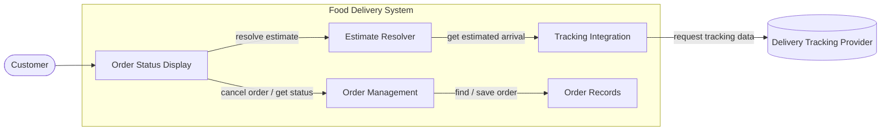
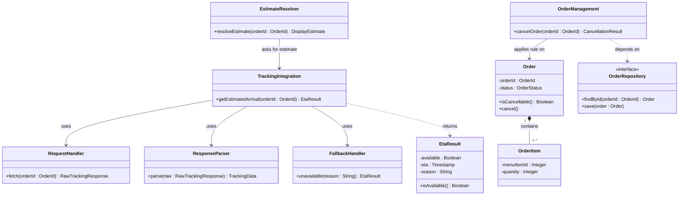

<!--
WORKED EXAMPLE — not a blank to fill in and not a project to reuse.
Food Delivery System, the running example from Classes 8 to 11. It covers three requirements
only (REQ-07, REQ-12, REQ-13) so it stays readable. Your deliverable must cover YOUR whole
system and YOUR own project. Use this for level of detail and for how the sections connect.
-->

# Food Delivery System — Architectural & Detailed Design v1.0

| | |
|---|---|
| **Team** | Equipo Almuerzate |
| **Members** | Brayan Santiago Amado Mejia, Diego Alejandro Gaviria Sabogal, Julian Camilo Londoño Zarate, Juan Felipe Pineda Gonzalez, Jose Alfredo Quevedo Suarez.   |
| **Status** | Ready for review |
| **Date** | 2026-10-19 |
| **Inputs** | `docs/REQ-01-Sistema-de-manejo-de-casos-especiales.md` |

---

## 1. System Overview & Design Drivers

**Proposito del requerimiento**

Permitir a los administradores del servicio asignar un comedor diferente a los estudiantes beneficiarios, bajo razones de fuerza mayor que requieran un cambio de comedor y hayan presentado una solicitud valida a través de la plataforma.

| Requirement / Use Case ID | Why it shapes the structure | Quality attribute, constraint or business rule involved |
|---|---|---|
| REQ-01 / UC-2 |	Un cambio aprobado debe sobrevivir a la reasignación periódica del RFC (Entrega 2). El recálculo y REQ-01 escriben sobre las mismas asignaciones, así que cada una registra su origen (automática o manual). El recálculo no modifica las manuales y las cuenta en la ocupación de cada comedor. Esa regla vive en el Servicio de asignación y casos, no en el cliente. | Regla de dominio: R-4 y R-3. Atributo de calidad: integridad de datos. Dependencia: R1 / Entrega 2. |
| REQ-1 / UC-3 y UC-5 | Si falla un envío, la solicitud del estudiante (UC-5) y el motivo de rechazo del administrador (UC-3) se guardan en el Cliente PWA. Este es el único responsable de recuperarlos y reintentar mediante una cola de sincronización. La interfaz solo encola y no decide cuándo reintentar. Cada envío lleva un identificador generado en el cliente para que un reintento no duplique la solicitud. En UC-3 (caso administrador) el reenvío lo confirma el administrador. | Regla de dominio: R-6. Atributo de calidad: fiabilidad (no perder lo que el usuario escribió) y cohesión del cliente. Restricción: PWA (Progressive Web App) (L4) | 
| REQ-01 / UC-1 a UC-5 | Dos roles (estudiante y administrador) con operaciones distintas sobre los mismos datos. Un único control de acceso en el Servicio de asignación y casos verifica en cada operación el rol, tomado de la cuenta guardada en el servidor y no de lo que envía el cliente. También verifica la propiedad del dato en las consultas del estudiante (UC-4). | Regla de dominio: R-1. Dependencia: cuentas y roles simulados. Atributos de calidad: control de acceso. |
| REQ-01 / UC-2, UC-3 y UC-4  | Toda decisión se guarda en un historial interno (quién, cuándo, resultado, motivo). El estudiante no lee ese historial. UC-4 consulta el estado de su caso (estado, motivo, comedor asignado), que el servicio entrega con un contrato JSON estable. Así el historial puede cambiar por auditoría sin romper la vista del estudiante. Como las notificaciones son solo dentro de la PWA (L9), no hay envío: el estudiante consulta. | Regla de negocio: R-9 y R-10. Restricción: L9. Calidad: auditabilidad y ocultamiento de información. |

 
---

## 2. Architectural Design

### 2.1 System Context & Boundary

| Outside the system | Type | How the system interacts with it |
|---|---|---|
| Customer | Actor | Opens order status, requests cancellation |
| Delivery Tracking Provider | External system | We request tracking data for an order. We do not control its availability or format |

### 2.2 Components, Responsibilities & Capabilities



| Component | Main responsibility | Requirements / use cases supported | Provided capabilities | Required capabilities | Main dependencies |
|---|---|---|---|---|---|
| Order Status Display | Presents order status and the estimate, and forwards customer actions | REQ-07, REQ-12, REQ-13 | Show status and estimate to the customer | Resolve estimate, cancel order, get order status | Estimate Resolver, Order Management |
| Estimate Resolver | Decides what estimate information the customer should see, including when no estimate exists | REQ-07 | Resolve estimate for an order | Get estimated arrival, get order status | Tracking Integration, Order Management |
| Tracking Integration | Isolates all communication with the tracking provider and returns an estimate or an explicit "unavailable" | REQ-07 | Get estimated arrival | Request tracking data (external) | Delivery Tracking Provider |
| Order Management | Applies the cancellation rules and controls order state changes | REQ-12, REQ-13 | Cancel order, get order status | Find order, save order | Order Records |
| Order Records | Persists and retrieves orders | REQ-12, REQ-13 | Find order, save order | none | none |

---

## 3. Detailed Design

### 3.1 Components selected

| Component | Why it was selected |
|---|---|
| Tracking Integration | Highest risk: depends on an external provider and must handle three outcomes (valid data, stale data, no response) |
| Order Management | Carries business rule BR-01. A mistake here breaks the cancellation behavior directly |

### 3.2 Class Diagram



*(`Order` and `OrderItem` use composition: an item has no meaning outside its order. No generalization is used because nothing in this design is a specialized type of something else.)*

### 3.3 Class Responsibilities

| Class | Component | Responsibility | Key collaborators |
|---|---|---|---|
| EstimateResolver | Estimate Resolver | Turns an estimate result into what the customer should see | TrackingIntegration |
| TrackingIntegration | Tracking Integration | Coordinates the steps needed to produce an estimate or Unavailable | RequestHandler, ResponseParser, FallbackHandler |
| RequestHandler | Tracking Integration | Sends the request to the provider and returns the raw response | (provider) |
| ResponseParser | Tracking Integration | Validates the provider's response and converts it to data our system understands | none |
| FallbackHandler | Tracking Integration | Builds a consistent "unavailable" result with a reason | none |
| EtaResult | Tracking Integration | Carries either an ETA or an unavailable reason | none |
| OrderManagement | Order Management | Applies BR-01 and coordinates cancellation | Order, OrderRepository |
| Order | Order Management | Knows its status and whether it can still be cancelled | OrderItem |
| OrderItem | Order Management | Represents one menu item and quantity inside an order | none |
| OrderRepository | Order Records | Stores and retrieves orders (contract only, storage details hidden) | Order |

### 3.4 Behavior of one key operation

```text
getEstimatedArrival(orderId):
    raw = RequestHandler.fetch(orderId)
    IF raw is missing:
        RETURN FallbackHandler.unavailable("provider did not respond")
    data = ResponseParser.parse(raw)
    IF data is incomplete OR older than the freshness limit:
        RETURN FallbackHandler.unavailable("tracking data not usable")
    RETURN EtaResult(available, computeEta(data))
```

---

## 4. Design Quality — Cohesion, Coupling, Information Hiding

| Question | Your answer, with evidence from your design |
|---|---|
| **Cohesion** | `TrackingIntegration` only coordinates. Fetching, parsing and building the unavailable result each live in their own class. `Order` holds only status and eligibility. |
| **Coupling** | The strongest dependency is on the provider's response format, and it is contained in `ResponseParser`. `EstimateResolver` depends only on `EtaResult`. A provider change reaches one class. |
| **Information hiding** | The raw provider response, the freshness check and the storage details behind `OrderRepository` stay internal. Other components see only `EtaResult` and the repository contract. |

**Real findings and what we changed**
> The first draft had `EstimateResolver` reading the provider's timestamp format to decide whether data was stale (coupling). We moved parsing and freshness checks into `ResponseParser`. The first draft also had `Order` formatting the cancellation message for the customer (cohesion). We moved the wording to Order Status Display.

---

## 5. Design Decisions & Decision Record

### Decision A — Architectural

| | |
|---|---|
| **Context** | REQ-07 depends on an external provider we do not control (Constraint). Its availability and format can change. |
| **Decision** | All communication with the tracking provider goes through Tracking Integration. No other component calls the provider or sees its format. |
| **Rationale** | A provider failure or format change stays contained, and the customer can still see the order status when no estimate exists. |
| **Trade-off accepted** | One extra hop between the customer's screen and the provider, so slightly more latency. We rejected letting the display call the provider directly because every provider change would then reach the user interface. |

### Decision B — Detailed design

| | |
|---|---|
| **Context** | The provider can answer with usable, stale, incomplete data, or not answer at all. Those outcomes were being handled in different places. |
| **Decision** | `TrackingIntegration` always returns an `EtaResult`, and "unavailable" is a normal result with a reason, never an exception that propagates. |
| **Rationale** | Callers handle one result type. The unavailable path (REQ-07 alternative and exception flows) is designed instead of accidental. |
| **Trade-off accepted** | Callers must check `isAvailable()` explicitly, and a forgotten check shows an empty estimate instead of failing loudly. |

### ADR

**ADR file:** `docs/decisions/ADR-001-isolate-tracking-provider.md` — records Decision A.

---

## 6. Traceability

| Requirement ID | Use Case | Component(s) | Class(es) |
|---|---|---|---|
| REQ-01 | UC-1 Consultar casos pendientes | Manejo de solicitudes, Solicitud de restitución  | ManejoSolicitudes (consultarSolicitudes), RepositorioSolicitudes (buscarPorEstudiante), Solicitud, EstadoSolicitud, Resultado |
| REQ-01 |	UC-2 Se acepta un caso pendiente | Manejo de solicitudes, Solicitud de restitución.  Árbol de decisión | solicitudes, Solicitud de restitución. Externo: árbol de decisión (R1)	ManejoSolicitudes (responderSolicitud), Solicitud (aprobar), DecisionSolicitud, EstadoSolicitud, RepositorioSolicitudes (buscarPorId, guardar), Resultado |
| REQ-01 |	UC-3 Informar a un estudiante el rechazo de su caso | Manejo de solicitudes, Solicitud de restitución | ManejoSolicitudes (responderSolicitud), Solicitud (rechazar), DecisionSolicitud, EstadoSolicitud, RepositorioSolicitudes (buscarPorId, guardar), Resultado |
| REQ-01 |		UC-4 Se notifica el estado de un caso atípico | Solicitud de restitución, Manejo de solicitudes | ManejoSolicitudes (consultarSolicitudes, consultarSolicitud), RepositorioSolicitudes (buscarPorEstudiante, buscarPorId), Solicitud, EstadoSolicitud, Resultado |
| REQ-01 |			UC-5 Se solicita reasignar un comedor | Solicitud de restitución, Manejo de solicitudes | ManejoSolicitudes (realizarSolicitud), Solicitud, EstadoSolicitud, RepositorioSolicitudes (guardar), Resultado |

---

## 7. Optional — AI-Assisted Design Reflection

> An AI assistant suggested adding a separate Notification component to tell customers when an estimate changes. We rejected it: no requirement in our set supports it, and it would add a component without a responsibility we can trace.

---

## 8. Consistency Checklist

- [x] Every component in the diagram appears in the responsibilities table, and the other way around.
- [x] Every class belongs to an identifiable component.
- [x] Components are named by responsibility, not technology.
- [x] Nothing inside the system boundary is something we do not control.
- [x] Provided and required capabilities match across components.
- [x] Both decisions name a real cost or limitation, and at least one has an ADR.
- [x] The traceability table has no empty rows and no orphan components or classes.
- [x] Diagrams render correctly on GitHub.
