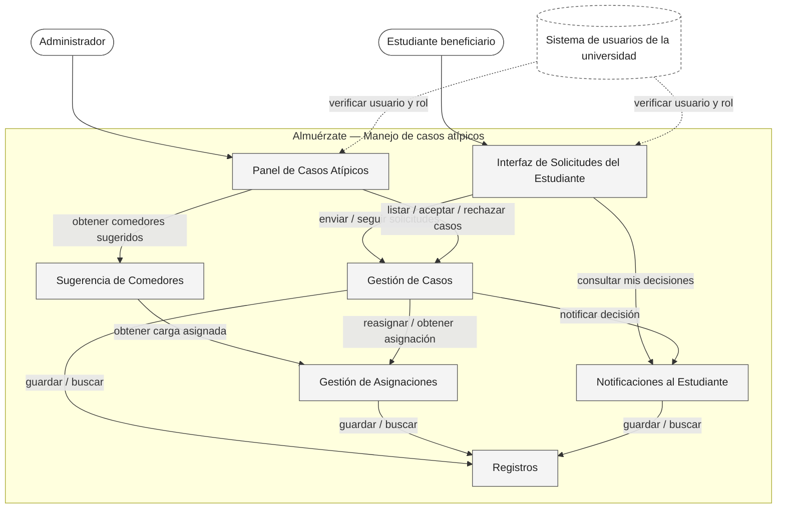

<!--
WORKED EXAMPLE — not a blank to fill in and not a project to reuse.
Food Delivery System, the running example from Classes 8 to 11. It covers three requirements
only (REQ-07, REQ-12, REQ-13) so it stays readable. Your deliverable must cover YOUR whole
system and YOUR own project. Use this for level of detail and for how the sections connect.
-->

# Food Delivery System — Architectural & Detailed Design v1.0

| | |
|---|---|
| **Team** | Equipo Almuerzate |
| **Members** | Brayan Santiago Amado Mejia, Diego Alejandro Gaviria Sabogal, Julian Camilo Londoño Zarate, Juan Felipe Pineda Gonzales, Jose Alfredo Quevedo Suarez.   |
| **Status** | Ready for review |
| **Date** | 2026-10-19 |
| **Inputs** | `docs/REQ-01-Sistema-de-manejo-de-casos-especiales.md` |

---

## 1. System Overview & Design Drivers

**System purpose**
> Let customers place food orders and follow them until delivery, reducing the uncertainty of waiting and avoiding wasted orders.

| Requirement / Use Case ID | Why it shapes the structure | Quality attribute, constraint or business rule involved |
|---|---|---|
| REQ-07 / Track Order | Needs data from a provider we do not control and must keep working when that data is missing | Constraint: integrate with the existing tracking provider. Quality: availability of the customer experience |
| REQ-12 / Cancel Order | Order state changes must be controlled in one place | Business Rule BR-01: an order can be cancelled only before preparation begins |
| REQ-13 / Cancel Order (rejection) | Same rule, opposite outcome, must stay consistent with REQ-12 | BR-01 |

---

## 2. Architectural Design
 
### 2.1 System Context & Boundary
 
| Outside the system | Type | How the system interacts with it |
|---|---|---|
| Estudiante beneficiario | Actor | Reporta un caso atípico, consulta el estado de sus solicitudes y ve la decisión tomada |
| Administrador del servicio de alimentación | Actor | Revisa los casos pendientes, acepta o rechaza cada uno y elige el comedor de reasignación |
| Sistema de usuarios de la universidad | External system (simulado con datos de prueba en el demo) | Le pedimos confirmar quién es el usuario y qué rol tiene. No controlamos su disponibilidad ni su formato |
 
*(La asignación base de comedores (R1 / Entrega 1) vive dentro del sistema, pero su cálculo con el árbol de decisión no se detalla aquí: REQ-01 solo necesita leerla y modificarla.)*
 
### 2.2 Components, Responsibilities & Capabilities
 

 
| Component | Main responsibility | Requirements / use cases supported | Provided capabilities | Required capabilities | Main dependencies |
|---|---|---|---|---|---|
| Interfaz de Solicitudes del Estudiante | Muestra al estudiante el formulario de solicitud, el estado de sus casos y la decisión, y reenvía sus acciones | REQ-01: US-05, US-06, UC-4, UC-5, AC-09, AC-10, AC-11 | Reportar un caso, consultar mis solicitudes y su decisión | Verificar usuario y rol (externo), enviar solicitud, consultar mis solicitudes, obtener opciones de solicitud, consultar mis decisiones | Gestión de Casos, Notificaciones al Estudiante, Sistema de usuarios |
| Panel de Casos Atípicos | Muestra al administrador los casos pendientes y la lista de comedores sugeridos, y reenvía su decisión | REQ-01: US-01 a US-04, UC-1, UC-2, UC-3, AC-01 a AC-07 | Mostrar y resolver casos pendientes | Verificar usuario y rol (externo), listar casos pendientes, aceptar caso, rechazar caso, obtener comedores sugeridos | Gestión de Casos, Sugerencia de Comedores, Sistema de usuarios |
| Gestión de Casos | Aplica las reglas de las solicitudes (justificación obligatoria, una pendiente por estudiante, motivo en todo rechazo, decisión registrada) y controla el estado de cada caso | REQ-01: US-01, US-02, US-03, US-05, UC-1 a UC-5, AC-01, AC-02, AC-04, AC-05, AC-09, AC-10; R-5, R-6, R-7, R-9 | Enviar solicitud, consultar mis solicitudes, obtener opciones de solicitud, listar casos pendientes, aceptar caso, rechazar caso | Reasignar estudiante, obtener asignación del estudiante, notificar decisión, buscar / guardar casos y decisiones | Gestión de Asignaciones, Notificaciones al Estudiante, Registros |
| Sugerencia de Comedores | Ordena los comedores alternativos de mejor a peor según la ocupación proyectada, o responde explícitamente que no pudo hacerlo (árbol de decisión en el backend, ADR-0004) | REQ-01: US-04, UC-2, AC-03, AC-06, AC-07; R-3, R-8 | Obtener comedores sugeridos | Obtener carga asignada por comedor | Gestión de Asignaciones |
| Gestión de Asignaciones | Entrega la asignación vigente de un estudiante, aplica la reasignación y la marca como manual para que ningún recálculo la pise | REQ-01: US-02, UC-2, UC-5, AC-04; R-4 | Obtener asignación del estudiante, reasignar estudiante, obtener carga asignada por comedor | Buscar / guardar asignaciones, obtener capacidades | Registros |
| Notificaciones al Estudiante | Deja disponible dentro de la PWA la decisión de cada caso (aceptado con nuevo comedor, o rechazado con motivo) | REQ-01: US-06, UC-2, UC-3, UC-4, AC-08; R-10, L9 | Notificar decisión, consultar mis decisiones | Buscar / guardar notificaciones | Registros |
| Registros | Guarda y entrega casos, decisiones, asignaciones, capacidades de los comedores y notificaciones | REQ-01: todos los anteriores; R-9 | Buscar / guardar casos y decisiones, buscar / guardar asignaciones, obtener capacidades, buscar / guardar notificaciones | none | none |
 
**Pendientes que afectan este diseño** (vienen de las *Open Questions* del REQ-01):
- La definición del estimado de ocupación (pregunta 3) no está cerrada. Mientras tanto, `Sugerencia de Comedores` usa lo que `Gestión de Asignaciones` le entrega (estudiantes asignados por comedor frente a su capacidad).
- No se decidió dónde se guardan los adjuntos de evidencia (pregunta 5), así que no hay un componente para ellos.
- Falta el ADR nuevo que defina qué parte pasa por la API en C++ (pregunta 8).
---
 
## 3. Detailed Design
 
### 3.1 Components selected
 
| Component | Why it was selected |
|---|---|
| Gestión de Casos | Es el único lugar que cambia el estado de una solicitud. Aplica la R-5 (justificación obligatoria), la R-6 (una sola pendiente por estudiante) y la R-7 (motivo en todo rechazo), registra la decisión según la R-9 y dispara la reasignación y la notificación al estudiante (R-10). Un error aquí rompe directamente el flujo de aceptar o rechazar |
| Sugerencia de Comedores | Es el componente con mayor incertidumbre: depende de un estimado de ocupación aún sin definir (pregunta abierta 3) y debe responder de forma explícita cuando no puede sugerir comedores (AC-07), sin dejar al administrador sin respuesta |
 
### 3.2 Class Diagram

```mermaid
classDiagram
    class ManejoSolicitudes {
        -repositorio: RepositorioSolicitudes
        -asignaciones: GestionAsignaciones
        -notificaciones: NotificacionesEstudiante
        +realizarSolicitud(idEstudiante: IdEstudiante, dia: Dia, idComedorDeseado: IdComedor, motivo: String) Resultado
        +consultarSolicitud(idSolicitud: IdSolicitud) Resultado
        +consultarSolicitudes(idEstudiante: IdEstudiante) Resultado
        +consultarSolicitudesPendientes() Resultado
        +aceptarSolicitud(idSolicitud: IdSolicitud, idComedor: IdComedor, idAdministrador: IdAdministrador) Resultado
        +rechazarSolicitud(idSolicitud: IdSolicitud, mensaje: String, idAdministrador: IdAdministrador) Resultado
    }
 
    class Solicitud {
        -idSolicitud: IdSolicitud
        -idEstudiante: IdEstudiante
        -dia: Dia
        -idComedorActual: IdComedor
        #idComedorDeseado: IdComedor
        #motivo: String
        #fechaCreacion: Fecha
        #estado: EstadoSolicitud
        #respuesta: String
        -idAdministrador: IdAdministrador
        -idComedorAsignado: IdComedor
        #fechaRespuesta: Fecha
        +estaPendiente() Boolean
        +aprobar(idComedor: IdComedor, idAdministrador: IdAdministrador) void
        +rechazar(mensaje: String, idAdministrador: IdAdministrador) void
    }
 
    class RepositorioSolicitudes {
        <<interface>>
        +guardar(solicitud: Solicitud) void
        +buscarPorId(id: IdSolicitud) Solicitud
        +buscarPorEstudiante(idEstudiante: IdEstudiante) List~Solicitud~
        +buscarPendientes() List~Solicitud~
        +tieneSolicitudPendiente(idEstudiante: IdEstudiante) Boolean
    }
 
    class Resultado {
        -solicitud: Solicitud
        -solicitudes: List~Solicitud~
        -errorSolicitud: ErrorSolicitud
        +esExitoso() Boolean
    }
 
    class GestionAsignaciones {
        +obtenerAsignacion(idEstudiante: IdEstudiante, dia: Dia) IdComedor
        +reasignar(idEstudiante: IdEstudiante, dia: Dia, idComedor: IdComedor) Boolean
        +obtenerCargaPorComedor(dia: Dia) List~CargaComedor~
    }
 
    class NotificacionesEstudiante {
        +notificarDecision(idEstudiante: IdEstudiante, idSolicitud: IdSolicitud, estado: EstadoSolicitud, mensaje: String) void
    }
 
    class SugerenciaComedores {
        +obtenerComedoresSugeridos(dia: Dia, idComedorActual: IdComedor) ResultadoSugerencia
    }
 
    class ProyectorOcupacion {
        +proyectar(carga: CargaComedor) OcupacionProyectada
    }
 
    class ClasificadorComedores {
        +clasificar(opciones: List~OcupacionProyectada~) List~ComedorSugerido~
    }
 
    class ManejadorNoDisponible {
        +noDisponible(motivo: String) ResultadoSugerencia
    }
 
    class ResultadoSugerencia {
        -disponible: Boolean
        -opciones: List~ComedorSugerido~
        -motivo: String
        +estaDisponible() Boolean
    }
 
    class ComedorSugerido {
        -idComedor: IdComedor
        -ocupacionProyectada: Porcentaje
        -superaLimite: Boolean
    }
 
    ManejoSolicitudes ..> RepositorioSolicitudes : depende de
    ManejoSolicitudes ..> Solicitud : coordina
    ManejoSolicitudes ..> Resultado : devuelve
    ManejoSolicitudes ..> GestionAsignaciones : reasigna mediante
    ManejoSolicitudes ..> NotificacionesEstudiante : notifica mediante
    Resultado ..> Solicitud : contiene si tiene éxito
 
    SugerenciaComedores --> ProyectorOcupacion : usa
    SugerenciaComedores --> ClasificadorComedores : usa
    SugerenciaComedores --> ManejadorNoDisponible : usa
    SugerenciaComedores ..> ResultadoSugerencia : devuelve
    SugerenciaComedores ..> GestionAsignaciones : lee la carga de
    ResultadoSugerencia "1" *-- "0..*" ComedorSugerido : contiene
```
 

 
*(`EstadoSolicitud` (`PENDIENTE`, `APROBADA`, `RECHAZADA`) y `ErrorSolicitud` (`NO_EXISTE`, `INFORMACION_INCOMPLETA`, `MOTIVO_REQUERIDO`, `SOLICITUD_PENDIENTE_EXISTENTE`, `NO_PENDIENTE`, `REASIGNACION_FALLIDA`) son enumeraciones y no se dibujan. `ResultadoSugerencia` y `ComedorSugerido` usan composición: un comedor sugerido no tiene sentido fuera de su resultado. No se usa generalización porque nada en este diseño es un tipo especializado de otra cosa.)*
 
### 3.3 Class Responsibilities
 
| Class | Component | Responsibility | Key collaborators |
|---|---|---|---|
| `ManejoSolicitudes` | Gestión de Casos | Coordina el ciclo de las solicitudes: las recibe validando la justificación y que no haya otra pendiente (R-5, R-6), permite consultarlas, y facilita que el administrador las acepte o rechace. Al decidir, dispara la reasignación y la notificación, y devuelve siempre un `Resultado` en lugar de lanzar errores. | `Solicitud`, `RepositorioSolicitudes`, `Resultado`, `GestionAsignaciones`, `NotificacionesEstudiante` |
| `Solicitud` | Gestión de Casos | Representa una solicitud de cambio de comedor de un estudiante. Mantiene su información, su estado y la respuesta administrativa (quién, cuándo, resultado y motivo, R-9), y controla las transiciones válidas entre estados. | `ManejoSolicitudes` |
| `RepositorioSolicitudes` | Registros | Define las operaciones para guardar y consultar solicitudes, sin acoplar la lógica a una implementación concreta de almacenamiento. | `Solicitud` |
| `Resultado` | Gestión de Casos | Representa el resultado de una operación: una solicitud o una lista de solicitudes si fue exitosa, o un error si no pudo completarse. | `Solicitud`, `ManejoSolicitudes` |
| `GestionAsignaciones` | Gestión de Asignaciones | Entrega la asignación vigente de un estudiante, aplica la reasignación como manual (R-4) y reporta la carga de cada comedor. | none |
| `NotificacionesEstudiante` | Notificaciones al Estudiante | Deja la decisión disponible para el estudiante dentro de la PWA (R-10). | none |
| `SugerenciaComedores` | Sugerencia de Comedores | Coordina los pasos para producir la lista ordenada de comedores o un resultado "no disponible". | `ProyectorOcupacion`, `ClasificadorComedores`, `ManejadorNoDisponible`, `GestionAsignaciones` |
| `ProyectorOcupacion` | Sugerencia de Comedores | Proyecta la ocupación de un comedor si se le suma un estudiante más. | none |
| `ClasificadorComedores` | Sugerencia de Comedores | Ordena los comedores de mejor a peor (árbol de decisión, ADR-0004) y marca los que superan el 85 % (R-8). | none |
| `ManejadorNoDisponible` | Sugerencia de Comedores | Construye un resultado "no disponible" con su motivo (AC-07). | none |
| `ResultadoSugerencia` | Sugerencia de Comedores | Lleva la lista ordenada de comedores o el motivo de que no esté disponible. | `ComedorSugerido` |
| `ComedorSugerido` | Sugerencia de Comedores | Representa un comedor sugerido con su ocupación proyectada y si supera el límite. | none |
 
### 3.4 Behavior of one key operation
 
```text
+aceptarSolicitud(idSolicitud: IdSolicitud, idComedor: IdComedor, idAdministrador: IdAdministrador): Resultado<Solicitud, ErrorSolicitud>
    solicitud = RepositorioSolicitudes.buscarPorId(idSolicitud)
 
    Si solicitud no existe:
        Retornar Resultado<NULL, ErrorSolicitud.NO_EXISTE>
 
    Si NO solicitud.estaPendiente():
        Retornar Resultado<NULL, ErrorSolicitud.NO_PENDIENTE>
 
    exito = GestionAsignaciones.reasignar(solicitud.idEstudiante, solicitud.dia, idComedor)
    Si NO exito:
        Retornar Resultado<NULL, ErrorSolicitud.REASIGNACION_FALLIDA>    // la solicitud sigue pendiente
 
    solicitud.aprobar(idComedor, idAdministrador)       // registra quién, cuándo y resultado
    RepositorioSolicitudes.guardar(solicitud)
    NotificacionesEstudiante.notificarDecision(solicitud.idEstudiante, idSolicitud, solicitud.estado, solicitud.respuesta)
 
    Retornar Resultado<solicitud, NULL>
```
 
---

## 4. Design Quality — Cohesion, Coupling, Information Hiding

| Question | Your answer, with evidence from your design |
|---|---|
| **Cohesion** | `TrackingIntegration` only coordinates. Fetching, parsing and building the unavailable result each live in their own class. `Order` holds only status and eligibility. |
| **Coupling** | The strongest dependency is on the provider's response format, and it is contained in `ResponseParser`. `EstimateResolver` depends only on `EtaResult`. A provider change reaches one class. |
| **Information hiding** | The raw provider response, the freshness check and the storage details behind `OrderRepository` stay internal. Other components see only `EtaResult` and the repository contract. |

**Real findings and what we changed**
> The first draft had `EstimateResolver` reading the provider's timestamp format to decide whether data was stale (coupling). We moved parsing and freshness checks into `ResponseParser`. The first draft also had `Order` formatting the cancellation message for the customer (cohesion). We moved the wording to Order Status Display.

---

## 5. Design Decisions & Decision Record

### Decision A — Architectural

| | |
|---|---|
| **Context** | REQ-07 depends on an external provider we do not control (Constraint). Its availability and format can change. |
| **Decision** | All communication with the tracking provider goes through Tracking Integration. No other component calls the provider or sees its format. |
| **Rationale** | A provider failure or format change stays contained, and the customer can still see the order status when no estimate exists. |
| **Trade-off accepted** | One extra hop between the customer's screen and the provider, so slightly more latency. We rejected letting the display call the provider directly because every provider change would then reach the user interface. |

### Decision B — Detailed design

| | |
|---|---|
| **Context** | The provider can answer with usable, stale, incomplete data, or not answer at all. Those outcomes were being handled in different places. |
| **Decision** | `TrackingIntegration` always returns an `EtaResult`, and "unavailable" is a normal result with a reason, never an exception that propagates. |
| **Rationale** | Callers handle one result type. The unavailable path (REQ-07 alternative and exception flows) is designed instead of accidental. |
| **Trade-off accepted** | Callers must check `isAvailable()` explicitly, and a forgotten check shows an empty estimate instead of failing loudly. |

### ADR

**ADR file:** `docs/decisions/ADR-001-isolate-tracking-provider.md` — records Decision A.

---

## 6. Traceability

| Requirement ID | Use Case | Component(s) | Class(es) |
|---|---|---|---|
| REQ-07 | Track Order | Order Status Display, Estimate Resolver, Tracking Integration | EstimateResolver, TrackingIntegration, RequestHandler, ResponseParser, FallbackHandler, EtaResult |
| REQ-12 | Cancel Order | Order Status Display, Order Management, Order Records | OrderManagement, Order, OrderItem, OrderRepository |
| REQ-13 | Cancel Order | Order Status Display, Order Management | OrderManagement, Order |

---

## 7. Optional — AI-Assisted Design Reflection

> An AI assistant suggested adding a separate Notification component to tell customers when an estimate changes. We rejected it: no requirement in our set supports it, and it would add a component without a responsibility we can trace.

---

## 8. Consistency Checklist

- [x] Every component in the diagram appears in the responsibilities table, and the other way around.
- [x] Every class belongs to an identifiable component.
- [x] Components are named by responsibility, not technology.
- [x] Nothing inside the system boundary is something we do not control.
- [x] Provided and required capabilities match across components.
- [x] Both decisions name a real cost or limitation, and at least one has an ADR.
- [x] The traceability table has no empty rows and no orphan components or classes.
- [x] Diagrams render correctly on GitHub.
