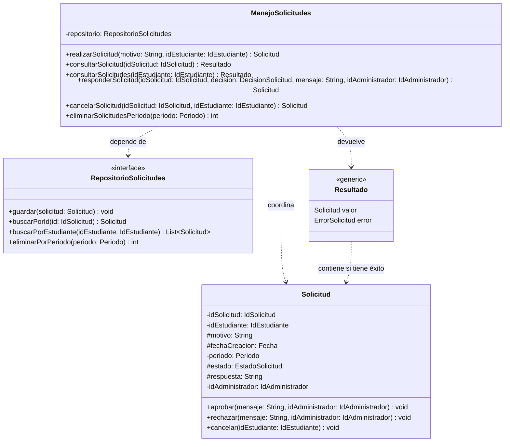

<!--
WORKED EXAMPLE — not a blank to fill in and not a project to reuse.
Food Delivery System, the running example from Classes 8 to 11. It covers three requirements
only (REQ-07, REQ-12, REQ-13) so it stays readable. Your deliverable must cover YOUR whole
system and YOUR own project. Use this for level of detail and for how the sections connect.
-->

# Sistema de manejo de casos especiales — Architectural & Detailed Design v1.0

| | |
|---|---|
| **Team** | Equipo Almuerzate |
| **Members** | Brayan Santiago Amado Mejia, Diego Alejandro Gaviria Sabogal, Julian Camilo Londoño Zarate, Juan Felipe Pineda Gonzales, Jose Alfredo Quevedo Suarez.   |
| **Status** | Ready for review |
| **Date** | 2026-10-19 |
| **Inputs** | `docs/REQ-01-Sistema-de-manejo-de-casos-especiales.md` |

---

## 1. System Overview & Design Drivers

**System purpose**
> Let customers place food orders and follow them until delivery, reducing the uncertainty of waiting and avoiding wasted orders.

| Requirement / Use Case ID | Why it shapes the structure | Quality attribute, constraint or business rule involved |
|---|---|---|
| REQ-07 / Track Order | Needs data from a provider we do not control and must keep working when that data is missing | Constraint: integrate with the existing tracking provider. Quality: availability of the customer experience |
| REQ-12 / Cancel Order | Order state changes must be controlled in one place | Business Rule BR-01: an order can be cancelled only before preparation begins |
| REQ-13 / Cancel Order (rejection) | Same rule, opposite outcome, must stay consistent with REQ-12 | BR-01 |

---

## 2. Architectural Design

### 2.1 System Context & Boundary

| Outside the system | Type | How the system interacts with it |
|---|---|---|
| Customer | Actor | Opens order status, requests cancellation |
| Delivery Tracking Provider | External system | We request tracking data for an order. We do not control its availability or format |

### 2.2 Components, Responsibilities & Capabilities


| Component | Main responsibility | Requirements / use cases supported | Provided capabilities | Required capabilities | Main dependencies |
|---|---|---|---|---|---|
| Order Status Display | Presents order status and the estimate, and forwards customer actions | REQ-07, REQ-12, REQ-13 | Show status and estimate to the customer | Resolve estimate, cancel order, get order status | Estimate Resolver, Order Management |
| Estimate Resolver | Decides what estimate information the customer should see, including when no estimate exists | REQ-07 | Resolve estimate for an order | Get estimated arrival, get order status | Tracking Integration, Order Management |
| Tracking Integration | Isolates all communication with the tracking provider and returns an estimate or an explicit "unavailable" | REQ-07 | Get estimated arrival | Request tracking data (external) | Delivery Tracking Provider |
| Order Management | Applies the cancellation rules and controls order state changes | REQ-12, REQ-13 | Cancel order, get order status | Find order, save order | Order Records |
| Order Records | Persists and retrieves orders | REQ-12, REQ-13 | Find order, save order | none | none |

---

## 3. Detailed Design

### 3.1 Components selected

| Component | Why it was selected |
|---|---|
| Solicitud de restitucion | Considerando la BR-01 es relevante garantizar que los estudiantes beneficiarios puedan realizar solicitudes, en la que estos tengan en cuanta la BR-05 |
| Manejo de solicitudes  | Los administradores del servicio deben realizar una evaluación de las solicitudes considerando la BR-07. Para posteriormente notificar al estudiante beneficiario que realizo la solicitud de la decisión siguiendo a las BR-09 y BR-10 |


### 3.2 Class Diagram



*(Tanto EstadoSolicitud como DecisionSolicitud son ennumeaciones. Sin embargo, una se enfoca en la solicitud y la otra en la desicion tomada)*

### 3.3 Class Responsibilities

| Class | Component | Responsibility | Key collaborators |
|---|---|---|---|
| `ManejoSolicitudes` | Manejo de solicitudes | Coordina la gestión de las solicitudes, permite consultar su información y facilita que el administrador las evalúe y registre una decisión. También gestiona la eliminación de solicitudes correspondientes a períodos finalizados y el manejo de errores en las consultas. | `Solicitud`, `RepositorioSolicitudes`, `DecisionSolicitud`, `Resultado` |
| `Solicitud` | Solicitud de restitución | Representa una solicitud realizada por un estudiante. Mantiene su información, estado y respuesta administrativa, y controla las transiciones válidas entre estados. | `ManejoSolicitudes` |
| `RepositorioSolicitudes` | Manejo de solicitudes | Define las operaciones para almacenar, consultar y eliminar solicitudes, permitiendo mantener los datos persistentes sin acoplar la lógica del sistema a una implementación concreta de almacenamiento. | `Solicitud` |
| `DecisionSolicitud` | Manejo de solicitudes | Representa las decisiones que puede tomar el administrador al evaluar una solicitud, como aprobarla o rechazarla. | `ManejoSolicitudes` |
| `Resultado` | Manejo de solicitudes | Representa el resultado de una operación, permitiendo devolver una solicitud o una lista de solicitudes cuando la operación es exitosa, o un error cuando no puede completarse. | `Solicitud`, `ManejoSolicitudes` |


### 3.4 Behavior of one key operation

```text

+consultarSolicitud(idSolicitud: IdSolicitud): Resultado<Solicitud, ErrorSolicitud>
    solicitud = RepositorioSolicitudes.buscarPorId(idSolicitud)

    Si solicitud no existe:
        Retornar Resultado<NULL,ErrorSolicitud.NO_EXISTE>

    Si solicitud.motivo está vacío O solicitud.idEstudiante está vacío:
        Retornar Resultado<NULL,ErrorSolicitud.INFORMACION_INCOMPLETA>

    Retornar Resultado<solicitud,NULL>

```

---

## 4. Design Quality — Cohesion, Coupling, Information Hiding

| Question | Your answer, with evidence from your design |
|---|---|
| **Cohesion** | `Solicitud de restitución` permite a los estudiantes beneficiarios generar y consultar solicitudes de cambio de comedor, mientras que `Manejo de solicitudes` coordina su evaluación y resolución por parte del administrador. La clase `Solicitud` contiene la información y el estado de cada solicitud, y `RepositorioSolicitudes` gestiona las operaciones de almacenamiento y consulta. |
| **Coupling** | `ManejoSolicitudes` utiliza la interfaz `RepositorioSolicitudes` para acceder a los registros sin depender de una implementación específica de almacenamiento. La clase `Solicitud` mantiene su información y estado sin asumir responsabilidades relacionadas con la persistencia ni con la coordinación del proceso administrativo. |
| **Information hiding** | `Solicitud` mantiene privados sus atributos, incluidos el motivo, el estudiante, el estado y la respuesta administrativa. El administrador consulta la información necesaria para evaluar cada solicitud mediante las operaciones del sistema, sin acceder directamente a la estructura interna de los datos ni a los detalles de almacenamiento. |

**Real findings and what we changed**

> Inicialmente, se pensaba gestionar todas las solicitudes directamente desde la clase `Solicitudes`. Sin embargo, se decidió incorporar `ManejoSolicitudes` para separar la información propia de cada solicitud de las operaciones relacionadas con su administración, favoreciendo la cohesión. Además, los estados se asociaron directamente a `Solicitud`, mientras que la validación y resolución se centralizaron en `ManejoSolicitudes`, manteniendo una relación clara entre la gestión administrativa y las solicitudes. Estos cambios buscan reducir el acoplamiento entre responsabilidades y mejorar la organización de los componentes del sistema.

---

## 5. Design Decisions & Decision Record

### Decision A — Architectural

| | |
|---|---|
| **Context** | REQ-07 depends on an external provider we do not control (Constraint). Its availability and format can change. |
| **Decision** | All communication with the tracking provider goes through Tracking Integration. No other component calls the provider or sees its format. |
| **Rationale** | A provider failure or format change stays contained, and the customer can still see the order status when no estimate exists. |
| **Trade-off accepted** | One extra hop between the customer's screen and the provider, so slightly more latency. We rejected letting the display call the provider directly because every provider change would then reach the user interface. |

### Decision B — Detailed design

| | |
|---|---|
| **Context** | The provider can answer with usable, stale, incomplete data, or not answer at all. Those outcomes were being handled in different places. |
| **Decision** | `TrackingIntegration` always returns an `EtaResult`, and "unavailable" is a normal result with a reason, never an exception that propagates. |
| **Rationale** | Callers handle one result type. The unavailable path (REQ-07 alternative and exception flows) is designed instead of accidental. |
| **Trade-off accepted** | Callers must check `isAvailable()` explicitly, and a forgotten check shows an empty estimate instead of failing loudly. |

### ADR

**ADR file:** `docs/decisions/ADR-001-isolate-tracking-provider.md` — records Decision A.

---

## 6. Traceability

| Requirement ID | Use Case | Component(s) | Class(es) |
|---|---|---|---|
| REQ-07 | Track Order | Order Status Display, Estimate Resolver, Tracking Integration | EstimateResolver, TrackingIntegration, RequestHandler, ResponseParser, FallbackHandler, EtaResult |
| REQ-12 | Cancel Order | Order Status Display, Order Management, Order Records | OrderManagement, Order, OrderItem, OrderRepository |
| REQ-13 | Cancel Order | Order Status Display, Order Management | OrderManagement, Order |

---

## 7. Optional — AI-Assisted Design Reflection

> An AI assistant suggested adding a separate Notification component to tell customers when an estimate changes. We rejected it: no requirement in our set supports it, and it would add a component without a responsibility we can trace.

---

## 8. Consistency Checklist

- [x] Every component in the diagram appears in the responsibilities table, and the other way around.
- [x] Every class belongs to an identifiable component.
- [x] Components are named by responsibility, not technology.
- [x] Nothing inside the system boundary is something we do not control.
- [x] Provided and required capabilities match across components.
- [x] Both decisions name a real cost or limitation, and at least one has an ADR.
- [x] The traceability table has no empty rows and no orphan components or classes.
- [x] Diagrams render correctly on GitHub.
