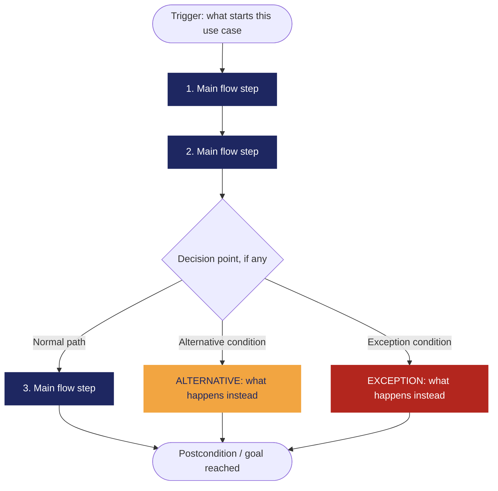

<!--
HOW TO USE THIS TEMPLATE
------------------------
1. Copy this file and rename it to the requirement's ID, e.g. REQ-01.md.
2. Fill in every section. If a section genuinely does not apply to this
   requirement (not every requirement has a Business Rule or a Constraint),
   write "N/A — none identified" and say why in one line. Never invent
   content to fill a blank cell — that breaks the rule we've followed since
   Class 8: specification is not invention.
3. If something is unknown rather than inapplicable, use the Open
   Questions section instead of guessing.
4. See REQ-07_Example.md (Food Delivery System) for a fully filled-in
   reference before you start.
-->

# [REQ-1] — [Sistema-de-manejo-de-casos-especiales]

| | |
|---|---|
| **Estado** | Validated  |
| **Equipo / Autores** | Julian Camilo Londoño Zarate, Jose Alfredo Quevedo Suarez, Juan Felipe Pineda Gonzalez, Diego Alejandro Gaviria Sabogal, Brayan Santiago Amado Mejia|
| **Fecha** | 10-10-26|
| **Historias de usuario anexadas / AC** | (Añadir cuando se completen las historias de usuario)|

---

## 1. Vista general

**Declaracion del requerimiento**
> El sistema debe permitir que los administradores del servicio de alimentación de la universidad asignen un comedor diferente a los estudiantes beneficiarios que por circunstancias excepcionales, requieran un cambio de comedor y hayan presentado la solicitud correspondiente a través de la plataforma.

**Tipo:** Funcional (Filtro de tecnologia perfecta: Incluso con velocidad infinita, memoria ilimitada, cero fallos y coste cero, los estudiantes pueden necesitar un cambio repentino dado por condiciones externas al sitema, y los administradores deben tratar estos casos. Funcional.)

**Source / Evidence**
> La ubicación, los horarios académicos y otras circunstancias personales pueden dificultar el acceso de los estudiantes al comedor asignado. Además, el proceso actual para solicitar cambios puede ser demorado.

**Need**

> - Permitir que los estudiantes beneficiarios soliciten un cambio de comedor a través de la plataforma.
> - Permitir que los administradores evalúen las solicitudes y determinen si procede realizar el cambio de comedor.
> - Permitir que los administradores asignen un nuevo comedor a los estudiantes cuyas solicitudes hayan sido aprobadas.

**Value / Rationale**
> Facilitar la gestión de cambios excepcionales y reducir los tiempos de respuesta a las necesidades de los estudiantes beneficiarios.
---

## 2. Contexto

**Business Rule(s) / Reglas de Dominio**
R-1: El programa de bienestar universitario asigna a cada estudiante beneficiario un comedor donde recibe almuerzo, total o parcialmente gratis. Solo los estudiantes beneficiarios pueden solicitar cambio.

R-2: No existe un catálogo cerrado de “circunstancias excepcionales”. El administrador evalúa cada caso según los argumentos del solicitante.
R-3: Cada comedor tiene un aforo operativo del 80 % de su capacidad máxima real, para mantenerlo subsaturado y balancear la carga entre comedores.

R-4: Un cambio aprobado es permanente durante el semestre, y puede modificarse con una nueva solicitud.

R-5: Toda solicitud debe incluir una justificación escrita. La evidencia adjunta es opcional.

R-6: Un estudiante puede tener una sola solicitud pendiente a la vez. Si le rechazan una, puede volver a solicitar aportando argumentos nuevos.

R-7 (propuesta): El administrador responde en un máximo de 3 días hábiles. Todo rechazo debe incluir el motivo.

R-8 (propuesta): El comedor destino no debería superar el 85 % de aforo de ser posible. Si el administrador decide excederlo, debe dejar justificación escrita, y nunca puede superar la capacidad máxima real.

R-9: Cada decisión queda registrada (quién, cuándo, resultado y motivo).

R-10: El estudiante es notificado de la decisión.

**Constraint(s) / Limitaciones**

Roles: estudiante y administrador son un atributo de la cuenta de usuario, definido por el rol que la persona tiene en el sistema de la universidad. El demo debe simular esa fuente de roles.

Arquitectura: la solicitud combina el backend en C++ (árbol de decisión, ADR-0004) con el criterio del administrador. El árbol sugiere alternativas y el administrador decide, priorizando la conveniencia del estudiante. El formato JSON y el ADR que reemplaza al ADR-0002 siguen POR CONFIRMAR.

Datos: solo datos de prueba. Aun así, el adjunto de evidencia permanece en el demo (confirmado). Si el sistema se usara con datos reales, debe aplicar la Ley 1581 de 2012 (habeas data), porque la evidencia puede contener datos de salud.

Despliegue: Vercel, con qué parte va allí POR CONFIRMAR. Esto limita dónde se pueden guardar los archivos adjuntos.

Seguridad: el ADR-0002 la deja fuera de alcance, pero el panel de administración debe al menos restringirse por rol.

**Assumption(s)**

-La asignación base (R1 / Entrega 1) ya existe cuando se hacen solicitudes.

-Siempre existe al menos un comedor alternativo con cupo disponible.

-Los administradores revisan las solicitudes con regularidad.

-El estudiante accede a la PWA Progressive Web App con conexión.

-Para el demo, las cuentas y roles se simulan con datos de prueba.

-Un cambio aprobado respeta almenos el 85 % del aforo, salvo excepción justificada (R-8).

**Dependenc(ies) / Dependencias**

-R1 / Entrega 1: sin asignación previa no hay nada que cambiar.

-Backend C++ (árbol de decisión): sugiere comedores alternativos al administrador.

-PostgreSQL: guarda solicitudes, decisiones, historial y asignaciones.

-Cuentas y roles: vienen del sistema de usuarios de la universidad (simulado en el demo).

-Estimado de ocupación (POR CONFIRMAR): sin él, el administrador no ve la ocupación proyectada al decidir.

-Notificación al estudiante: mecanismo mínimo propuesto, in-app.

-Reasignación periódica (Entrega 2): debe respetar los cambios manuales aprobados. Se deriva de BR-4, porque un cambio “permanente para el semestre” no puede ser pisado por el recálculo.

**Risk(s) / Riesgos**
| Risk |	Likelihood | Impact |	Mitigation |
|--- |--- |--- | ---|
| La reasignación automática sobrescribe un cambio manual |	Medium |	High |Marcar la asignación como “manual” con precedencia sobre el recálculo |
|Se acumulan solicitudes y el administrador no da abasto |	Medium |	High |	Plazo de respuesta (R-7) y vista de pendientes ordenada por antigüedad |
|Se aprueban cambios que dejan un comedor sobre el 85 % |	Medium |	Medium |	Mostrar ocupación proyectada al decidir y exigir justificación si se excede |
|Uso indebido o criterio arbitrario por falta de reglas de excepcionalidad |	Medium |	Medium |	Justificación obligatoria, registro de decisiones y una solicitud pendiente por estudiante |
|El estimado de ocupación no está definido y el administrador decide a ciegas |	High |	Medium |	Definirlo antes de la entrega del panel, o usar un conteo simple de asignados por comedor |
|El almacenamiento de archivos adjuntos no encaja con el despliegue en Vercel |	Medium |	Medium |	Decidir dónde se guardan antes de implementar; limitar tipo y tamaño |
| No hay un stakeholder real que valide las reglas |	High |	Medium |	Tratar las reglas como supuestos y validarlas con el profesor o un stakeholder simulado |

**Open Questions**

1.Alcance por día: R1 asigna comedor por día, pero el cambio es “permanente para el semestre”. ¿El cambio reemplaza toda la asignación semanal o puede pedirse solo para días concretos?

2.Entrega: el RFC ubica el panel de administración y la reasignación de emergencia en la entrega final, pero REQ-1 es Must Have. ¿Qué parte de REQ-1 entra en cada entrega?

3.Estimado de ocupación: ¿cómo se calcula y es dependencia dura de REQ-1?

4.Notificación: ¿es solo in-app o también por correo?

5.Reglas propuestas: BR-5 a BR-10 (plazo de 3 días, una solicitud pendiente, justificar rechazos) no están validadas.

6.Almacenamiento: ¿dónde se guardan los archivos de evidencia, y con qué límites de tipo y tamaño?

7.Interpretación del 80 %: asumí que es 80 % de la capacidad máxima real. ¿Es correcto?

8.Validación: el estado dice Validated, pero no hay historias de usuario ni stakeholder confirmado. ¿Quién o qué lo validó?

9.Backend: ¿las solicitudes pasan por la API en C++ o solo la sugerencia del árbol? Falta el ADR nuevo.

# 3. Priority & Estimation

**Priority model used:** MoSCoW *(Modelo alternativo considerado: Kano)*

### Priority assigned: Must Have

> **Justificación:** Debido a que la saturación de los comedores y las fallas en la asignación de cupos o turnos impactan directamente la continuidad de la operación diaria y la atención al usuario, asignamos la prioridad **Must Have**. Aceptamos el trade-off de destinar capacidad de desarrollo en las primeras iteraciones al diseño de herramientas de monitoreo y gestión administrativa en lugar de avanzar en funcionalidades secundarias. Consideramos la prioridad **Should Have** y la descartamos porque carecer de un mecanismo de contingencia desde el lanzamiento expondría al sistema a colapsos operativos no gestionables.
>
> *(Nota sobre la alternativa: Se evaluó la matriz **Kano**, pero fue descartada debido a que mide la satisfacción y el deleite del usuario en lugar de la criticidad operativa y el alcance del MVP, para lo cual **MoSCoW** resulta más efectivo).*

### Estimate (confidence): Medium

> **Justificación:** Mantenemos un nivel de confianza **Medium** debido a que, mientras la captura del reporte por parte del usuario es un flujo estándar, la dimensión real del módulo administrativo dependerá del nivel de detalle en la consulta. Para facilitar una toma de decisiones rápida ante picos de saturación, las herramientas de consulta deberán incorporar filtros por comedor o sede, categoría del incidente (fallas de asignación vs. sobrecupo), nivel de severidad y rango temporal, sumado a vistas resumidas para la reasignación de aforos. La definición final de la interactividad de estos filtros determinará el esfuerzo exacto de desarrollo.

## 4. Representations — Requirement ≠ Representation

*(Class 9. Each representation reveals different information. Fill in all three below — for this capstone requirement, all three are required.)*

### 4.1 User Story

> As a **[role]**,
> I want **[capability]**,
> so that **[value]**.

*Check yourself: is the "I want" describing the need, or already prescribing a solution?*

### 4.2 Acceptance Criteria

*(At least two scenarios: one normal path, one alternative or exception.)*

**Scenario 1 — [short name]**
> **Given** [context]
> **When** [event/stimulus]
> **Then** [observable outcome]

**Scenario 2 — [short name, alternative or exception]**
> **Given** [context]
> **When** [event/stimulus]
> **Then** [observable outcome]

### 4.3 Use Case

| Field | |
|---|---|
| **Use Case name** | |
| **Actor** | |
| **Goal** | |
| **Trigger** | |
| **Precondition** | |

**Main Flow**
1.
2.
3.
4.

**Alternative Flow**
> [Condition] → [what happens instead]

**Exception**
> [Condition] → [what happens instead]

**Postcondition**
>

**Flow Diagram**
*(Replace the labels below with your own steps. Keep Main Flow, Alternative, and Exception visually distinct — delete whichever branch doesn't apply to your use case. This renders automatically on GitHub.)*

---

## 5. Traceability & Impact

*(Class 10. Conceptual, not a formal matrix.)*

**Backward — why does this requirement exist?**
> Evidence → Need → Requirement. Point to the specific evidence/need entries that justify this requirement (from your Discovery Sheet).

**Forward — what will this affect?**
> Requirement → future Design → Implementation → Tests. *(It's fine if Design hasn't happened yet — note what you expect this to touch once it does, and update this section once Class 11 work begins.)*

**Impact Analysis — if this requirement changes, what else might need to change?**
- [ ] Business Rules
- [ ] Constraints
- [ ] Dependencies
- [ ] Risks
- [ ] Acceptance Criteria
- [ ] Estimate
- [ ] Priority
- [ ] Future Design
- [ ] Future Tests

> Briefly note which of the above are actually likely to be affected, and why.

---

## 6. Validation — Quality Gate

*(Class 9 + Class 10. Self-audit before you commit this file. Check honestly — a "no" here means the requirement isn't ready yet, not that you should force a checkmark.)*

- [ ] **Valid?** Does it reflect a real, evidenced need — not an invented one?
- [ ] **Clear / Unambiguous?** Is there only one reasonable interpretation?
- [ ] **Atomic?** Is this one independently testable expectation, not several bundled together?
- [ ] **Necessary?** Does removing it actually break something real?
- [ ] **Feasible?** Can this realistically be built with what the team has?
- [ ] **Verifiable?** Can you demonstrate, concretely, whether it's satisfied?
- [ ] **Consistent?** Does it conflict with any other requirement in your set?
- [ ] **Complete enough?** Are there important functions or constraints still missing?
- [ ] **Traceable?** Can every part of this document be traced back to real evidence — not invented to fill a section?

> If any box is unchecked, say what's missing and whether it becomes an Open Question or sends you back to Class 8 (re-elicit) or Class 9 (re-specify).
