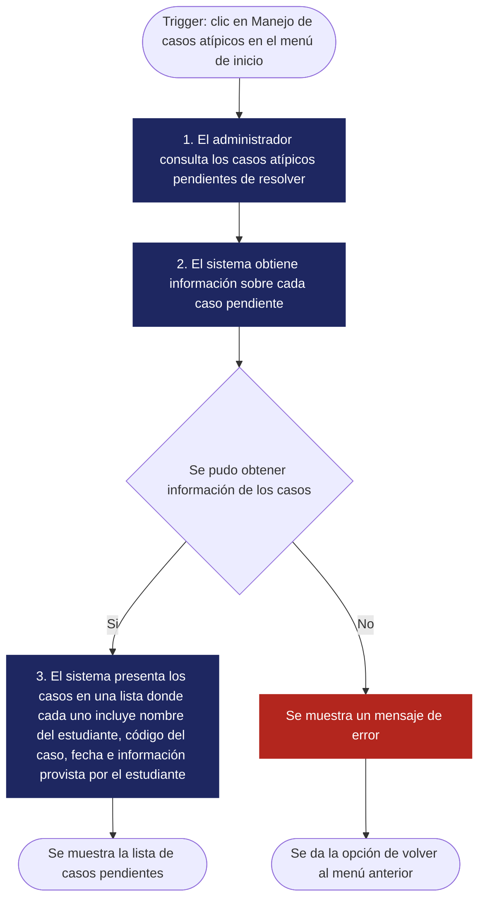
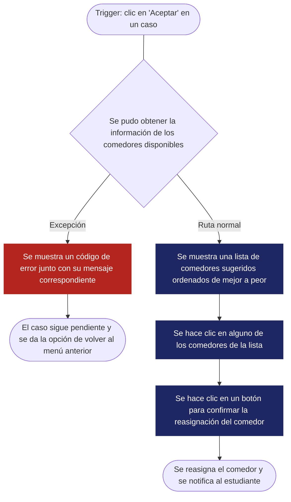
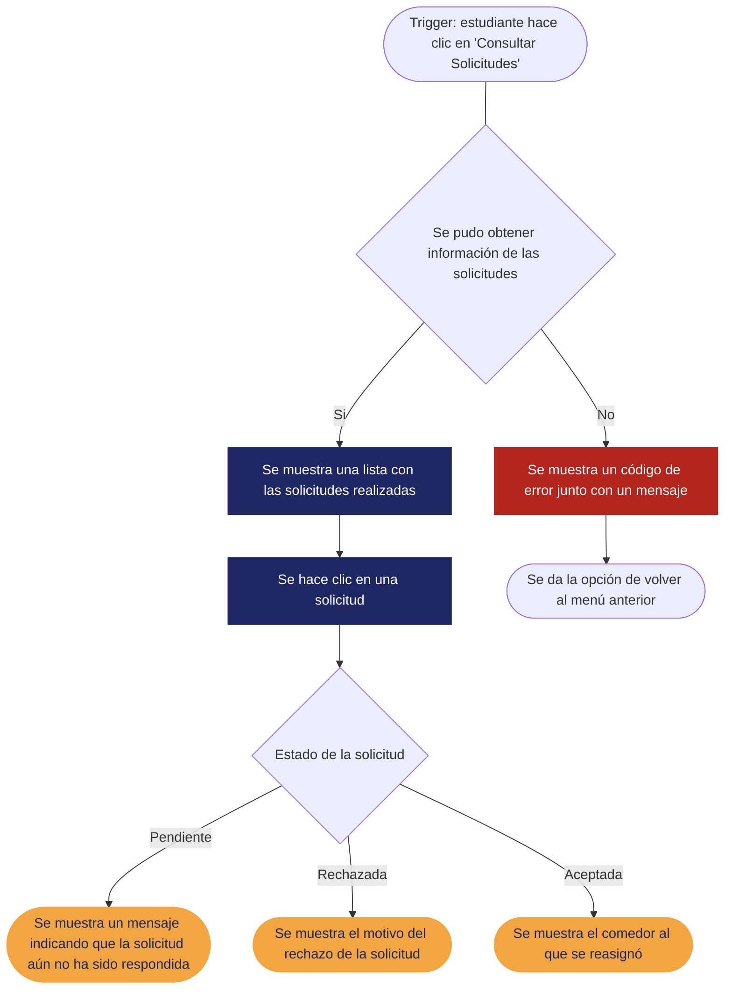
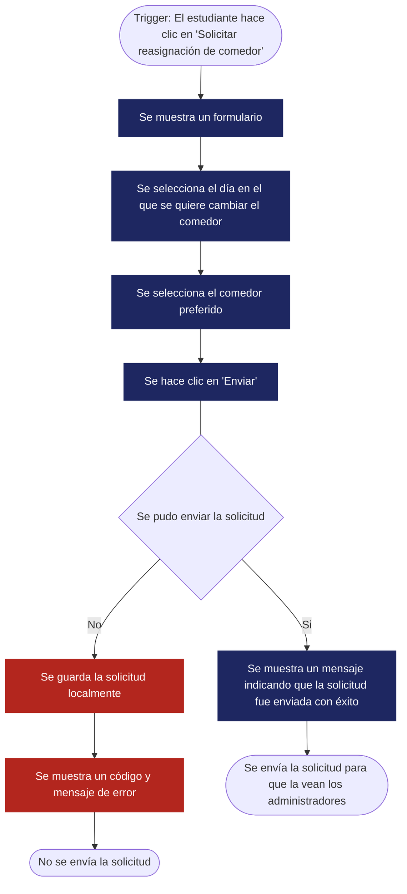

<!--
HOW TO USE THIS TEMPLATE
------------------------
1. Copy this file and rename it to the requirement's ID, e.g. REQ-01.md.
2. Fill in every section. If a section genuinely does not apply to this
   requirement (not every requirement has a Business Rule or a Constraint),
   write "N/A — none identified" and say why in one line. Never invent
   content to fill a blank cell — that breaks the rule we've followed since
   Class 8: specification is not invention.
3. If something is unknown rather than inapplicable, use the Open
   Questions section instead of guessing.
4. See REQ-07_Example.md (Food Delivery System) for a fully filled-in
   reference before you start.
-->

# [REQ-1] — [Sistema-de-manejo-de-casos-especiales]

| | |
|---|---|
| **Estado** | Validated  |
| **Equipo / Autores** | Julian Camilo Londoño Zarate, Jose Alfredo Quevedo Suarez, Juan Felipe Pineda Gonzalez, Diego Alejandro Gaviria Sabogal, Brayan Santiago Amado Mejia|
| **Fecha** | 10-10-26|
| **Historias de usuario anexadas / AC** | (Añadir cuando se completen las historias de usuario)|

---

## 1. Vista general

**Declaracion del requerimiento**
> El sistema debe permitir que los administradores del servicio de alimentación de la universidad asignen un comedor diferente a los estudiantes beneficiarios que por circunstancias excepcionales, requieran un cambio de comedor y hayan presentado la solicitud correspondiente a través de la plataforma.

**Tipo:** Funcional (Filtro de tecnologia perfecta: Incluso con velocidad infinita, memoria ilimitada, cero fallos y coste cero, los estudiantes pueden necesitar un cambio repentino dado por condiciones externas al sitema, y los administradores deben tratar estos casos. Funcional.)

**Source / Evidence**
> La ubicación, los horarios académicos y otras circunstancias personales pueden dificultar el acceso de los estudiantes al comedor asignado. Además, el proceso actual para solicitar cambios puede ser demorado.

**Need**

> - Permitir que los estudiantes beneficiarios soliciten un cambio de comedor a través de la plataforma.
> - Permitir que los administradores evalúen las solicitudes y determinen si procede realizar el cambio de comedor.
> - Permitir que los administradores asignen un nuevo comedor a los estudiantes cuyas solicitudes hayan sido aprobadas.

**Value / Rationale**
> Facilitar la gestión de cambios excepcionales y reducir los tiempos de respuesta a las necesidades de los estudiantes beneficiarios.
---

## 2. Contexto

**Business Rule(s) / Reglas de Dominio**
R-1: El programa de bienestar universitario asigna a cada estudiante beneficiario un comedor donde recibe almuerzo, total o parcialmente gratis. Solo los estudiantes beneficiarios pueden solicitar cambio.

R-2: No existe un catálogo cerrado de “circunstancias excepcionales”. El administrador evalúa cada caso según los argumentos del solicitante.
R-3: Cada comedor tiene un aforo operativo del 80 % de su capacidad máxima real, para mantenerlo subsaturado y balancear la carga entre comedores.

R-4: Un cambio aprobado es permanente durante el semestre, y puede modificarse con una nueva solicitud.

R-5: Toda solicitud debe incluir una justificación escrita. La evidencia adjunta es opcional.

R-6: Un estudiante puede tener una sola solicitud pendiente a la vez. Si le rechazan una, puede volver a solicitar aportando argumentos nuevos.

R-7 (propuesta): El administrador responde en un máximo de 3 días hábiles. Todo rechazo debe incluir el motivo.

R-8 (propuesta): El comedor destino no debería superar el 85 % de aforo de ser posible. Si el administrador decide excederlo, debe dejar justificación escrita, y nunca puede superar la capacidad máxima real.

R-9: Cada decisión queda registrada (quién, cuándo, resultado y motivo).

R-10: El estudiante es notificado de la decisión.

**Constraint(s) / Limitaciones**

*Del equipo y del contexto académico*

L1. Capacidad del equipo: hay 5 estudiantes de 5.º semestre con tiempo limitado por el semestre y otras materias. Solo caben soluciones simples y entregables.

L2. Proyecto demostrativo: no hay usuarios ni operación reales. Disponibilidad, escalabilidad y carga real quedan fuera de alcance.

L3. Sin stakeholder real: no hay nadie del servicio de alimentación que valide reglas ni plazos. Las reglas de negocio quedan como supuestos hasta que alguien las valide.

*De Software*

L4. Stack fijo por ADR: PostgreSQL, JavaScript con Tailwind y PWA, y lógica en C++ (ADR-0001, 0003 y 0004). Salirse del stack exige un ADR nuevo.

L5. Despliegue limitado: Vercel es la plataforma elegida y según lo que se encuentra, C++ no es un runtime oficial de Vercel, así que el backend probablemente necesite otro servicio, con los límites de un plan gratuito.

*De datos e integración*

L6. Solo datos de prueba: nunca datos personales reales. Los adjuntos se quedan en el demo con contenido ficticio. Con datos reales aplicaría la Ley 1581 de 2012, porque la evidencia puede incluir datos de salud, de manera que al ser implementado en la realidad, todo puede cambiar al estar tratando datos reales.

L7. Sin datos reales de ocupación: no hay sensores ni registros de ingreso a los comedores, se puede calcular con base en el aforo por comedor, y cantidad de estudiantes tanto ocupando el comedor como haciendo fila, al igual que franjas horarias con mayor afluencia. Sin embargo, estos son estimados que lejos de ser exactos representan una estimación.

*De infraestructura*

L8. Sin almacenamiento de archivos dedicado: el equipo solo dispone de PostgreSQL y un hosting gratuito. Los adjuntos de evidencia deben resolverse con esos recursos.

L9. Notificaciones, no hay servicio de correo institucional. Solo notificación dentro de la app.

**Assumption(s) / Supuestos**

-La asignación base (R1 / Entrega 1) ya existe cuando se hacen solicitudes.

-Siempre existe al menos un comedor alternativo con cupo disponible.

-Los administradores revisan las solicitudes con regularidad.

-El estudiante accede a la PWA (Progressive Web App) con conexión.

-Para el demo, las cuentas y roles se simulan con datos de prueba.

-Un cambio aprobado respeta almenos el 85 % del aforo, salvo excepción justificada (R-8).

**Dependenc(ies) / Dependencias**

-R1 / Entrega 1: sin asignación previa no hay nada que cambiar.

-Backend C++ (árbol de decisión): sugiere comedores alternativos al administrador.

-PostgreSQL: guarda solicitudes, decisiones, historial y asignaciones.

-Cuentas y roles: vienen del sistema de usuarios de la universidad (simulado en el demo).

-Estimado de ocupación (POR CONFIRMAR): sin él, el administrador no ve la ocupación proyectada al decidir.

-Notificación al estudiante: mecanismo mínimo propuesto, in-app.

-Reasignación periódica (Entrega 2): debe respetar los cambios manuales aprobados. Se deriva de BR-4, porque un cambio “permanente para el semestre” no puede ser pisado por el recálculo.

**Risk(s) / Riesgos**
| Risk |	Likelihood | Impact |	Mitigation |
|--- |--- |--- | ---|
| La reasignación automática sobrescribe un cambio manual |	Medium |	High |Marcar la asignación como “manual” con precedencia sobre el recálculo |
|Se acumulan solicitudes y el administrador no da abasto |	Medium |	High |	Plazo de respuesta (R-7) y vista de pendientes ordenada por antigüedad |
|Se aprueban cambios que dejan un comedor sobre el 85 % |	Medium |	Medium |	Mostrar ocupación proyectada al decidir y exigir justificación si se excede |
|Uso indebido o criterio arbitrario por falta de reglas de excepcionalidad |	Medium |	Medium |	Justificación obligatoria, registro de decisiones y una solicitud pendiente por estudiante |
|El estimado de ocupación no está definido y el administrador decide a ciegas |	High |	Medium |	Definirlo antes de la entrega del panel, o usar un conteo simple de asignados por comedor |
|El almacenamiento de archivos adjuntos no encaja con el despliegue en Vercel |	Medium |	Medium |	Decidir dónde se guardan antes de implementar; limitar tipo y tamaño |
| No hay un stakeholder real que valide las reglas |	High |	Medium |	Tratar las reglas como supuestos y validarlas con el profesor o un stakeholder simulado |

**Open Questions**

1.Alcance por día: R1 asigna comedor por día, pero el cambio es “permanente para el semestre”. ¿El cambio reemplaza toda la asignación semanal o puede pedirse solo para días concretos?

2.Entrega: el RFC ubica el panel de administración y la reasignación de emergencia en la entrega final, pero REQ-1 es Must Have. ¿Qué parte de REQ-1 entra en cada entrega?

3.Estimado de ocupación: ¿cómo se calcula y es dependencia dura de REQ-1?

4.Notificación: ¿es solo in-app o también por correo?

5.Reglas propuestas: BR-5 a BR-10 (plazo de 3 días, una solicitud pendiente, justificar rechazos) no están validadas.

6.Almacenamiento: ¿dónde se guardan los archivos de evidencia, y con qué límites de tipo y tamaño?

7.Interpretación del 80 %: asumí que es 80 % de la capacidad máxima real. ¿Es correcto?

8.Validación: el estado dice Validated, pero no hay historias de usuario ni stakeholder confirmado. ¿Quién o qué lo validó?

9.Backend: ¿las solicitudes pasan por la API en C++ o solo la sugerencia del árbol? Falta el ADR nuevo.

## 3. Priority & Estimation
**Priority model used:** MoSCoW *(Alternativa considerada: Kano)*

**Priority assigned:** Must Have
> **Porque** la asignación inicial no contempla situaciones imprevistas como comedores saturados o fallas en el sistema; sin un canal para reportar inconformidades y una herramienta de consulta ágil para el administrador, el estudiante afectado queda atrapado en un comedor inoperativo y la administración pierde capacidad de respuesta. Aceptamos el trade-off de aplazar el desarrollo del **mapa interactivo de comedores** y la **personalización de interfaz (modo oscuro)**. Descartamos **Should Have** porque, sin este mecanismo de contingencia y consulta, los casos donde la asignación base falla quedan totalmente sin salida operativa.

*(Elección del modelo: Se seleccionó **MoSCoW** porque el objetivo es definir el alcance del Producto Mínimo Viable (MVP). Se evaluó **Kano**, pero se descartó debido a que mide el deleite o la satisfacción del usuario frente a atributos deseables, lo cual no aplica para un requerimiento de contingencia y gestión operativa administrativa).*

**Estimate (confidence):** Medium
> Mantenemos un nivel de confianza **Medium** ya que, aunque la captura del reporte del usuario es un flujo estándar, la dimensión de la herramienta administrativa dependerá de la complejidad de los filtros requeridos (por sede, tipo de falla, severidad y rango temporal) para garantizar una consulta rápida y toma de decisiones eficiente.

## 4. Representations — Requirement ≠ Representation

*(Class 9. Each representation reveals different information. Fill in all three below — for this capstone requirement, all three are required.)*

### 4.1 User Story

**US-01**
> Como **administrativo**,
> Quiero **ver un resumen de los casos inesperados en la asignación de comedores**,
> Para que **los casos no manejados automáticamente por el sistema se puedan resolver fácilmente**.

**US-02**
> Como **administrativo**,
> Quiero **reasignar un comedor a un estudiante**,
> Para **resolver su caso atípico el cual acepté**.

**US-03**
> Como **administrativo**,
> Quiero **informar a un estudiante la razón de por qué su caso fue rechazado**,
> Para **que el estudiante conozca como se manejó su caso**.

**US-04**
> Como **administrativo**,
> Quiero **conocer los mejores comedores para reasignar a un estudiante**,
> Para **brindar una solución satisfactoria a su caso atípico**.

**US-05**
> Como **estudiante**,
> Quiero **reportar un problema con la asignación de mi comedor**,
> Para que **un administrativo lo resuelva y ser asignado un mejor comedor**.

**US-06**
> Como **estudiante**,
> Quiero **ser informado de cuando se resuelva mi caso atípico**,
> Para **saber si se pudo reasignar mi comedor**.

*Check yourself: is the "I want" describing the need, or already prescribing a solution?*

### 4.2 Acceptance Criteria

**AC-01**
**Escenario 1 — Hay casos pendientes**
> **Dado que** hay casos pendientes por resolver
> **Cuando** el administrador abre el menú de "Manejo de casos atípicos"
> **Entonces,** se muestra una lista de los casos, donde cada uno incluye nombre del estudiante, código del caso, fecha, información provista por el estudiante y botones de aceptar o rechazar.

**AC-02**
**Escenario 2 — No hay casos pendientes**
> **Dado que** no haya casos pendientes por resolver
> **Cuando** el administrador abre el menú de "Manejo de casos atípicos"
> **Entonces,** mostrar un mensaje que indique que no hay casos pendientes por resolver

**AC-03**
**Escenario 3 — Se acepta un caso**
> **Dado que** se acepte un caso
> **Cuando** el administrador se encuentre en el menú de "Manejo de casos atípicos"
> **Entonces,** se muestra un menú que lista comedores sugeridos en orden de mejor a peor

**AC-04**
**Escenario 4 — Se reasigna un comedor**
> **Dado que** se seleccione un comedor para reasignar
> **Cuando** el administrador acepte un caso atípico
> **Entonces,** se habilita la opción de resolver el caso

**AC-05**
**Escenario 5 — Se rechaza un caso**
> **Dado que** se rechace un caso
> **Cuando** el administrador se encuentre en el menú de "Manejo de casos atípicos"
> **Entonces,** se muestra un menú con un campo de texto donde se deberá escribir la razón por la que se rechazó el caso y un botón para confirmar el rechazo del caso

**AC-06**
**Escenario 6 — Los comedores sugeridos están disponibles**
> **Dado que** se pueda conseguir la lista de comedores sugeridos
> **Cuando** el administrador acepte un caso
> **Entonces,** se mostrará la lista de comedores sugeridos, organizados de mejor a peor

**AC-07**
**Escenario 7 — Los comedores sugeridos NO están disponibles**
> **Dado que** no se pueda conseguir la lista de comedores sugeridos
> **Cuando** el administrador acepte un caso
> **Entonces,** se mostrará un mensaje de error informando que no se pudo obtener la lista de comedores

**AC-08**
**Escenario 8 — Se notifica a un estudiante de que se resolvió su caso**
> **Dado que** se haya aceptado/rechazado un caso
> **Cuando** el estudiante lo haya reportado
> **Entonces,** se notifica al estudiante acerca de la decisión tomada para su caso

**AC-09**
**Escenario 9 — El sistema pudo enviar un reporte**
> **Dado que** el sistema envía un reporte
> **Cuando** un estudiante reporte su caso atípico
> **Entonces,** se muestra un mensaje indicando que se envió el reporte exitosamente

**AC-10**
**Escenario 10 — El sistema NO pudo enviar un reporte**
> **Dado que** el sistema no pueda enviar un reporte
> **Cuando** un estudiante reporta su caso atípico
> **Entonces,** se muestra un código de error junto con un mensaje y se guarda la solicitud localmente

**AC-11**
**Escenario 11 — No se pudo obtener informacion de las solicitudes**
> **Dado que** no se pudo obtener información sobre las solicitudes realizadas
> **Cuando** un estudiante consulta el estado de sus casos atípicos
> **Entonces,** se muestra un código de error junto con un mensaje

### 4.3 Use Case

| Field | |
|---|---|
| **Use Case name** | Consultar casos pendientes |
| **Actor** | Administrativo |
| **Goal** | Acceder a información sobre los casos pendientes de asignación de comedores |
| **Trigger** | El administrador hace clic en "Manejo de casos atípicos" en el menú de inicio |
| **Precondition** | Deberá haber una sesión abierta con rol de administrador |

**Main Flow**
1. El administrador consulta los casos atípicos pendientes de resolver
2. El sistema obtiene información sobre cada caso pendiente
3. El sistema presenta los casos en una lista donde cada uno incluye nombre del estudiante, código del caso, fecha, información provista por el estudiante y botones de aceptar o rechazar.

**Exception**
> No está disponible la información sobre los casos pendientes → Se muestra un mensaje de error informando que no se pudo obtener los casos junto con el código del error (e.g. 4XX para errores en el cliente o 5XX para errores del servidor)

**Postcondition**
> Se muestra la lista de casos pendientes y se da la opción de aceptar o rechazar para cada uno

**Flow Diagram**

| Field | |
|---|---|
| **Use Case name** | Se acepta un caso pendiente |
| **Actor** | Administrativo |
| **Goal** | reasignar el comedor de un estudiante cuyo caso atípico fue aceptado |
| **Trigger** | El administrador hace clic en "Aceptar" en un caso de la lista de casos pendientes |
| **Precondition** | Acceder a la lista de casos pendientes a través del botón de "Manejo de casos atípicos" |

**Main Flow**
1. El administrador hace clic en "Aceptar" para un caso atípico
2. Se muestra una lista de comedores sugeridos ordenados de mejor a peor

**Exception**
> No esta disponible la lista de comedores sugeridos → Se muestra un código de error junto con su mensaje correspondiente

**Postcondition**
> Se muestra junto a la lista un botón para confirmar la reasignación de comedor, y otro para retroceder al menú anterior

**Flow Diagram**

| Field | |
|---|---|
| **Use Case name** | Informar a un estudiante el rechazo de su caso |
| **Actor** | Administrativo |
| **Goal** | Dar a conocer el motivo del rechazo de un caso atípico |
| **Trigger** | El administrador hace clic en "Rechazar" en un caso de la lista de casos pendientes |
| **Precondition** | Acceder a la lista de casos pendientes a través del botón de "Manejo de casos atípicos" |

**Main Flow**
1. El administrador hace clic en "Rechazar" para un caso atípico
2. Se muestra una caja de texto donde se debe escribir el motivo del rechazo
3. Se hace clic en "Confirmar y enviar"
4. Se muestra un mensaje informando que se envió la respuesta exitosamente

**Exception**
> No se pudo enviar la respuesta a la solicitud → Se guarda localmente el motivo de rechazo (como un borrador de un correo) y el caso se mantiene pendiente

**Postcondition**
> Se notifica al estudiante del motivo del rechazo de su solicitud

**Flow Diagram**

| Field | |
|---|---|
| **Use Case name** | Se notifica el estado de un caso atípico |
| **Actor** | Estudiante |
| **Goal** | Conocer el estado de un caso reportado |
| **Trigger** | El estudiante hace clic en "Consultar Solicitudes" en el menú de inicio |
| **Precondition** | Iniciar sesión como estudiante en el sistema |

**Main Flow**
1. El estudiante hace clic en "Consultar Solicitudes"
2. Se muestra una lista con las solicitudes realizadas
3. Se hace clic en una solicitud

**Exception**
> No se obtuvo información sobre solicitudes realizadas → Se muestra un código de error junto con un mensaje

**Alternative**
> La solicitud sigue pendiente de respuesta
**Postcondition**
> Se muestra un mensaje indicando que la solicitud aún no ha sido respondida

**Alternative**
> La solicitud fue rechazada
**Postcondition**
> Se muestra el motivo del rechazo

**Alternative**
> La solicitud fue aceptada
**Postcondition**
> Se muestra el comedor al que se reasignó

**Flow Diagram**

| Field | |
|---|---|
| **Use Case name** | Se solicita reasignar un comedor |
| **Actor** | Estudiante |
| **Goal** | Solicitar que se reasigne un comedor debido a alguna situación fuera del alcance del sistema |
| **Trigger** | El estudiante hace clic en "Solicitar reasignación de comedor" en el menú de inicio |
| **Precondition** | Iniciar sesión como estudiante en el sistema |

**Main Flow**
1. El estudiante hace clic en "Solicitar reasignación de comedor"
2. Se muestra un formulario
3. Se selecciona el día en el que se quiere cambiar el comedor
4. Se selecciona el comedor preferido
5. Se hace clic en "Enviar"

**Exception**
> No se pudo enviar la solicitud → Se guarda la solicitud localmente y se muestra un código de error junto con un mensaje

**Postcondition**
> Se envía la solicitud y se muestra un mensaje que lo indica

**Flow Diagram**

---

## 5. Traceability & Impact

*(Class 10. Conceptual, not a formal matrix.)*

**Backward — why does this requirement exist?**
> Los estudiantes reportan que actualmente tienen dificultades para hacer llegar las solicitudes de cambio de comedor a los administrativos encargados, puesto que no hay canales claros ni accesibles para reportar sus casos, dependiendo de correos que se pierden o carecen de seguimiento → Necesidad: Gestionar de manera ágil los casos en los que la asignación base falla o perjudica al estudiante por circunstancias excepcionales → REQ-01.

**Forward — what will this affect?**
> REQ-01 → Diseño futuro (Formulario de solicitud in-app para el estudiante y Panel de administración para el administrativo) → Implementación (Frontend web PWA con Tailwind, lógica de sugerencias de comedores en el backend C++ y almacenamiento de estados/historial en PostgreSQL) → Pruebas (Validación mediante los criterios AC-01 a AC-11 y los 5 Casos de Uso definidos).

**Impact Analysis — if this requirement changes, what else might need to change?**
- [x ] Business Rules
- [ x] Constraints
- [ x] Dependencies
- [x ] Risks
- [ x] Acceptance Criteria
- [x ] Estimate
- [ ] Priority
- [x ] Future Design
- [x ] Future Tests

> Si el alcance de este requerimiento cambia (por ejemplo, si se decide que los casos atípicos se manejan fuera del sistema), las Reglas de Negocio (R-4, R-8) y la Dependencia del estimado de ocupación cambiarán radicalmente. Las Restricciones de infraestructura (L8 sobre adjuntos) y los Riesgos (la sobrescritura por reasignación automática) tendrían que ser reevaluados. Los Criterios de Aceptación, el Diseño futuro, las Pruebas y el Estimado (actualmente Medium por la complejidad de los filtros) se modificarían en proporción. La Prioridad (Must Have) es lo único que difícilmente cambiaría, pues la necesidad operativa se mantiene.

---

## 6. Validation — Quality Gate

*(Class 9 + Class 10. Self-audit before you commit this file. Check honestly — a "no" here means the requirement isn't ready yet, not that you should force a checkmark.)*

- [x] **Valid?** Sí. Con la evidencia incluida, el requerimiento refleja una necesidad real y no inventada.
- [x] **Clear / Unambiguous?** Sí. Las reglas de dominio están descritas. Sin embargo, la interpretación del 80% de la capacidad máxima real sigue anotada como una pregunta abierta (Pregunta 7).
- [ ] **Atomic?** No. El requerimiento agrupa múltiples acciones tanto de los estudiantes (solicitudes) como de los administrativos (revisión, aceptación y rechazo), abarcando más de una expectativa comprobable de forma independiente.
- [x] **Necessary?** Sí. Sin este mecanismo, los casos donde la asignación base falla quedarían sin resolución operativa.
- [x] **Feasible?** Sí. Es viable implementarlo dadas las restricciones del equipo, usando el stack definido (PostgreSQL, JavaScript con Tailwind, y lógica en C++).
- [x] **Verifiable?** Sí. El requerimiento cuenta con 11 Criterios de Aceptación verificables.
- [x] **Consistent?** Sí. No entra en conflicto con otros requerimientos y se declara correctamente como una dependencia de la asignación base (R1).
- [ ] **Complete enough?** No. El documento detalla 9 "Open Questions" pendientes, incluyendo el cálculo del estimado de ocupación y los límites de almacenamiento para las evidencias.
- [x] **Traceable?** Sí. El requerimiento se puede trazar desde la necesidad inicial documentada hasta el diseño futuro y las pruebas planificadas.

> If any box is unchecked, say what's missing and whether it becomes an Open Question or sends you back to Class 8 (re-elicit) or Class 9 (re-specify).
