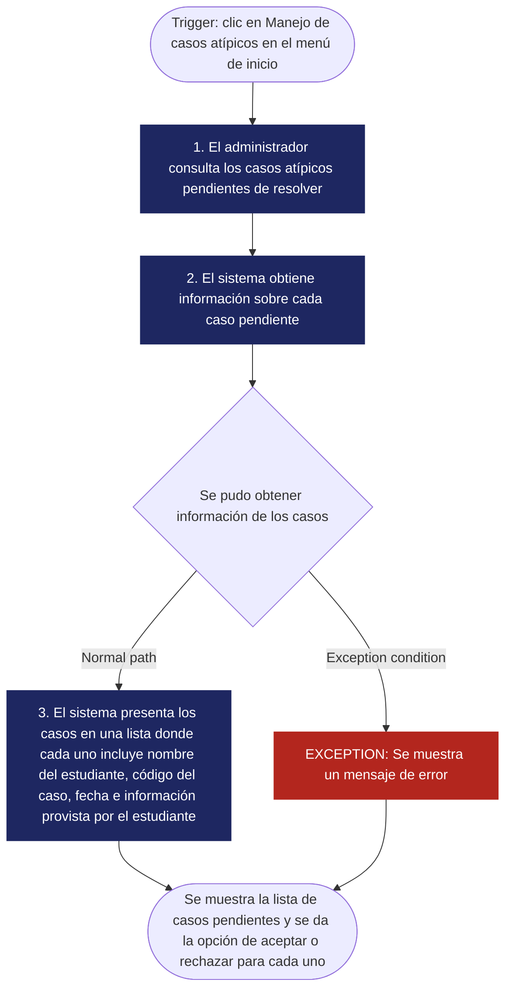
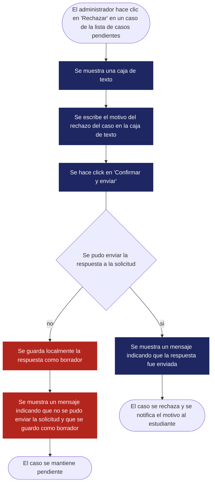

<!--
HOW TO USE THIS TEMPLATE
------------------------
1. Copy this file and rename it to the requirement's ID, e.g. REQ-01.md.
2. Fill in every section. If a section genuinely does not apply to this
   requirement (not every requirement has a Business Rule or a Constraint),
   write "N/A — none identified" and say why in one line. Never invent
   content to fill a blank cell — that breaks the rule we've followed since
   Class 8: specification is not invention.
3. If something is unknown rather than inapplicable, use the Open
   Questions section instead of guessing.
4. See REQ-07_Example.md (Food Delivery System) for a fully filled-in
   reference before you start.
-->

# [REQ-ID] — [Short Requirement Title]

| | |
|---|---|
| **Status** | Draft / Validated / Open Question |
| **Team / Author(s)** | |
| **Date** | |
| **Linked User Story / AC** | |

---

## 1. Overview

**Requirement Statement**
> The system shall [capability/behavior] [under what condition, if applicable].

**Type:** Functional / Non-functional
*(Classified using the Perfect Technology Filter from Class 8: imagine a perfect computer — infinite speed, unlimited memory, zero failures, zero cost. Would this requirement still matter? Yes → likely functional. The limitation disappears with perfect technology → likely non-functional.)*

**Source / Evidence**
> Where did this come from? (stakeholder, interview, workshop, existing system, regulation — reference your Class 8 Discovery Sheet entry if you have one)

**Need**
> What is the underlying need, stated as a goal — not a solution? (e.g. "know when my order will arrive," not "build a GPS map")

**Value / Rationale**
> Why does this requirement matter? What becomes better for the user/business if it's satisfied? *(This is usually the same as the "so that" of your User Story below — write it once and reuse it, don't rewrite it from scratch.)*

---

## 2. Context — A Requirement Rarely Stands Alone

*(Class 10. Fill honestly — "N/A — none identified" is a valid, expected answer for several of these.)*

**Business Rule(s)**
> What rule(s) exist in the business/domain, independent of software, that this requirement supports or enforces? Remember: Business Rule ≠ Software Requirement — not every rule needs one.

**Constraint(s)**
> What limits how this requirement can be solved (regulation, existing technology, contract, interoperability, organizational policy)? A constraint reduces the available design space — it doesn't describe what must be satisfied, it describes what limits the solution.

**Assumption(s)**
> What are we currently treating as true, without full verification, to keep moving? (Assumption ≠ Fact.)

**Dependenc(ies)**
> What does this requirement rely on to be satisfied (another requirement, an external system/API, a data source, a third party, an organizational process)?

**Risk(s)**
> What uncertain event or condition could negatively affect this requirement or its delivery? For each risk, note a rough Likelihood and Impact (High / Medium / Low) and, if you have one, a brief mitigation note.

| Risk | Likelihood | Impact | Mitigation (optional) |
|---|---|---|---|
| | | | |

**Open Questions**
> Anything still unresolved — ambiguity, a question no stakeholder has answered yet, a missing piece of evidence. List it here instead of guessing.

# 3. Priority & Estimation

**Priority model used:** MoSCoW *(Modelo alternativo considerado: Kano)*

### Priority assigned: Must Have

> **Justificación:** Debido a que la saturación de los comedores y las fallas en la asignación de cupos o turnos impactan directamente la continuidad de la operación diaria y la atención al usuario, asignamos la prioridad **Must Have**. Aceptamos el trade-off de destinar capacidad de desarrollo en las primeras iteraciones al diseño de herramientas de monitoreo y gestión administrativa en lugar de avanzar en funcionalidades secundarias. Consideramos la prioridad **Should Have** y la descartamos porque carecer de un mecanismo de contingencia desde el lanzamiento expondría al sistema a colapsos operativos no gestionables.
>
> *(Nota sobre la alternativa: Se evaluó la matriz **Kano**, pero fue descartada debido a que mide la satisfacción y el deleite del usuario en lugar de la criticidad operativa y el alcance del MVP, para lo cual **MoSCoW** resulta más efectivo).*

### Estimate (confidence): Medium

> **Justificación:** Mantenemos un nivel de confianza **Medium** debido a que, mientras la captura del reporte por parte del usuario es un flujo estándar, la dimensión real del módulo administrativo dependerá del nivel de detalle en la consulta. Para facilitar una toma de decisiones rápida ante picos de saturación, las herramientas de consulta deberán incorporar filtros por comedor o sede, categoría del incidente (fallas de asignación vs. sobrecupo), nivel de severidad y rango temporal, sumado a vistas resumidas para la reasignación de aforos. La definición final de la interactividad de estos filtros determinará el esfuerzo exacto de desarrollo.

## 4. Representations — Requirement ≠ Representation

*(Class 9. Each representation reveals different information. Fill in all three below — for this capstone requirement, all three are required.)*

### 4.1 User Story

**US-01**
> Como **administrativo**,
> Quiero **ver un resumen de los casos inesperados en la asignación de comedores**,
> Para que **los casos no manejados automáticamente por el sistema se puedan resolver fácilmente**.

**US-02**
> Como **administrativo**,
> Quiero **reasignar un comedor a un estudiante**,
> Para **resolver su caso atípico el cual acepté**.

**US-03**
> Como **administrativo**,
> Quiero **informar a un estudiante la razón de por qué su caso fue rechazado**,
> Para **que el estudiante conozca como se manejó su caso**.

**US-04**
> Como **administrativo**,
> Quiero **conocer los mejores comedores para reasignar a un estudiante**,
> Para **brindar una solución satisfactoria a su caso atípico**.

**US-05**
> Como **estudiante**,
> Quiero **reportar un problema con la asignación de mi comedor**,
> Para que **un administrativo lo resuelva y ser asignado un mejor comedor**.

**US-06**
> Como **estudiante**,
> Quiero **ser informado de cuando se resuelva mi caso atípico**,
> Para **saber si se pudo reasignar mi comedor**.

*Check yourself: is the "I want" describing the need, or already prescribing a solution?*

### 4.2 Acceptance Criteria

*(At least two scenarios: one normal path, one alternative or exception.)*
**AC-01**
**Escenario 1 — Hay casos pendientes**
> **Dado que** hay casos pendientes por resolver
> **Cuando** el administrador abre el menú de "Manejo de casos atípicos"
> **Entonces,** se muestra una lista de los casos, donde cada uno incluye nombre del estudiante, código del caso, fecha, información provista por el estudiante y botones de aceptar o rechazar. 
**AC-02**
**Escenario 2 — No hay casos pendientes**
> **Dado que** no haya casos pendientes por resolver
> **Cuando** el administrador abre el menú de "Manejo de casos atípicos"
> **Entonces,** mostrar un mensaje que indique que no hay casos pendientes por resolver
**AC-03**
**Escenario 3 — Se acepta un caso**
> **Dado que** se acepte un caso
> **Cuando** el administrador se encuentre en el menú de "Manejo de casos atípicos"
> **Entonces,** se muestra un menú que lista comedores sugeridos en orden de mejor a peor
**AC-04**
**Escenario 4 — Se reasigna un comedor**
> **Dado que** se seleccione un comedor para reasignar
> **Cuando** el administrador acepte un caso atípico
> **Entonces,** se habilita la opción de resolver el caso
**AC-05**
**Escenario 5 — Se rechaza un caso**
> **Dado que** se rechace un caso
> **Cuando** el administrador se encuentre en el menú de "Manejo de casos atípicos"
> **Entonces,** se muestra un menú con un campo de texto donde se deberá escribir la razón por la que se rechazó el caso y un botón para confirmar el rechazo del caso
**AC-06**
**Escenario 6 — Los comedores sugeridos están disponibles**
> **Dado que** se pueda conseguir la lista de comedores sugeridos
> **Cuando** el administrador acepte un caso
> **Entonces,** se mostrará la lista de comedores sugeridos, organizados de mejor a peor
**AC-07**
**Escenario 7 — Los comedores sugeridos NO están disponibles**
> **Dado que** no se pueda conseguir la lista de comedores sugeridos
> **Cuando** el administrador acepte un caso
> **Entonces,** se mostrará un mensaje de error informando que no se pudo obtener la lista de comedores
**AC-08**
**Escenario 8 — Se notifica a un estudiante de que se resolvió su caso**
> **Dado que** se haya aceptado/rechazado un caso
> **Cuando** el estudiante lo haya reportado
> **Entonces,** se notifica al estudiante acerca de la decisión tomada para su caso
**AC-09**
**Escenario 9 — El sistema pudo enviar un reporte**
> **Dado que** el sistema envía un reporte
> **Cuando** un estudiante reporte su caso atípico
> **Entonces,** se muestra un mensaje indicando que se envió el reporte exitosamente
**AC-10**
**Escenario 10 — El sistema NO pudo enviar un reporte**
> **Dado que** el sistema no pueda enviar un reporte
> **Cuando** un estudiante reporta su caso atípico
> **Entonces,** se muestra un código de error junto con un mensaje y se guarda la solicitud localmente
**AC-11**
**Escenario 11 — No se pudo obtener informacion de las solicitudes**
> **Dado que** no se pudo obtener información sobre las solicitudes realizadas
> **Cuando** un estudiante consulta el estado de sus casos atípicos
> **Entonces,** se muestra un código de error junto con un mensaje

### 4.3 Use Case

| Field | |
|---|---|
| **Use Case name** | Consultar casos pendientes |
| **Actor** | Administrativo |
| **Goal** | Acceder a información sobre los casos pendientes de asignación de comedores |
| **Trigger** | El administrador hace clic en "Manejo de casos atípicos" en el menú de inicio |
| **Precondition** | Deberá haber una sesión abierta con rol de administrador |

**Main Flow**
1. El administrador consulta los casos atípicos pendientes de resolver
2. El sistema obtiene información sobre cada caso pendiente
3. El sistema presenta los casos en una lista donde cada uno incluye nombre del estudiante, código del caso, fecha, información provista por el estudiante y botones de aceptar o rechazar.

**Exception**
> No está disponible la información sobre los casos pendientes → Se muestra un mensaje de error informando que no se pudo obtener los casos junto con el código del error (e.g. 4XX para errores en el cliente o 5XX para errores del servidor)

**Postcondition**
> Se muestra la lista de casos pendientes y se da la opción de aceptar o rechazar para cada uno

**Flow Diagram**

| Field | |
|---|---|
| **Use Case name** | Se acepta un caso pendiente |
| **Actor** | Administrativo |
| **Goal** | reasignar el comedor de un estudiante cuyo caso atípico fue aceptado |
| **Trigger** | El administrador hace clic en "Aceptar" en un caso de la lista de casos pendientes |
| **Precondition** | Acceder a la lista de casos pendientes a través del botón de "Manejo de casos atípicos" |

**Main Flow**
1. El administrador hace clic en "Aceptar" para un caso atípico
2. Se muestra una lista de comedores sugeridos ordenados de mejor a peor

**Exception**
> No esta disponible la lista de comedores sugeridos → Se muestra un código de error junto con su mensaje correspondiente

**Postcondition**
> Se muestra junto a la lista un botón para confirmar la reasignación de comedor, y otro para retroceder al menú anterior

**Flow Diagram**

| Field | |
|---|---|
| **Use Case name** | Informar a un estudiante el rechazo de su caso |
| **Actor** | Administrativo |
| **Goal** | Dar a conocer el motivo del rechazo de un caso atípico |
| **Trigger** | El administrador hace clic en "Rechazar" en un caso de la lista de casos pendientes |
| **Precondition** | Acceder a la lista de casos pendientes a través del botón de "Manejo de casos atípicos" |

**Main Flow**
1. El administrador hace clic en "Rechazar" para un caso atípico
2. Se muestra una caja de texto donde se debe escribir el motivo del rechazo
3. Se hace clic en "Confirmar y enviar"
4. Se muestra un mensaje informando que se envió la respuesta exitosamente

**Exception**
> No se pudo enviar la respuesta a la solicitud → Se guarda localmente el motivo de rechazo (como un borrador de un correo) y el caso se mantiene pendiente

**Postcondition**
> Se notifica al estudiante del motivo del rechazo de su solicitud

**Flow Diagram**

| Field | |
|---|---|
| **Use Case name** | Se notifica el estado de un caso atípico |
| **Actor** | Estudiante |
| **Goal** | Conocer el estado de un caso reportado |
| **Trigger** | El estudiante hace clic en "Consultar Solicitudes" en el menú de inicio |
| **Precondition** | Iniciar sesión como estudiante en el sistema |

**Main Flow**
1. El estudiante hace clic en "Consultar Solicitudes"
2. Se muestra una lista con las solicitudes realizadas
3. Se hace clic en una solicitud

**Exception**
> No se obtuvo información sobre solicitudes realizadas → Se muestra un código de error junto con un mensaje

**Alternative**
> La solicitud sigue pendiente de respuesta
**Postcondition**
> Se muestra un mensaje indicando que la solicitud aún no ha sido respondida

**Alternative**
> La solicitud fue rechazada
**Postcondition**
> Se muestra el motivo del rechazo

**Alternative**
> La solicitud fue aceptada
**Postcondition**
> Se muestra el comedor al que se reasignó

**Flow Diagram**

| Field | |
|---|---|
| **Use Case name** | Se solicita reasignar un comedor |
| **Actor** | Estudiante |
| **Goal** | Solicitar que se reasigne un comedor debido a alguna situación fuera del alcance del sistema |
| **Trigger** | El estudiante hace clic en "Solicitar reasignación de comedor" en el menú de inicio |
| **Precondition** | Iniciar sesión como estudiante en el sistema |

**Main Flow**
1. El estudiante hace clic en "Solicitar reasignación de comedor"
2. Se muestra un formulario
3. Se selecciona el día en el que se quiere cambiar el comedor
4. Se selecciona el comedor preferido
5. Se hace clic en "Enviar"

**Exception**
> No se pudo enviar la solicitud → Se guarda la solicitud localmente y se muestra un código de error junto con un mensaje

**Postcondition**
> Se envía la solicitud y se muestra un mensaje que lo indica

**Flow Diagram**

---

## 5. Traceability & Impact

*(Class 10. Conceptual, not a formal matrix.)*

**Backward — why does this requirement exist?**
> Evidence → Need → Requirement. Point to the specific evidence/need entries that justify this requirement (from your Discovery Sheet).

**Forward — what will this affect?**
> Requirement → future Design → Implementation → Tests. *(It's fine if Design hasn't happened yet — note what you expect this to touch once it does, and update this section once Class 11 work begins.)*

**Impact Analysis — if this requirement changes, what else might need to change?**
- [ ] Business Rules
- [ ] Constraints
- [ ] Dependencies
- [ ] Risks
- [ ] Acceptance Criteria
- [ ] Estimate
- [ ] Priority
- [ ] Future Design
- [ ] Future Tests

> Briefly note which of the above are actually likely to be affected, and why.

---

## 6. Validation — Quality Gate

*(Class 9 + Class 10. Self-audit before you commit this file. Check honestly — a "no" here means the requirement isn't ready yet, not that you should force a checkmark.)*

- [ ] **Valid?** Does it reflect a real, evidenced need — not an invented one?
- [ ] **Clear / Unambiguous?** Is there only one reasonable interpretation?
- [ ] **Atomic?** Is this one independently testable expectation, not several bundled together?
- [ ] **Necessary?** Does removing it actually break something real?
- [ ] **Feasible?** Can this realistically be built with what the team has?
- [ ] **Verifiable?** Can you demonstrate, concretely, whether it's satisfied?
- [ ] **Consistent?** Does it conflict with any other requirement in your set?
- [ ] **Complete enough?** Are there important functions or constraints still missing?
- [ ] **Traceable?** Can every part of this document be traced back to real evidence — not invented to fill a section?

> If any box is unchecked, say what's missing and whether it becomes an Open Question or sends you back to Class 8 (re-elicit) or Class 9 (re-specify).
