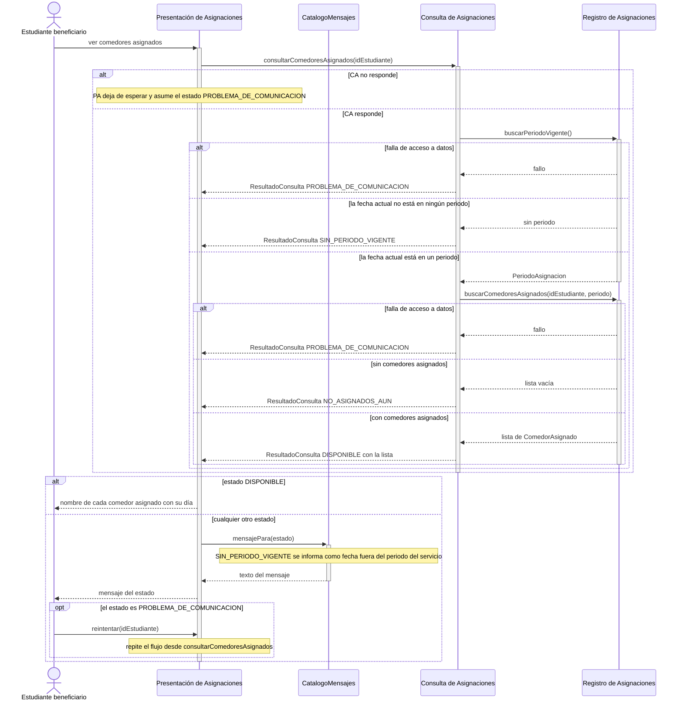
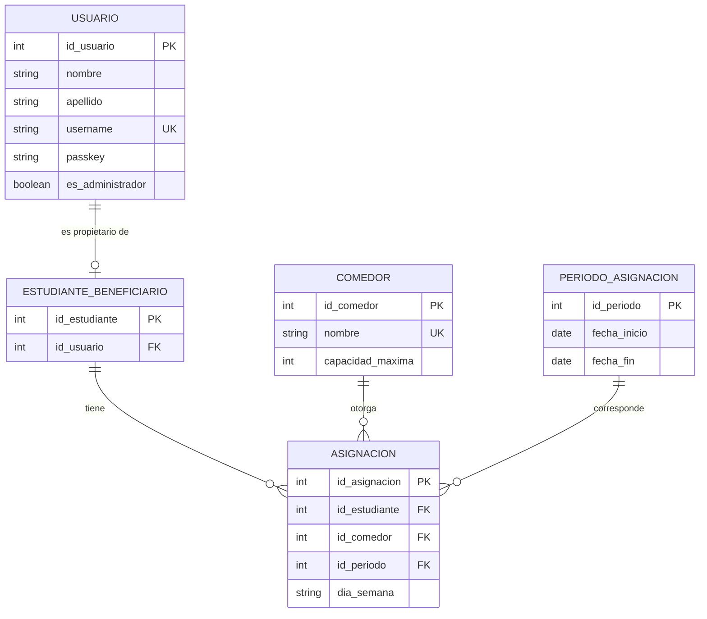

# Almuérzate — Interaction & Data Design v1.0

| | |
|---|---|
| **Team** | Almuérzate |
| **Members** | @amadodev07, @juanfpg1, @xedroc422, @alfredoquev, @julondono07 |
| **Status** | Draft |
| **Date** | 2026-11-04 |
| **Inputs** | `docs/design/01_Architectural_and_Detailed_Design.md` (D1 aceptado, REQ-10), `docs/requirements/REQ-10.md`, `docs/requirements/REQ-01.md`, `docs/adr/0006-consulta-de-asignaciones-unico-punto-de-acceso.md` |

> **Alcance:** este documento cubre REQ-10 (UC-01 Ver comedores asignados), igual que D1. REQ-01 solo aparece como productor de los datos que REQ-10 lee; su diseño interno (Cálculo de Asignaciones) no se detalla aquí.

---

## 1. Behavior — Selected Use Cases

### 1.1 Ver comedores asignados — from requirement [REQ-10]

| Use Case step or flow | Message(s) in the diagram | Information exchanged | Operation defined in (Deliverable 1) |
|---|---|---|---|
| Main flow, step 1: el estudiante consulta sus comedores asignados | `ver comedores asignados` | `idEstudiante` | `PresentacionAsignaciones.mostrar` (capacidad "Ver comedores asignados", D1 2.2) |
| Main flow, step 2: el sistema busca los comedores asignados | `consultarComedoresAsignados`, `buscarPeriodoVigente`, `buscarComedoresAsignados` | `idEstudiante`, `PeriodoAsignacion`, lista de `ComedorAsignado` | `ConsultaAsignaciones.consultarComedoresAsignados`, `RepositorioAsignaciones.buscarPeriodoVigente` y `buscarComedoresAsignados` |
| Main flow, step 3 [AC-03]: se muestra cada comedor con su día | Rama "con comedores asignados" y rama "estado DISPONIBLE" | `ResultadoConsulta` DISPONIBLE con 5 `ComedorAsignado` | `PresentacionAsignaciones.mostrar` |
| Alternative flow [AC-04]: la fecha actual está fuera del periodo del servicio | Rama "la fecha actual no está en ningún periodo", `mensajePara` | `ResultadoConsulta` SIN_PERIODO_VIGENTE, texto que indica que la fecha actual está fuera del periodo del servicio de comedores para estudiantes beneficiarios | `ConsultaAsignaciones.consultarComedoresAsignados`, `CatalogoMensajes.mensajePara` |
| Alternative flow: aún no hay asignaciones | Rama "sin comedores asignados", `mensajePara` | `ResultadoConsulta` NO_ASIGNADOS_AUN, texto | `ConsultaAsignaciones.consultarComedoresAsignados`, `CatalogoMensajes.mensajePara` |
| Exception: no se pudieron obtener los comedores asignados | Ramas "falla de acceso a datos" (las dos) y rama "CA no responde", `mensajePara` | `ResultadoConsulta` PROBLEMA_DE_COMUNICACION, texto | `ConsultaAsignaciones.consultarComedoresAsignados` (falla de acceso), `PresentacionAsignaciones` (falta de respuesta, D1 Decisión A), `CatalogoMensajes.mensajePara` |
| Exception: el estudiante reintenta | `reintentar` | `idEstudiante` | `PresentacionAsignaciones.reintentar` |

> Si no hay periodo vigente y tampoco asignaciones, prevalece `SIN_PERIODO_VIGENTE`: es la precedencia definida en D1 (3.4), porque se evalúa primero el periodo.

---

## 2. Data Design

### 2.1 Principal information the system needs

| Information | Needed by (use cases) | Persisted? | Why (or why not) |
|---|---|---|---|
| Comedores (nombre, capacidad máxima) | UC-01 (nombre); proceso interno de REQ-01, sin caso de uso (capacidad) | Yes | Un comedor existe independientemente de cualquier consulta. Su nombre se muestra y su capacidad es el tope que REQ-01 no puede superar |
| Estudiantes beneficiarios | Proceso interno de REQ-01; UC-01 solo usa su identificador | Yes | Solo ellos reciben asignación (REQ-01, REQ-10). Cada asignación debe referirse a uno, y cada uno pertenece a un usuario propietario |
| Usuarios (nombre, apellido, username, passkey, indicador de administrador) | UC-01, de forma indirecta: identifican al estudiante que consulta (mecanismo de autenticación sin definir, OQ-4). Las funciones de administrador (REQ-06, REQ-08, REQ-09) quedan fuera de este documento | Yes | Una cuenta existe independientemente de cualquier consulta y debe conservarse entre sesiones. Son los datos personales más sensibles del modelo (RFC, seguridad) |
| Periodos de asignación | UC-01; proceso interno de REQ-01 | Yes | Periodo del servicio de comedores para estudiantes beneficiarios (el semestre). Se crea de antemano, con fechas conocidas. Determina si hay asignación vigente para mostrar (AC-04) y delimita cuándo se asigna (BR-02) |
| Asignaciones (estudiante, comedor, día, periodo) | UC-01; proceso interno de REQ-01 | Yes | Es lo que REQ-01 produce y REQ-10 muestra. Se escribe una sola vez, al inicio del semestre, con 5 asignaciones por estudiante (una por día, distintas entre sí), y se mantiene constante hasta el final del semestre. Solo cambia en un caso atípico a solicitud del estudiante (OQ-1). Se lee en cada consulta |
| `ResultadoConsulta` y `EstadoConsulta` | UC-01 | No | Se calculan en cada consulta a partir del periodo y de las asignaciones. Guardarlos crearía una segunda fuente de verdad que quedaría desactualizada |
| Horario de comedores que ve el estudiante (día y comedor) | UC-01 | No | Es una vista derivada de las asignaciones: se reconstruye en cada consulta |
| Textos de los mensajes al estudiante | UC-01 | No | Son textos fijos de la presentación (`CatalogoMensajes`), no datos de negocio |

### 2.2 Data model

**Justification:** relational (ADR-0001, PostgreSQL). Usuarios, estudiantes, comedores, periodos y asignaciones tienen relaciones directas y reglas de integridad (una asignación no existe sin su estudiante, comedor y periodo, y un estudiante no existe sin su usuario propietario). La asignación de los 5 días de un estudiante debe guardarse de forma atómica, lo que aprovecha las transacciones ACID.

| Entity / document type | Meaning in the system | Identifier | Constraints (required, unique, allowed values) |
|---|---|---|---|
| USUARIO | Persona con una cuenta en el sistema, sea estudiante beneficiario o administrador | `id_usuario` | `nombre`, `apellido`, `username` y `passkey` requeridos. `username` único. `es_administrador` requerido (verdadero para los administradores). La `passkey` no se devuelve en ninguna consulta de este diseño; cómo se almacena y verifica: OQ-4 |
| ESTUDIANTE_BENEFICIARIO | Estudiante que recibe asignación de comedor y pertenece a un usuario propietario. Solo se almacenan beneficiarios, por lo que la regla "solo beneficiarios reciben asignación" queda protegida por la clave foránea de ASIGNACION | `id_estudiante` | `id_estudiante` requerido y único. `id_usuario` requerido, único y clave foránea a USUARIO (un usuario es propietario de a lo sumo un estudiante: suposición, OQ-9) |
| COMEDOR | Instalación física que ofrece el servicio | `id_comedor` | `nombre` requerido y único (identifica el comedor sin ambigüedad, porque `ComedorAsignado` solo expone el nombre). `capacidad_maxima` requerida y mayor que 0 |
| PERIODO_ASIGNACION | Periodo del servicio de comedores para estudiantes beneficiarios (el semestre), durante el cual rige la asignación única de cada estudiante. `fecha_inicio` es el día en que se empieza a asignar (o se programa la asignación) y `fecha_fin` es el fin del servicio contratado. Ambas fechas se conocen de antemano: el periodo se crea antes de que empiece | `id_periodo` | `fecha_inicio` y `fecha_fin` requeridas, con `fecha_inicio` menor o igual que `fecha_fin`. Los periodos no se solapan (ver 2.4) |
| ASIGNACION | Comedor asignado a un estudiante para un día de la semana durante todo el periodo (semestre) | `id_asignacion` | `id_estudiante`, `id_comedor` e `id_periodo` requeridos. `dia_semana` limitado a Lunes, Martes, Miércoles, Jueves, Viernes (los valores del tipo `DiaSemana` de D1). Único por (`id_estudiante`, `id_periodo`, `dia_semana`) |

> **Periodo vigente:** no se guarda una marca de vigencia. Es el periodo cuyo rango contiene la fecha actual del servidor, con `fecha_inicio` y `fecha_fin` incluidas, así que no puede quedar desactualizado.
>
> **Un periodo por semestre:** las 5 asignaciones de un estudiante se guardan una sola vez y rigen todas las semanas del periodo, así que no se replican por semana. Por eso `buscarComedoresAsignados` no necesita la semana en curso: la semana solo determina qué día se mira, no qué filas existen. Esto obliga a reformular la expresión "semana en curso" de REQ-10 y D1 (ver sección 4).

> **Usuario y estudiante:** ESTUDIANTE_BENEFICIARIO conserva su propio identificador (`id_estudiante`), de modo que ASIGNACION y los contratos no dependen de la cuenta. Un usuario administrador no necesita un estudiante asociado (OQ-9).

**Correspondencia entre el modelo y los contratos (sección 3)**

| Elemento del contrato / D1 | Se obtiene del modelo así |
|---|---|
| `IdEstudiante` | `ESTUDIANTE_BENEFICIARIO.id_estudiante` |
| Usuario propietario de un estudiante | `ESTUDIANTE_BENEFICIARIO.id_usuario` hacia `USUARIO.id_usuario`. Ningún contrato de la sección 3 lee USUARIO: la relación queda disponible para obtener `idEstudiante` del usuario autenticado (OQ-4) |
| `PeriodoAsignacion` (`inicio`, `fin`) | `PERIODO_ASIGNACION.fecha_inicio` y `fecha_fin` del periodo que contiene la fecha actual del servidor. Si ninguno la contiene, no hay periodo (`buscarPeriodoVigente` devuelve ausencia) |
| `PeriodoAsignacion` recibido por `buscarComedoresAsignados` | Se busca el periodo con esa misma `fecha_inicio` y `fecha_fin` para obtener `id_periodo` y filtrar ASIGNACION. Como los periodos no se solapan, ese rango identifica un único periodo, y por eso `PeriodoAsignacion` no necesita un identificador en D1 |
| `ComedorAsignado` (`dia`, `nombreComedor`) | `ASIGNACION.dia_semana` y `COMEDOR.nombre`, unidos por `id_comedor`, filtrados por `id_estudiante` e `id_periodo` y devueltos en orden Lunes a Viernes |
| `DiaSemana` | Los cinco valores permitidos de `ASIGNACION.dia_semana` |
| `EstadoConsulta` | No se almacena (2.1): se deduce de si existe periodo, de si la lista tiene 0 o 5 elementos y de si el acceso a los datos falló |
| `guardarComedoresAsignados` (REQ-01) | Inserta de una vez las 5 filas de ASIGNACION de un estudiante en un periodo, o ninguna (2.4). Se ejecuta una sola vez por semestre |

### 2.3 Data Ownership

| Information | Authoritative owner (component responsible for maintaining it) | Consumed by (uses it without owning it) | Access through |
|---|---|---|---|
| Asignaciones | Registro de Asignaciones (persiste y entrega, D1 2.2) | Consulta de Asignaciones (lee). Cálculo de Asignaciones produce el contenido una vez por semestre, pero no lo almacena. Un cambio atípico lo ejecutaría un proceso aún no definido (OQ-1) | `RepositorioAsignaciones` (`guardarComedoresAsignados`, `buscarComedoresAsignados`) |
| Periodos de asignación | Registro de Asignaciones | Consulta de Asignaciones (periodo vigente). Cálculo de Asignaciones (REQ-01, cuándo asignar) | `RepositorioAsignaciones` (`buscarPeriodoVigente`) |
| Comedores | Registro de Asignaciones | Consulta de Asignaciones (solo el nombre, dentro de `ComedorAsignado`). Cálculo de Asignaciones (capacidad, REQ-01) | `RepositorioAsignaciones`. D1 no define aún una operación para leer capacidades: se define con el diseño de REQ-01 |
| Estudiantes beneficiarios | Registro de Asignaciones (copia persistida). La fuente es externa: las entidades que informan quiénes son beneficiarios (dependencia de REQ-01) | Cálculo de Asignaciones (REQ-01) | `RepositorioAsignaciones`. Cómo llega esa información al sistema es OQ-3 |
| Usuarios | Registro de Asignaciones (provisional: copia persistida, igual que los estudiantes; D1 no tiene un componente de cuentas ni de autenticación, ver sección 4, punto 3) | Ningún contrato de este documento. Un futuro mecanismo de autenticación (OQ-4) y las funciones de administrador (REQ-06, REQ-08, REQ-09) | `RepositorioAsignaciones` no define operaciones sobre usuarios: se definen con el mecanismo de autenticación |

> Quién carga o actualiza el contenido de periodos, comedores, beneficiarios y usuarios no está definido en las fuentes. No se asigna a un actor ni componente inexistente (como "Administración"): es OQ-3.

### 2.4 Business rules and invariants enforced in data

| Business rule or invariant | Where it is enforced (component logic / data constraint / both) | How |
|---|---|---|
| BR-01: asignación con frecuencia diaria | Both | Data: `dia_semana` limitado a los 5 días hábiles y único por (`id_estudiante`, `id_periodo`, `dia_semana`); esto evita duplicados, pero no garantiza que existan los 5 días. Logic: Cálculo de Asignaciones asigna los 5 días en una única ejecución al inicio del semestre y Registro de Asignaciones los guarda todos juntos, por estudiante, en una sola transacción (ADR-0001) |
| BR-02: solo se asigna durante el semestre académico | Logic | Cálculo de Asignaciones no asigna fuera del semestre. Fuera del periodo del servicio, es decir, cuando la fecha actual no está contenida en ningún periodo, la consulta informa `SIN_PERIODO_VIGENTE` (AC-04). Cómo se registran los periodos: OQ-3 |
| A lo sumo un periodo vigente | Both | Data: los periodos no se solapan (restricción de exclusión sobre el rango de fechas, con extremos incluidos, en PostgreSQL). Logic: `buscarPeriodoVigente` devuelve el periodo que cumple `fecha_inicio` menor o igual que la fecha actual y esta menor o igual que `fecha_fin` |
| Solo los estudiantes beneficiarios reciben asignación (REQ-01) | Data | Solo existen beneficiarios en ESTUDIANTE_BENEFICIARIO y ASIGNACION referencia esa tabla |
| Un nombre de usuario identifica a una sola cuenta | Data | `username` requerido y único en USUARIO |
| Cada estudiante beneficiario pertenece a un usuario, y un usuario es propietario de a lo sumo un estudiante (suposición, OQ-9) | Data | `id_usuario` requerido y único en ESTUDIANTE_BENEFICIARIO, con clave foránea a USUARIO |
| Las credenciales no se exponen (RFC, seguridad: acceso restringido y protegido a los datos) | Logic | Ningún contrato de este documento devuelve datos de USUARIO: `ResultadoConsulta` y `ComedorAsignado` solo llevan estado, día y nombre del comedor. La passkey no se incluye en ninguna consulta. Cómo se almacena y verifica: OQ-4 |
| El aforo real de un comedor no se puede superar (REQ-01, AC-02) | Logic | Cálculo de Asignaciones verifica el tope antes de asignar, dentro de la transacción. No es una restricción declarativa simple, porque contar filas contra `capacidad_maxima` exige bloqueo o transacción serializable. Un cambio atípico también debería respetar el tope (OQ-1). Qué significa exactamente el aforo (por día, por franja): OQ-6 |
| Un estudiante tiene 0 o 5 asignaciones por periodo (invariante de D1) | Logic | Se cumple porque los 5 días se guardan juntos o no se guarda ninguno, y un cambio atípico solo actualiza filas existentes. Si aparecieran entre 1 y 4, el comportamiento no está definido: OQ-5 |
| La asignación es única por semestre e invariable, salvo caso atípico (REQ-01, REQ-06) | Both | Logic: Cálculo de Asignaciones asigna una sola vez al inicio del semestre y no hay recálculo periódico. Data: la unicidad por (`id_estudiante`, `id_periodo`, `dia_semana`) impide una segunda asignación del mismo día en el semestre. Un cambio atípico actualiza el comedor de un día existente, no agrega ni borra filas. Quién lo ejecuta y cómo se solicita: OQ-1 |

---

## 3. Interface Contract

La plantilla pide un contrato. **3.1 es el principal**, porque es el punto único de acceso definido por la Decisión A de D1 y el ADR-0006. Los contratos 3.2 a 3.4 detallan el resto de las interacciones del diagrama 1.1. Los contratos no mencionan el motor de almacenamiento: `RepositorioAsignaciones` lo oculta (D1).

### 3.1 `ConsultaAsignaciones.consultarComedoresAsignados`

**Interaction chosen** (from diagram 1.1, message `consultarComedoresAsignados(idEstudiante)` de Presentación de Asignaciones hacia Consulta de Asignaciones):
> El punto donde se resuelven los cuatro resultados de UC-01 y donde se contiene el fallo de acceso a los datos.

| Element | Specification |
|---|---|
| **Operation and purpose** | `consultarComedoresAsignados(idEstudiante)`: determinar qué debe ver el estudiante: sus comedores asignados o la razón por la que no están disponibles |
| **Input (parameters and types)** | `idEstudiante` (`IdEstudiante`): identificador no nulo de un estudiante beneficiario |
| **Output (successful result and data structure)** | `ResultadoConsulta`: un `EstadoConsulta` (`DISPONIBLE`, `NO_ASIGNADOS_AUN`, `SIN_PERIODO_VIGENTE` o `PROBLEMA_DE_COMUNICACION`) y una lista de `ComedorAsignado` (`dia`, `nombreComedor`). La lista tiene exactamente 5 elementos (Lunes a Viernes) si el estado es `DISPONIBLE` y está vacía en cualquier otro estado |
| **Preconditions** | `idEstudiante` no es nulo y corresponde a un estudiante beneficiario: el sistema no maneja a quienes no lo son, así que el contrato no define ese caso. Quien invoca debe garantizarlo (cómo se identifica al estudiante: OQ-4) |
| **Postconditions** | Siempre se devuelve un `ResultadoConsulta`: nunca un texto ni una excepción hacia la presentación. Primero se evalúa el periodo y después las asignaciones, así que si la fecha actual no está contenida en ningún periodo el estado es `SIN_PERIODO_VIGENTE` aunque tampoco haya asignaciones |
| **Failure outcomes** | Si falla el acceso a los datos en `buscarPeriodoVigente` o en `buscarComedoresAsignados`: devuelve `PROBLEMA_DE_COMUNICACION` con lista vacía. En ningún caso se modifica algún dato |
| **Invariants and side effects** | Side effects: ninguno, es solo lectura. Repetir la misma consulta es seguro. Invariant: si el estado es `DISPONIBLE`, la lista tiene 5 elementos, uno por día. Mientras no cambien el periodo ni las asignaciones, consultas repetidas devuelven lo mismo, porque la asignación es constante durante el semestre (REQ-01). Un cambio atípico (OQ-1) sí altera el resultado |

**Testable examples**

| Case | Before | Request | Expected |
|---|---|---|---|
| Todo correcto [AC-03] | La fecha actual está contenida en un periodo y el estudiante 123 tiene 5 asignaciones en él | `consultarComedoresAsignados(123)` | `DISPONIBLE` y lista de 5 comedores |
| Aún sin asignaciones | La fecha actual está contenida en un periodo y la asignación del semestre aún no se ha guardado para el estudiante 456 | `consultarComedoresAsignados(456)` | `NO_ASIGNADOS_AUN` y lista vacía |
| Cambio atípico ya aplicado | El estudiante 123 tenía 5 asignaciones y el comedor de un día fue cambiado por un caso atípico | `consultarComedoresAsignados(123)` | `DISPONIBLE` y lista de 5 con el comedor actualizado en ese día |
| Fecha fuera del periodo del servicio [AC-04] | La fecha actual no está contenida en ningún periodo y el estudiante 123 tiene asignaciones de otro periodo | `consultarComedoresAsignados(123)` | `SIN_PERIODO_VIGENTE` y lista vacía |
| Fecha fuera del periodo y sin asignaciones | La fecha actual no está contenida en ningún periodo y el estudiante 456 no tiene asignaciones | `consultarComedoresAsignados(456)` | `SIN_PERIODO_VIGENTE` y lista vacía |
| Falla al buscar el periodo | El acceso a los datos falla en `buscarPeriodoVigente` | `consultarComedoresAsignados(123)` | `PROBLEMA_DE_COMUNICACION` y lista vacía |
| Falla al buscar los comedores | La fecha actual está contenida en un periodo y el acceso a los datos falla en `buscarComedoresAsignados` | `consultarComedoresAsignados(123)` | `PROBLEMA_DE_COMUNICACION` y lista vacía |

---

### 3.2 `PresentacionAsignaciones.mostrar` y `reintentar`

**Interaction chosen** (from diagram 1.1, message `ver comedores asignados` del estudiante hacia Presentación de Asignaciones, y `reintentar(idEstudiante)`):

| Element | Specification |
|---|---|
| **Operation and purpose** | `mostrar(idEstudiante)`: invocar a `ConsultaAsignaciones` y mostrar los comedores asignados o el mensaje del estado. `reintentar(idEstudiante)`: repetir exactamente la misma consulta cuando el estudiante lo pide |
| **Input (parameters and types)** | `idEstudiante` (`IdEstudiante`): identificador no nulo del estudiante beneficiario. Cómo obtiene la presentación este identificador: OQ-4 |
| **Output (successful result and data structure)** | Vista para el estudiante (`void`). Si el estado es `DISPONIBLE`: cada `ComedorAsignado` con su día y nombre. En otro caso: el texto devuelto por `CatalogoMensajes.mensajePara(estado)` |
| **Preconditions** | La presentación dispone de un `idEstudiante` válido. `mostrar` puede invocarse cualquier día dentro del periodo vigente, incluidos sábados y domingos: la consulta no depende del día de la semana. Para `reintentar`, la última vista mostrada fue el mensaje de `PROBLEMA_DE_COMUNICACION` |
| **Postconditions** | El estudiante ve sus comedores o el motivo por el que no están disponibles, sin excepciones técnicas. Si están disponibles, siempre se muestran los 5 días, de Lunes a Viernes, sin importar qué día de la semana sea hoy. Ante `PROBLEMA_DE_COMUNICACION`, se ofrece `reintentar` |
| **Failure outcomes** | Si `ConsultaAsignaciones` devuelve `PROBLEMA_DE_COMUNICACION` o no responde, la presentación usa ese mismo estado, muestra su mensaje y ofrece reintentar. No se modifica ningún dato |
| **Invariants and side effects** | Side effects: ninguno sobre datos persistidos. Invariant: nombres y días se muestran tal como llegan en `ResultadoConsulta`, sin transformarlos. `reintentar` solo lo dispara el estudiante (como define D1) |

**Testable examples**

| Case | Before | Request | Expected |
|---|---|---|---|
| Asignaciones disponibles | `ConsultaAsignaciones` devuelve `DISPONIBLE` con 5 elementos | `mostrar(123)` | Se muestra cada comedor con su día (Lunes a Viernes) |
| Consulta en fin de semana | La fecha actual es un sábado o un domingo dentro del periodo y `ConsultaAsignaciones` devuelve `DISPONIBLE` con 5 elementos | `mostrar(123)` | Se muestran los 5 comedores, de Lunes a Viernes |
| Sin periodo vigente | `ConsultaAsignaciones` devuelve `SIN_PERIODO_VIGENTE` | `mostrar(123)` | Mensaje que indica que la fecha actual está fuera del periodo del servicio de comedores para estudiantes beneficiarios |
| Aún sin asignaciones | `ConsultaAsignaciones` devuelve `NO_ASIGNADOS_AUN` | `mostrar(456)` | Mensaje de que aún no se ha brindado el subsidio alimentario |
| Consulta con problema | `ConsultaAsignaciones` devuelve `PROBLEMA_DE_COMUNICACION` | `mostrar(123)` | Mensaje de problema de comunicación y opción de reintentar |
| Consulta sin respuesta | `ConsultaAsignaciones` no responde | `mostrar(123)` | Mismo resultado que el caso anterior |
| Reintento exitoso | Se mostró el problema de comunicación y luego los datos vuelven a estar accesibles | `reintentar(123)` | Se repite la consulta y se muestran los 5 comedores |

---

### 3.3 `RepositorioAsignaciones.buscarPeriodoVigente`

**Interaction chosen** (from diagram 1.1, message `buscarPeriodoVigente()` de Consulta de Asignaciones hacia Registro de Asignaciones):

| Element | Specification |
|---|---|
| **Operation and purpose** | `buscarPeriodoVigente()`: obtener el periodo de asignación cuyo rango contiene la fecha actual del servidor, con `fecha_inicio` y `fecha_fin` incluidas |
| **Input (parameters and types)** | Ninguno |
| **Output (successful result and data structure)** | `PeriodoAsignacion` (`inicio`, `fin`) del periodo que contiene la fecha actual, o ausencia de periodo si ninguno la contiene (multiplicidad `0..1` de D1). `inicio` es el día en que se empieza a asignar y `fin` el fin del servicio contratado |
| **Preconditions** | Ninguna. Los periodos se crean de antemano con sus fechas conocidas (2.2) |
| **Postconditions** | Si devuelve un periodo, `inicio` es menor o igual que la fecha actual y esta es menor o igual que `fin`. La ausencia significa que la fecha actual no está contenida en ningún periodo (es anterior al primero, posterior al último o queda entre dos). No se modifica ningún dato |
| **Failure outcomes** | Si falla el acceso al almacenamiento, el fallo se propaga a `ConsultaAsignaciones`, que lo convierte en `PROBLEMA_DE_COMUNICACION`. No se modifica ningún dato |
| **Invariants and side effects** | Side effects: ninguno, es solo lectura. Invariant: a lo sumo un periodo contiene una fecha dada, porque los rangos no se solapan (2.4). El resultado depende solo de la fecha actual y de los rangos almacenados |

**Testable examples**

| Case | Before | Request | Expected |
|---|---|---|---|
| Fecha dentro del periodo | Existe un periodo con `inicio` = I y `fin` = F, y la fecha actual está entre I y F | `buscarPeriodoVigente()` | Devuelve ese `PeriodoAsignacion` |
| Primer día del periodo | La fecha actual es igual a I | `buscarPeriodoVigente()` | Devuelve ese `PeriodoAsignacion` |
| Último día del periodo | La fecha actual es igual a F | `buscarPeriodoVigente()` | Devuelve ese `PeriodoAsignacion` |
| Antes del periodo | La fecha actual es anterior a I y no hay otro periodo que la contenga | `buscarPeriodoVigente()` | Ausencia de periodo (no es un fallo) |
| Después del periodo | La fecha actual es posterior a F y no hay otro periodo que la contenga | `buscarPeriodoVigente()` | Ausencia de periodo (no es un fallo) |
| Falla de acceso | El almacenamiento no responde | `buscarPeriodoVigente()` | El fallo se propaga al invocador |

---

### 3.4 `RepositorioAsignaciones.buscarComedoresAsignados`

**Interaction chosen** (from diagram 1.1, message `buscarComedoresAsignados(idEstudiante, periodo)` de Consulta de Asignaciones hacia Registro de Asignaciones):

| Element | Specification |
|---|---|
| **Operation and purpose** | `buscarComedoresAsignados(idEstudiante, periodo)`: recuperar los comedores asignados por día a un estudiante en el periodo dado |
| **Input (parameters and types)** | `idEstudiante` (`IdEstudiante`): no nulo. `periodo` (`PeriodoAsignacion`): el periodo vigente devuelto por `buscarPeriodoVigente`, no nulo. El almacenamiento lo identifica por su `inicio` y `fin`, únicos porque los periodos no se solapan (2.2 y 2.4), así que el contrato no necesita un identificador |
| **Output (successful result and data structure)** | Lista de `ComedorAsignado` (`dia`, `nombreComedor`). Cada elemento reúne la asignación con el nombre del comedor, que es único. Tiene 5 elementos (Lunes a Viernes) o ninguno |
| **Preconditions** | `idEstudiante` y `periodo` no son nulos |
| **Postconditions** | Devuelve los 5 elementos si el estudiante tiene asignaciones en el periodo, o una lista vacía si no tiene. Refleja el estado actual, incluido cualquier cambio atípico. No se modifica ningún dato. Si hubiera entre 1 y 4, el comportamiento no está definido: OQ-5 |
| **Failure outcomes** | Si falla el acceso al almacenamiento, el fallo se propaga a `ConsultaAsignaciones`. No se modifica ningún dato |
| **Invariants and side effects** | Side effects: ninguno, es solo lectura. Invariant: a lo sumo un elemento por día de la semana. El resultado es constante durante el semestre salvo un cambio atípico |

**Testable examples**

| Case | Before | Request | Expected |
|---|---|---|---|
| Asignaciones encontradas | El estudiante 123 tiene 5 asignaciones en el periodo | `buscarComedoresAsignados(123, periodo)` | Lista de 5 `ComedorAsignado` |
| Sin asignaciones | El estudiante 456 no tiene asignaciones en el periodo | `buscarComedoresAsignados(456, periodo)` | Lista vacía |
| Falla de acceso | El almacenamiento no responde | `buscarComedoresAsignados(123, periodo)` | El fallo se propaga al invocador |

---

## 4. Cross-Consistency & Changes to Deliverable 1

| Check | Result |
|---|---|
| Every participant in a sequence diagram is an actor, a component, a class or an external system from Deliverable 1 | Yes. Estudiante beneficiario es el actor. Presentación de Asignaciones, Consulta de Asignaciones y Registro de Asignaciones son componentes de D1 (2.2). `CatalogoMensajes` es una clase de D1 (3.3) que pertenece a Presentación de Asignaciones. Cálculo de Asignaciones no participa en la secuencia: solo aparece en 2.3 como productor de datos |
| Every message corresponds to a capability, operation or contract | Yes. Cada mensaje está mapeado en la tabla 1.1 a una operación de D1. `ver comedores asignados` es la acción del estudiante que ejecuta `PresentacionAsignaciones.mostrar`. `reintentar` tiene su contrato en 3.2 |
| Every entity or document type is reflected in the class diagrams, or the reason it is not is stated | ASIGNACION (unida al nombre de COMEDOR) corresponde a `ComedorAsignado`, que es una proyección de lectura (`dia`, `nombreComedor`); por eso no lleva los identificadores internos. PERIODO_ASIGNACION corresponde a `PeriodoAsignacion` (`inicio`, `fin`). ESTUDIANTE_BENEFICIARIO no tiene clase: REQ-10 solo maneja `IdEstudiante` y la entidad sirve a REQ-01 y a la integridad de ASIGNACION. COMEDOR no tiene clase propia: su nombre viaja en `ComedorAsignado` y su capacidad se diseña con REQ-01. USUARIO no tiene clase: ninguna operación de REQ-10 lo usa y su relación con el estudiante queda para el mecanismo de autenticación (OQ-4) |
| Every persisted information element has exactly one authoritative owner | Yes (2.3). Registro de Asignaciones es el dueño de todo lo persistido (el de usuarios, de forma provisional: sección 4, punto 3); la fuente externa de los beneficiarios y quién carga los datos quedan en OQ-3 |
| The contract agrees with the sequence diagram and with the data model (same behavior in all three views) | Yes para los cuatro resultados de UC-01, la precedencia periodo → asignaciones, el fallo en cualquiera de las dos búsquedas y el reintento. Lo no definido (OQ-1 a OQ-9) no se resuelve por suposición |

**Changes made to Deliverable 1 because of this deliverable**
> Ninguno aplicado. D1 es la versión aceptada y este documento se ajustó a él. Se detectaron cuatro puntos de alineación. Ninguno cambia clases, operaciones ni contratos de REQ-10:
>
> 1. **Periodo semestral (decisión del equipo sobre la asignación única):** REQ-10 (restricción "los periodos de asignación vigentes cubren solo la semana en curso", AC-03 y flujo principal "para la semana") y D1 sección 1 (restricción equivalente) hablan de semana en curso. Con un periodo por semestre, el periodo vigente es el semestre y el estudiante ve las 5 asignaciones que rigen esa semana. D1 3.2 ya decía "igual para todas las semanas del semestre". Falta reformular esa restricción en REQ-10 y en D1.
> 2. `guardarComedoresAsignados(idEstudiante, comedores)` no recibe el periodo, pero ASIGNACION guarda `id_periodo`. Conviene añadirlo a esa operación cuando se detalle REQ-01.
> 3. D1 describe a Registro de Asignaciones como el que persiste asignaciones y periodo vigente. Este documento también le asigna la persistencia de comedores y estudiantes beneficiarios, que son insumos de REQ-01, y de usuarios (cuentas y rol de administrador). D1 no tiene un componente de cuentas ni de autenticación, así que conviene decidir cuando se detalle REQ-01 si esa persistencia queda en Registro de Asignaciones o en un componente nuevo.
> 4. **Texto de `SIN_PERIODO_VIGENTE`:** D1 (3.3, `CatalogoMensajes`) y REQ-10 (flujo alternativo y AC-04) lo redactan como "actualmente no se están realizando asignaciones de comedores" o "no hay ningún periodo de asignación vigente", que es ambiguo. Este documento lo expresa como "la fecha actual está fuera del periodo del servicio de comedores para estudiantes beneficiarios". El texto puede cambiar después; conviene alinear esa redacción en D1 y REQ-10. No cambia el estado ni los contratos.

---

## 5. Open Questions

> **OQ-1.** ¿Cómo se ejecuta un caso atípico? Según la decisión del equipo, la asignación es única por semestre e invariable (REQ-01), salvo un caso atípico a solicitud del estudiante. No está definido quién lo ejecuta (posiblemente un administrador, como los casos aislados de REQ-06), cómo se solicita (REQ-07 registra reportes, pero no lo dice), con qué criterios se acepta, si respeta el tope del aforo y si se conserva un historial de cambios. Tampoco está claro cómo encaja con la reasignación periódica y de emergencia que prevé el RFC (entregas 2 y final), que este diseño no modela. REQ-10 solo lee el estado actual, así que no depende de la respuesta.
>
> **OQ-2.** ¿Cómo visualiza el frontend la lista de "día: comedor"? (Open Question heredada de REQ-10; este diseño solo fija la representación lógica.)
>
> **OQ-3.** ¿Quién crea los periodos y carga o actualiza comedores, estudiantes beneficiarios y usuarios, y cómo llegan esos datos al sistema? Las fuentes solo establecen que las entidades que administran los datos de los estudiantes son una dependencia (RFC, REQ-01).
>
> **OQ-4.** ¿Cómo se identifica al estudiante y cómo llega `idEstudiante` a la presentación, con el acceso restringido que pide el RFC? El contrato 3.1 asume que el identificador es de un estudiante beneficiario, porque el sistema no maneja a quienes no lo son, pero no se define cómo se garantiza. El modelo incluye USUARIO (`username`, `passkey`) y su relación con el estudiante propietario, pero no se define el mecanismo de autenticación, cómo se almacena y verifica la passkey, ni cómo se obtiene `idEstudiante` del usuario autenticado.
>
> **OQ-5.** ¿Qué hacer si un estudiante tiene entre 1 y 4 asignaciones en un periodo? La escritura atómica busca evitarlo, pero el comportamiento de la lectura no está definido (D1 lo registra como "comedores parciales").
>
> **OQ-6.** ¿Qué mide exactamente el aforo (ocupación simultánea por franja horaria o asignaciones por día)? El RFC habla de ocupación por franja; REQ-01 solo habla de comedor lleno. Se resuelve en el diseño de REQ-01.
>
> **OQ-7.** El reintento lo dispara el estudiante (flujo de excepción de UC-01 y D1), pero el riesgo de REQ-10 menciona reintentar de forma periódica. Hay que alinear la mitigación de REQ-10 con el flujo de excepción.
>
> **OQ-8.** La plantilla pide dos casos de uso. REQ-01 no tiene caso de uso (REQ-01, sección 4.3) y los demás requerimientos no tienen diseño todavía. No se inventó uno: el equipo debe decidir cuál segundo caso de uso usar (ver checklist).
>
> **OQ-9.** ¿Qué cardinalidad y reglas hay entre usuarios y estudiantes? Se supuso que un usuario es propietario de a lo sumo un estudiante beneficiario (`id_usuario` único). No está definido si un usuario podría ser propietario de varios, ni si una cuenta de administrador puede tener también un estudiante asociado.

---

## 6. Optional — AI-Assisted Design Reflection

> Una IA revisó este borrador contra D1 y recomendó eliminar la marca `es_vigente` de PERIODO_ASIGNACION, porque duplicaba la información de `fecha_inicio` y `fecha_fin` y podía quedar desactualizada. Se aceptó: el periodo vigente se calcula con la fecha actual y la unicidad se garantiza evitando solapamientos entre periodos.
>
> La misma revisión recomendó agregar identificadores a `ComedorAsignado` y `PeriodoAsignacion` en D1. No se aceptó: son proyecciones de lectura y los identificadores son internos del almacenamiento, que D1 declara oculto. El nombre del comedor se hizo único para que la proyección no sea ambigua, y el periodo se identifica por su rango (`inicio`, `fin`), único porque los periodos no se solapan.

---

## 7. Consistency Checklist

- [ ] Two use cases from the project, each traceable to a Use Case written in the requirements. *(Solo se desarrolla UC-01: REQ-01 no tiene caso de uso. Pendiente de decisión del equipo, OQ-8.)*
- [x] Each sequence diagram shows the main flow and at least one alternative or exception flow.
- [x] No business behavior is invented: anything unspecified is marked as an assumption or Open Question.
- [x] Section 2.1 explains what is NOT persisted as well as what is.
- [x] The data model has identifiers, relationships and constraints, not only boxes.
- [x] Every piece of principal information has one authoritative owner, and consumers are listed (Section 2.3).
- [x] The contract defines input, output, preconditions, postconditions and failure outcomes.
- [x] Sequence, data model and contract describe the same behavior.
- [ ] Diagrams render correctly on GitHub. *(Pendiente de verificar en la vista previa de GitHub.)*
