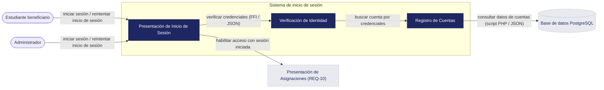
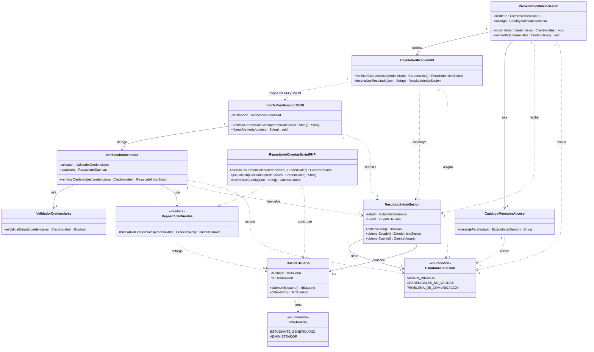

# Almuérzate — Architectural & Detailed Design v1.0 (REQ-11)

| | |
|---|---|
| **Team** | Almuérzate |
| **Members** | @amadodev07, @juanfpg1, @xedroc422, @alfredoquev, @julondono07 |
| **Status** | Draft |
| **Date** | 2026-11-27 |
| **Inputs** | `docs/requirements/REQ-11.md`, `ADR-0002`, `ADR-0005`, Diseño de REQ-10 v1.0 (referencia de contexto) |

> **Alcance:** este documento cubre REQ-11 (inicio de sesión de estudiantes beneficiarios y administradores). Incluye a *Presentación de Asignaciones* (REQ-10) únicamente como referencia de contexto del acceso que se habilita tras iniciar sesión como estudiante beneficiario; su diseño interno no se repite aquí.

---

## 1. System Overview & Design Drivers

**System purpose**
> Reconocer quién utiliza la página web de Almuérzate y con qué rol (estudiante beneficiario o administrador), para conceder acceso únicamente a lo que corresponde a cada rol y proteger los datos personales de los estudiantes frente a terceros. Cuando las credenciales no son válidas o no pueden verificarse por una falla de acceso a los datos, el sistema debe denegar el acceso e informar a la persona.

| Requirement / Use Case ID | Why it shapes the structure | Quality attribute, constraint or business rule involved |# Almuérzate — Architectural & Detailed Design v1.0 (REQ-11)

| | |
|---|---|
| **Team** | Almuérzate |
| **Members** | @amadodev07, @juanfpg1, @xedroc422, @alfredoquev, @julondono07 |
| **Status** | Draft |
| **Date** | 2026-11-27 |
| **Inputs** | `docs/requirements/REQ-11.md`, `docs/requirements/REQ-10.md`, `ADR-0001`, `ADR-0004`, `ADR-0007`, `ADR-0008`, Diseño de REQ-10 v1.0 (referencia de contexto) |

> **Alcance:** este documento cubre REQ-11 (inicio de sesión de estudiantes beneficiarios y administradores). Incluye a *Presentación de Asignaciones* (REQ-10) únicamente como referencia de contexto del acceso que se habilita tras iniciar sesión como estudiante beneficiario; su diseño interno no se repite aquí.

---

## 1. System Overview & Design Drivers

**System purpose**
> Reconocer quién utiliza la página web de Almuérzate y con qué rol (estudiante beneficiario o administrador), para conceder acceso únicamente a lo que corresponde a cada rol y proteger los datos personales de los estudiantes frente a terceros. Cuando las credenciales no son válidas o no pueden verificarse por una falla de acceso a los datos, el sistema debe denegar el acceso e informar a la persona.

| Requirement / Use Case ID | Why it shapes the structure | Quality attribute, constraint or business rule involved |
|---|---|---|
| REQ-11 / UC-02 Iniciar sesión | Exige identificar dos roles y resolver tres resultados distintos del flujo (credenciales válidas con reconocimiento de rol, credenciales no válidas y falla de acceso a los datos), validando lo que ingresa el usuario antes de llegar al acceso a datos y gestionando la comunicación entre PHP, la librería compartida en C++ y el script PHP de PostgreSQL | Restricción: acceso restringido y protegido a datos de estudiantes (RFC, Seguridad). Restricción: aplicación web sin app móvil (ADR-0005, Aceptado). Restricción: PHP actúa como puente con el backend en C++ (ADR-0002, ADR-0004), cargándolo como librería compartida vía FFI con intercambio JSON y liberación manual de memoria (ADR-0007, Aceptado; reemplaza el mecanismo de invocación de ADR-0002). Restricción: el backend C++ accede a PostgreSQL (ADR-0001) ejecutando un script PHP que devuelve JSON, generando doble paso por PHP (`PHP → C++ → PHP`, ADR-0008, Aceptado). Riesgos de impacto High: verificación de identidad deficiente (Medium/High), inyección de comandos al invocar el script `php` desde C++ (Medium/High, ADR-0008), desajuste de firmas FFI o fallo del subproceso `php` y falla de acceso a los datos (Low/High). Criterios AC-05 y AC-06. Reglas de negocio: N/A (ninguna identificada en REQ-11) |
| REQ-10 / UC-01 Ver comedores asignados *(contexto)* | Muestra al estudiante sus propias asignaciones y requiere saber quién consulta para restringir el acceso a sus datos; REQ-11 habilita esa identificación | Restricción: acceso restringido a datos de estudiantes (RFC, Seguridad). Brecha de identificación abierta en REQ-10 |

---

## 2. Architectural Design

### 2.1 System Context & Boundary

| Outside the system | Type (actor / external system / hardware) | How the system interacts with it |
|---|---|---|
| Estudiante beneficiario | Actor | Solicita iniciar sesión en la página web, entrega sus credenciales, obtiene acceso a su rol o recibe el aviso correspondiente y puede reintentar ante una falla de comunicación |
| Administrador | Actor | Solicita iniciar sesión en la página web, entrega sus credenciales, obtiene acceso a su rol o recibe el aviso correspondiente y puede reintentar ante una falla de comunicación |
| Base de datos (PostgreSQL) | External system | Almacena las cuentas registradas (ADR-0001); `Registro de Cuentas` la consulta desde el backend en C++ ejecutando un script PHP que devuelve el resultado en JSON (ADR-0008) |
| Presentación de Asignaciones (REQ-10) | External system | Recibe al estudiante beneficiario cuando `Presentación de Inicio de Sesión` habilita su acceso tras iniciar sesión |

### 2.2 Components, Responsibilities & Capabilities



> *Presentación de Asignaciones (REQ-10)* y *Base de datos PostgreSQL* se muestran fuera de la frontera del sistema de inicio de sesión como sistemas externos con los que interactúa. Los destinos del administrador (REQ-08 y REQ-09) aún no están diseñados y no se incluyen. Los componentes se nombran por responsabilidad, mientras que sus fronteras de comunicación reflejan los ADR aceptados: la presentación web en PHP invoca al backend en C++ compilado como librería compartida vía FFI con intercambio JSON (`ADR-0002`, `ADR-0004`, `ADR-0005`, `ADR-0007`), y el backend consulta PostgreSQL ejecutando un script PHP que devuelve JSON (`ADR-0001`, `ADR-0008`).

| Component | Main responsibility | Requirements / use cases supported | Provided capabilities | Required capabilities | Main dependencies |
|---|---|---|---|---|---|
| Presentación de Inicio de Sesión | Recibe las credenciales en la página web, solicita la verificación invocando la librería compartida del backend vía FFI, interpreta la respuesta JSON, libera la memoria devuelta por C++ (ADR-0007), habilita el acceso acorde al rol cuando la sesión se inicia, muestra el aviso correspondiente cuando no se concede acceso (incluidos fallos de FFI o JSON) y permite reintentar | REQ-11 / UC-02 | Iniciar sesión; reintentar inicio de sesión | Verificar credenciales; habilitar acceso con sesión iniciada | Verificación de Identidad, Presentación de Asignaciones (REQ-10, externo) |
| Verificación de Identidad | Se ejecuta en el backend C++ (librería compartida): valida el formato de las credenciales recibidas, consulta la cuenta en el registro, determina el rol (estudiante beneficiario o administrador), decide el resultado del inicio de sesión y lo expone serializado en JSON hacia la presentación (ADR-0007) | REQ-11 / UC-02 | Verificar credenciales | Buscar cuenta por credenciales | Registro de Cuentas |
| Registro de Cuentas | Accede a la persistencia de cuentas en PostgreSQL ejecutando desde C++ el script PHP de consulta, procesa el JSON retornado (ADR-0008) y entrega la cuenta registrada junto con su identidad y su rol | REQ-11 / UC-02 | Buscar cuenta por credenciales | Consultar datos de cuentas | Base de datos PostgreSQL (externo) |

---

## 3. Detailed Design

### 3.1 Components selected (at least two)

| Component | Why it was selected (risk, complexity, centrality to the drivers) |
|---|---|
| Verificación de Identidad | Es el componente central de REQ-11: resuelve los tres resultados de UC-02 (AC-05, AC-06 y falla de acceso a los datos), expone la frontera FFI/JSON desde la librería compartida en C++ (ADR-0007) y mitiga la verificación deficiente y la inyección de comandos antes de alcanzar el subproceso `php` (ADR-0008) |
| Presentación de Inicio de Sesión | Es el punto de entrada en PHP para estudiantes beneficiarios y administradores: encapsula la invocación FFI, la deserialización JSON y la liberación manual de memoria del backend C++ (ADR-0007), habilita el acceso según el rol (AC-05), muestra el aviso ante credenciales no válidas (AC-06) y ofrece el reintento ante fallos de comunicación |
| Registro de Cuentas | Concentra la integración del backend C++ con PostgreSQL mediante la ejecución del subproceso `php` y la interpretación del JSON retornado (ADR-0008), aislando los fallos de proceso, script o base de datos detrás de un contrato estable |

### 3.2 Class Diagram(s)



> No se usa composición ni herencia entre clases de dominio: `CuentaUsuario` existe en el registro independientemente del resultado de un intento de inicio de sesión, y los roles se modelan con `RolUsuario` porque en REQ-11 ambos roles comparten el mismo flujo de autenticación sin atributos ni operaciones especializadas definidas. Sí se utiliza realización de interfaz (`RepositorioCuentasScriptPHP ..|> RepositorioCuentas`) para aislar el acceso mediante subproceso PHP (`ADR-0008`) del núcleo de verificación. `ResultadoInicioSesion` contiene `0..1` `CuentaUsuario` (presente solo cuando el estado es `SESION_INICIADA`).
>
> La frontera de comunicación entre lenguajes (`ADR-0007`) se encapsula en `ClienteVerificacionFFI` (lado PHP) e `InterfazVerificacionJSON` (lado librería compartida C++): el intercambio se realiza mediante cadenas JSON y `ClienteVerificacionFFI` es responsable de invocar `liberarMemoria` tras leer la respuesta. Los tipos `Credenciales` e `IdUsuario` se mantienen opacos sin campos internos porque con qué credenciales inicia sesión cada rol y cómo se crean y mantienen las cuentas son Open Questions de REQ-11.>
> La frontera de comunicación entre lenguajes (`ADR-0007`) se encapsula en `ClienteVerificacionFFI` (lado PHP) e `InterfazVerificacionJSON` (lado librería compartida C++): el intercambio se realiza mediante cadenas JSON y `ClienteVerificacionFFI` es responsable de invocar `liberarMemoria` tras leer la respuesta. Los tipos `Credenciales` e `IdUsuario` se mantienen opacos sin campos internos porque con qué credenciales inicia sesión cada rol y cómo se crean y mantienen las cuentas son Open Questions de REQ-11.

> No se usa composición ni generalización: `CuentaUsuario` existe en el registro independientemente del resultado de un intento de inicio de sesión, y los roles se modelan con `RolUsuario` en lugar de herencia porque en REQ-11 ambos roles comparten el mismo flujo de autenticación sin atributos ni operaciones especializadas definidas. `ResultadoInicioSesion` contiene `0..1` `CuentaUsuario` (presente solo cuando el estado es `SESION_INICIADA`).
>
> Los tipos `Credenciales` e `IdUsuario` se mantienen opacos sin campos internos porque con qué credenciales inicia sesión cada rol y cómo se crean y mantienen las cuentas son Open Questions de REQ-11.

### 3.3 Class Responsibilities

| Class | Component it belongs to | Responsibility | Key collaborators |
|---|---|---|---|
| PresentacionInicioSesion | Presentación de Inicio de Sesión | Recibe las credenciales, solicita la verificación a través del cliente FFI y habilita el acceso según el rol de `CuentaUsuario` cuando el estado es `SESION_INICIADA`; en otro caso muestra el aviso del estado y permite reintentar | ClienteVerificacionFFI, CatalogoMensajesAcceso, ResultadoInicioSesion, EstadoInicioSesion, CuentaUsuario |
| ClienteVerificacionFFI | Presentación de Inicio de Sesión | Carga la librería compartida C++ mediante FFI (`ffi.enable=true`), invoca `verificarCredencialesJson`, libera manualmente la memoria reservada por C++ (`liberarMemoria`) y deserializa la cadena JSON a `ResultadoInicioSesion`; ante fallos de carga, invocación o parseo devuelve `PROBLEMA_DE_COMUNICACION` (ADR-0007) | InterfazVerificacionJSON, ResultadoInicioSesion, EstadoInicioSesion |
| CatalogoMensajesAcceso | Presentación de Inicio de Sesión | Entrega el texto de aviso para los estados sin acceso: `CREDENCIALES_NO_VALIDAS` (informa que no fue posible iniciar sesión, AC-06) y `PROBLEMA_DE_COMUNICACION` (informa el problema de comunicación y pide reintentar, análogo a REQ-10). `SESION_INICIADA` no tiene mensaje | EstadoInicioSesion |
| InterfazVerificacionJSON | Verificación de Identidad | Expone las funciones con firma compatible con FFI en la librería compartida C++, convierte la entrada JSON, delega en `VerificacionIdentidad`, serializa `ResultadoInicioSesion` a JSON y provee la operación para liberar la memoria reservada (ADR-0007) | VerificacionIdentidad, ResultadoInicioSesion |
| VerificacionIdentidad | Verificación de Identidad | Coordina la validación de entradas y la búsqueda en el registro, y decide el `EstadoInicioSesion` resultante | ValidadorCredenciales, RepositorioCuentas, ResultadoInicioSesion, EstadoInicioSesion |
| ValidadorCredenciales | Verificación de Identidad | Verifica que las credenciales recibidas por FFI sean estructuralmente válidas y seguras antes de pasarlas al subproceso `php` y a la consulta en PostgreSQL (mitigación de inyección de comandos, ADR-0007 y ADR-0008) | Ninguno |
| ResultadoInicioSesion | Verificación de Identidad | Transporta el estado del intento de inicio de sesión y, si fue exitoso, la `CuentaUsuario` autenticada; define el contrato serializado en JSON entre C++ y PHP | EstadoInicioSesion, CuentaUsuario |
| EstadoInicioSesion | Verificación de Identidad | Enumera los resultados de UC-02: `SESION_INICIADA` (AC-05), `CREDENCIALES_NO_VALIDAS` (AC-06) y `PROBLEMA_DE_COMUNICACION` (falla de FFI, subproceso `php`, PostgreSQL o JSON inválido) | Ninguno |
| RepositorioCuentas | Registro de Cuentas | Contrato para localizar una cuenta válida a partir de las credenciales entregadas (oculta el almacenamiento, la ejecución del script PHP y el mecanismo de verificación interna) | CuentaUsuario |
| RepositorioCuentasScriptPHP | Registro de Cuentas | Implementa `RepositorioCuentas` ejecutando desde C++ el script PHP que consulta PostgreSQL, interpreta el JSON devuelto para construir `CuentaUsuario` y señala falla de acceso a datos si `php` no está disponible, el script falla o el JSON es inválido (ADR-0008) | RepositorioCuentas, CuentaUsuario |
| CuentaUsuario | Registro de Cuentas | Representa la identidad y el rol de una cuenta autenticada, sin exponer sus credenciales | RolUsuario |
| RolUsuario | Registro de Cuentas | Enumera los roles reconocidos por REQ-11: `ESTUDIANTE_BENEFICIARIO` y `ADMINISTRADOR` | Ninguno |
### 3.4 Behavior of one key operation

```text
verificarCredenciales(credenciales):
    SI NO validador.esValidaEntrada(credenciales):
        RETORNAR ResultadoInicioSesion(CREDENCIALES_NO_VALIDAS)      // ADR-0008 / AC-06
    INTENTAR:                                                        // "El sistema verifica las credenciales"
        cuenta = repositorio.buscarPorCredenciales(credenciales)     // ejecuta script PHP -> PostgreSQL -> JSON (ADR-0008)
    SI EL ACCESO A LOS DATOS FALLA:                                  // fallo al lanzar php, error en BD o JSON inválido
        RETORNAR ResultadoInicioSesion(PROBLEMA_DE_COMUNICACION)     // flujo de excepción
    SI no hay cuenta:
        RETORNAR ResultadoInicioSesion(CREDENCIALES_NO_VALIDAS)      // AC-06 (flujo alternativo)
    RETORNAR ResultadoInicioSesion(SESION_INICIADA, cuenta)          // AC-05
```

> **Brecha documentada:** el flujo de UC-02 no define qué rama prevalece si la entrada está malformada y al mismo tiempo existe una falla de acceso a los datos. Se evalúa primero `esValidaEntrada` para impedir que entradas malformadas alcancen la invocación del proceso `php` y la consulta a PostgreSQL (mitigación del riesgo de inyección de comandos, ADR-0008), devolviendo `CREDENCIALES_NO_VALIDAS` igual que en el flujo alternativo de AC-06. Al retornar `ResultadoInicioSesion`, `InterfazVerificacionJSON` lo serializa a JSON para entregarlo vía FFI a `ClienteVerificacionFFI`, quien libera la memoria reservada por C++ (`ADR-0007`). Políticas de sesión (duración, cierre de sesión e intentos fallidos repetidos) siguen abiertas en REQ-11 y no se incluyen en esta operación.

---

## 4. Design Quality — Cohesion, Coupling, Information Hiding

| Question | Your answer, with evidence from your design |
|---|---|
| **Cohesion:** do the responsibilities inside each class or component belong together? | `VerificacionIdentidad` solo coordina el flujo de verificación y decide el estado; la validación de formato vive en `ValidadorCredenciales`; los textos de aviso viven en `CatalogoMensajesAcceso`; `PresentacionInicioSesion` solo captura entradas, muestra avisos, habilita acceso por rol y reintenta; `CuentaUsuario` solo expone identidad y rol. Los detalles de comunicación y serialización quedan separados en `ClienteVerificacionFFI`, `InterfazVerificacionJSON` (ADR-0007) y `RepositorioCuentasScriptPHP` (ADR-0008). |
| **Coupling:** how far does a change in one element spread? Where are the strongest dependencies? | Los acoplamientos más fuertes se concentran en dos fronteras: (1) el contrato de firmas FFI y el esquema JSON entre `ClienteVerificacionFFI` e `InterfazVerificacionJSON` (ADR-0007: un desajuste de firma puede tumbar el proceso), y (2) el contrato JSON y la disponibilidad del binario `php` en el servidor entre `RepositorioCuentasScriptPHP` y el script de PostgreSQL (ADR-0008). Hacia el dominio, `VerificacionIdentidad` depende solo de la interfaz `RepositorioCuentas`, por lo que cambiar el script PHP por `libpqxx` en el futuro no afecta la lógica de verificación ni la presentación. Agregar un estado nuevo impacta `EstadoInicioSesion`, `VerificacionIdentidad`, `CatalogoMensajesAcceso` y la serialización JSON; definir los campos concretos de `Credenciales` afectará `PresentacionInicioSesion`, `ClienteVerificacionFFI`, `InterfazVerificacionJSON`, `ValidadorCredenciales` y `RepositorioCuentasScriptPHP`. |
| **Information hiding:** what did you keep private or internal, and why? | La carga de la librería compartida vía FFI, los punteros de memoria C++ y la serialización JSON quedan ocultos dentro de `ClienteVerificacionFFI` e `InterfazVerificacionJSON` (ADR-0007). La ejecución del subproceso `php`, el acceso a PostgreSQL y el mecanismo de cotejo de credenciales quedan ocultos detrás de `RepositorioCuentas` (ADR-0008). `CuentaUsuario` nunca devuelve credenciales ni secretos hacia la presentación, solo `idUsuario` y `rol`. Las reglas de validación contra entradas malformadas quedan encapsuladas en `ValidadorCredenciales`. |

**At least one real finding** (a problem you found in your own design) **and what you changed or would change:**
> 1. **Múltiples orígenes para `PROBLEMA_DE_COMUNICACION` y desalineación documental con `REQ-11.md`:** el estado puede originarse en `VerificacionIdentidad` cuando falla `RepositorioCuentasScriptPHP` (ausencia de `php`, fallo del script, error de PostgreSQL o JSON inválido según ADR-0008), pero también en `ClienteVerificacionFFI` si falla la carga FFI o el parseo JSON del borde PHP→C++ (ADR-0007). Se diseñó que ambos orígenes se unifiquen en `PROBLEMA_DE_COMUNICACION` y ofrezcan `reintentar()` (comportamiento análogo a REQ-10 definido por el equipo).
> 2. **Cómo se entrega la identidad autenticada a REQ-10:** `CuentaUsuario` provee `idUsuario` y `rol`, pero el diseño aún no fija cómo se conserva la sesión entre solicitudes web ni cómo `Consulta de Asignaciones` (REQ-10) recibe el identificador del estudiante sin confiar en datos manipulables desde el navegador. Cuando el equipo resuelva las Open Questions de políticas de sesión de REQ-11, será necesario añadir el componente o mecanismo que gestiona la sesión activa.
> 3. **Doble paso por PHP (`PHP → C++ → PHP`), sincronización FFI y gestión manual de memoria:** combinar `ADR-0007` y `ADR-0008` introduce riesgo de fuga de memoria o caída del proceso ante desajustes de firma FFI, además del costo de lanzar un proceso `php` por consulta desde C++. Para mitigarlo sin romper el diseño del dominio, se encapsuló toda la interacción FFI y la llamada obligatoria a `liberarMemoria` en `ClienteVerificacionFFI` / `InterfazVerificacionJSON`, y se aisló la invocación del subproceso detrás de la interfaz `RepositorioCuentas` (implementada por `RepositorioCuentasScriptPHP`), permitiendo migrar luego a una conexión directa como `libpqxx` sin modificar `VerificacionIdentidad` ni `PresentacionInicioSesion`.
---

## 5. Design Decisions & Decision Record

### Decision A — Architectural

| | |
|---|---|
| **Context** | REQ-11 exige restringir y proteger el acceso a datos de estudiantes (RFC, Seguridad), reconocer dos roles (AC-05), rechazar credenciales no válidas (AC-06) y mitigar riesgos de impacto High (verificación deficiente, inyección de comandos y falla de acceso a los datos). Con los ADR aceptados, el frontend web usa PHP como puente hacia una librería compartida en C++ cargada vía FFI con respuestas JSON (ADR-0002, ADR-0004, ADR-0005, ADR-0007), y el backend C++ consulta PostgreSQL lanzando un script PHP que devuelve JSON (ADR-0001, ADR-0008), punto donde reside el riesgo de inyección de comandos. |
| **Decision** | `Presentación de Inicio de Sesión` nunca accede directamente a `Registro de Cuentas` ni a PostgreSQL, ni valida credenciales por sí misma. Toda solicitud de inicio de sesión cruza la frontera FFI/JSON hacia `Verificación de Identidad`, que es el único componente que valida las entradas, consulta el registro y decide el resultado y el rol. |
| **Rationale** | Centraliza en el backend C++ la verificación de identidad, la defensa frente a entradas malformadas antes de lanzar el subproceso `php` y el manejo de fallos de acceso a los datos, manteniendo la misma separación de responsabilidades usada en REQ-10 y evitando exponer cuentas o reglas de verificación en la capa web. |
| **Trade-off accepted** | El flujo recorre PHP dos veces (`PHP → C++ vía FFI → subproceso PHP → PostgreSQL`, ADR-0007 y ADR-0008), obliga a mantener sincronizadas las firmas FFI, liberar manualmente la memoria reservada por C++ y lanzar un proceso `php` por verificación, y genera múltiples puntos de origen para `PROBLEMA_DE_COMUNICACION`. Se descartó que la presentación consultara directamente a PostgreSQL o a `Registro de Cuentas` porque dispersaría la lógica de autenticación en la interfaz y rompería la frontera definida por el RFC (Seguridad), ADR-0004 y ADR-0007. |

### Decision B — Detailed design

| | |
|---|---|
| **Context** | UC-02 contempla tres resultados (sesión iniciada, credenciales no válidas y falla de acceso a los datos), además del rechazo de entradas malformadas antes del subproceso `php` (ADR-0008) y posibles fallos de FFI o JSON en la integración con C++ (ADR-0007). Por seguridad (RFC, Seguridad) y AC-06, ante credenciales no válidas el sistema solo debe informar que no fue posible iniciar sesión, sin exponer errores técnicos de FFI, subprocesos o PostgreSQL ni revelar si una cuenta existe. |
| **Decision** | `VerificacionIdentidad` devuelve siempre un `ResultadoInicioSesion` con un `EstadoInicioSesion` cerrado (`SESION_INICIADA`, `CREDENCIALES_NO_VALIDAS`, `PROBLEMA_DE_COMUNICACION`), nunca excepciones propagadas ni textos de error; `InterfazVerificacionJSON` y `ClienteVerificacionFFI` serializan y deserializan exactamente ese contrato en JSON (ADR-0007). Tanto las entradas malformadas como las credenciales no encontradas devuelven `CREDENCIALES_NO_VALIDAS`; los mensajes visibles al usuario viven únicamente en `CatalogoMensajesAcceso`. |
| **Rationale** | Garantiza un contrato JSON simple y uniforme a través de la frontera FFI, evita filtrar información sensible sobre cuentas registradas o fallos internos de C++/PHP/PostgreSQL, y aísla los textos de aviso en una sola clase para facilitar cambios de redacción sin tocar la lógica de verificación ni el contrato FFI. |
| **Trade-off accepted** | Todo estado nuevo (por ejemplo, cuenta bloqueada si se definen límites de intentos) obliga a modificar `EstadoInicioSesion`, `VerificacionIdentidad`, `CatalogoMensajesAcceso` y la serialización/deserialización JSON en ambos lados del puente FFI (`ClienteVerificacionFFI` e `InterfazVerificacionJSON`), y al unificar entradas malformadas con credenciales inexistentes no se indica al usuario qué parte de las credenciales falló. |

### ADR

**ADR file:** `Pendiente` — corresponde redactar `docs/adr/0009-verificacion-de-identidad-unico-punto-de-acceso.md` para registrar la Decisión A (siguiendo el mismo patrón de separación adoptado en `ADR-0006` para REQ-10). *(No se reutilizan `ADR-0006`, `ADR-0007` ni `ADR-0008` porque ya corresponden a decisiones aceptadas previamente.)*

---

## 6. Traceability

| Requirement ID | Use Case | Component(s) | Class(es) |
|---|---|---|---|
| REQ-11 | UC-02 Iniciar sesión | Presentación de Inicio de Sesión, Verificación de Identidad, Registro de Cuentas | PresentacionInicioSesion, ClienteVerificacionFFI, CatalogoMensajesAcceso, InterfazVerificacionJSON, VerificacionIdentidad, ValidadorCredenciales, ResultadoInicioSesion, EstadoInicioSesion, RepositorioCuentas, RepositorioCuentasScriptPHP, CuentaUsuario, RolUsuario |

---

## 7. Optional — AI-Assisted Design Reflection

> Pendiente: registrar las recomendaciones reales que el equipo acepte, modifique o rechace durante la revisión de este borrador.

---

## 8. Consistency Checklist

- [x] Every component in the diagram appears in the responsibilities table, and the other way around.
- [x] Every class belongs to an identifiable component.
- [x] Components are named by responsibility, not technology.
- [x] Nothing inside the system boundary is something you do not control.
- [x] Provided and required capabilities match across components (what one requires, another provides). *(Las capacidades requeridas hacia afuera —`habilitar acceso con sesión iniciada` y `consultar datos de cuentas`— corresponden a los sistemas externos `Presentación de Asignaciones (REQ-10)` y `Base de datos`, documentados en la sección 2.1.)*
- [x] Both decisions name a real cost or limitation, and at least one has an ADR. *(Ambas decisiones nombran su costo real; falta redactar y aceptar el ADR correspondiente en `docs/adr/0009-...md`.)*
- [x] The traceability table has no empty rows and no orphan components or classes.
- [x] Diagrams render correctly on GitHub (or the exported images are embedded).
