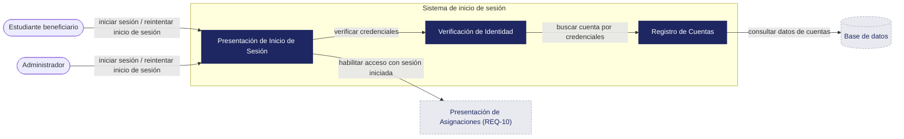
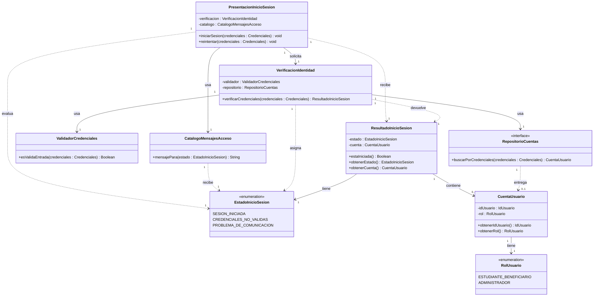

# Almuérzate — Architectural & Detailed Design v1.0 (REQ-11)

| | |
|---|---|
| **Team** | Almuérzate |
| **Members** | @amadodev07, @juanfpg1, @xedroc422, @alfredoquev, @julondono07 |
| **Status** | Draft |
| **Date** | 2026-11-27 |
| **Inputs** | `docs/requirements/REQ-11.md`, `ADR-0002`, `ADR-0005`, Diseño de REQ-10 v1.0 (referencia de contexto) |

> **Alcance:** este documento cubre REQ-11 (inicio de sesión de estudiantes beneficiarios y administradores). Incluye a *Presentación de Asignaciones* (REQ-10) únicamente como referencia de contexto del acceso que se habilita tras iniciar sesión como estudiante beneficiario; su diseño interno no se repite aquí.

---

## 1. System Overview & Design Drivers

**System purpose**
> Reconocer quién utiliza la página web de Almuérzate y con qué rol (estudiante beneficiario o administrador), para conceder acceso únicamente a lo que corresponde a cada rol y proteger los datos personales de los estudiantes frente a terceros. Cuando las credenciales no son válidas o no pueden verificarse por una falla de acceso a los datos, el sistema debe denegar el acceso e informar a la persona.

| Requirement / Use Case ID | Why it shapes the structure | Quality attribute, constraint or business rule involved |
|---|---|---|
| REQ-11 / UC-02 Iniciar sesión | Exige identificar dos roles y resolver tres resultados distintos del flujo (credenciales válidas con reconocimiento de rol, credenciales no válidas y falla de acceso a los datos), validando lo que ingresa el usuario antes de llegar al backend | Restricción: acceso restringido y protegido a datos de estudiantes (RFC, Seguridad). Restricción: entradas pasan por PHP hacia el backend y deben validarse (ADR-0002, Aceptado). Restricción: aplicación web sin app móvil (ADR-0005, Aceptado). Riesgos de impacto High: verificación de identidad deficiente (Medium/High), inyección de comandos vía PHP (Medium/High) y falla de acceso a los datos (Low/High). Criterios AC-05 y AC-06. Reglas de negocio: N/A (ninguna identificada en REQ-11) |
| REQ-10 / UC-01 Ver comedores asignados *(contexto)* | Muestra al estudiante sus propias asignaciones y requiere saber quién consulta para restringir el acceso a sus datos; REQ-11 habilita esa identificación | Restricción: acceso restringido a datos de estudiantes (RFC, Seguridad). Brecha de identificación abierta en REQ-10 |

---

## 2. Architectural Design

### 2.1 System Context & Boundary

| Outside the system | Type (actor / external system / hardware) | How the system interacts with it |
|---|---|---|
| Estudiante beneficiario | Actor | Solicita iniciar sesión en la página web, entrega sus credenciales, obtiene acceso a su rol o recibe el aviso correspondiente y puede reintentar ante una falla de comunicación |
| Administrador | Actor | Solicita iniciar sesión en la página web, entrega sus credenciales, obtiene acceso a su rol o recibe el aviso correspondiente y puede reintentar ante una falla de comunicación |
| Base de datos | External system | Almacena las cuentas registradas; `Registro de Cuentas` le consulta los datos de cuentas para validar identidad y rol |
| Presentación de Asignaciones (REQ-10) | External system | Recibe al estudiante beneficiario cuando `Presentación de Inicio de Sesión` habilita su acceso tras iniciar sesión |

### 2.2 Components, Responsibilities & Capabilities



> *Presentación de Asignaciones (REQ-10)* y *Base de datos* se muestran fuera de la frontera del sistema de inicio de sesión como sistemas externos con los que interactúa. Los destinos del administrador (REQ-08 y REQ-09) aún no están diseñados y no se incluyen. La frontera entre la presentación web y la verificación en el servidor respeta los ADR-0002 y ADR-0005 (Aceptados).

| Component | Main responsibility | Requirements / use cases supported | Provided capabilities | Required capabilities | Main dependencies |
|---|---|---|---|---|---|
| Presentación de Inicio de Sesión | Recibe las credenciales en la página web, solicita la verificación, habilita el acceso acorde al rol cuando la sesión se inicia, muestra el aviso correspondiente cuando no se concede acceso (incluida la falta de respuesta de Verificación) y permite reintentar | REQ-11 / UC-02 | Iniciar sesión; reintentar inicio de sesión | Verificar credenciales; habilitar acceso con sesión iniciada | Verificación de Identidad, Presentación de Asignaciones (REQ-10, externo) |
| Verificación de Identidad | Valida el formato de las credenciales recibidas, consulta la cuenta en el registro, determina el rol (estudiante beneficiario o administrador) y decide el resultado del inicio de sesión | REQ-11 / UC-02 | Verificar credenciales | Buscar cuenta por credenciales | Registro de Cuentas |
| Registro de Cuentas | Accede a la persistencia de cuentas y entrega las cuentas registradas junto con su identidad y su rol | REQ-11 / UC-02 | Buscar cuenta por credenciales | Consultar datos de cuentas | Base de datos (externo) |

---

## 3. Detailed Design

### 3.1 Components selected (at least two)

| Component | Why it was selected (risk, complexity, centrality to the drivers) |
|---|---|
| Verificación de Identidad | Es el componente central de REQ-11: resuelve los tres resultados de UC-02 (AC-05, AC-06 y falla de acceso a los datos) y concentra los tres riesgos de impacto High del requerimiento (verificación deficiente, inyección de comandos según ADR-0002 y falla de acceso a los datos) |
| Presentación de Inicio de Sesión | Es el punto de entrada para estudiantes beneficiarios y administradores: habilita el acceso según el rol (AC-05), muestra el aviso ante credenciales no válidas (AC-06), trata la falta de respuesta de Verificación como problema de comunicación y ofrece el reintento |

### 3.2 Class Diagram(s)



> No se usa composición ni generalización: `CuentaUsuario` existe en el registro independientemente del resultado de un intento de inicio de sesión, y los roles se modelan con `RolUsuario` en lugar de herencia porque en REQ-11 ambos roles comparten el mismo flujo de autenticación sin atributos ni operaciones especializadas definidas. `ResultadoInicioSesion` contiene `0..1` `CuentaUsuario` (presente solo cuando el estado es `SESION_INICIADA`).
>
> Los tipos `Credenciales` e `IdUsuario` se mantienen opacos sin campos internos porque con qué credenciales inicia sesión cada rol y cómo se crean y mantienen las cuentas son Open Questions de REQ-11.

### 3.3 Class Responsibilities

| Class | Component it belongs to | Responsibility | Key collaborators |
|---|---|---|---|
| PresentacionInicioSesion | Presentación de Inicio de Sesión | Recibe las credenciales, solicita la verificación y habilita el acceso según el rol de `CuentaUsuario` cuando el estado es `SESION_INICIADA`; en otro caso muestra el aviso del estado. Si `VerificacionIdentidad` no responde, aplica `PROBLEMA_DE_COMUNICACION`. Permite reintentar | VerificacionIdentidad, CatalogoMensajesAcceso, ResultadoInicioSesion, EstadoInicioSesion, CuentaUsuario |
| CatalogoMensajesAcceso | Presentación de Inicio de Sesión | Entrega el texto de aviso para los estados sin acceso: `CREDENCIALES_NO_VALIDAS` (informa que no fue posible iniciar sesión, AC-06) y `PROBLEMA_DE_COMUNICACION` (informa el problema de comunicación y pide reintentar, análogo a REQ-10). `SESION_INICIADA` no tiene mensaje | EstadoInicioSesion |
| VerificacionIdentidad | Verificación de Identidad | Coordina la validación de entradas y la búsqueda en el registro, y decide el `EstadoInicioSesion` resultante | ValidadorCredenciales, RepositorioCuentas, ResultadoInicioSesion, EstadoInicioSesion |
| ValidadorCredenciales | Verificación de Identidad | Verifica que las credenciales recibidas sean estructuralmente válidas y seguras antes de pasar al backend o al registro (mitigación de inyección de comandos, ADR-0002) | Ninguno |
| ResultadoInicioSesion | Verificación de Identidad | Transporta el estado del intento de inicio de sesión y, si fue exitoso, la `CuentaUsuario` autenticada | EstadoInicioSesion, CuentaUsuario |
| EstadoInicioSesion | Verificación de Identidad | Enumera los resultados de UC-02: `SESION_INICIADA` (AC-05), `CREDENCIALES_NO_VALIDAS` (AC-06) y `PROBLEMA_DE_COMUNICACION` (falla de acceso a los datos o falta de respuesta) | Ninguno |
| RepositorioCuentas | Registro de Cuentas | Contrato para localizar una cuenta válida a partir de las credenciales entregadas (oculta el almacenamiento y el mecanismo de verificación interna) | CuentaUsuario |
| CuentaUsuario | Registro de Cuentas | Representa la identidad y el rol de una cuenta autenticada, sin exponer sus credenciales | RolUsuario |
| RolUsuario | Registro de Cuentas | Enumera los roles reconocidos por REQ-11: `ESTUDIANTE_BENEFICIARIO` y `ADMINISTRADOR` | Ninguno |

### 3.4 Behavior of one key operation

```text
verificarCredenciales(credenciales):
    SI NO validador.esValidaEntrada(credenciales):
        RETORNAR ResultadoInicioSesion(CREDENCIALES_NO_VALIDAS)      // ADR-0002 / AC-06
    INTENTAR:                                                        // "El sistema verifica las credenciales"
        cuenta = repositorio.buscarPorCredenciales(credenciales)
    SI EL ACCESO A LOS DATOS FALLA:
        RETORNAR ResultadoInicioSesion(PROBLEMA_DE_COMUNICACION)     // flujo de excepción
    SI no hay cuenta:
        RETORNAR ResultadoInicioSesion(CREDENCIALES_NO_VALIDAS)      // AC-06 (flujo alternativo)
    RETORNAR ResultadoInicioSesion(SESION_INICIADA, cuenta)          // AC-05
```

> **Brecha documentada:** el flujo de UC-02 no define qué rama prevalece si la entrada está malformada y al mismo tiempo existe una falla de acceso a los datos. Se evalúa primero `esValidaEntrada` para impedir que entradas malformadas alcancen el backend o el almacenamiento (mitigación del riesgo de inyección de comandos, ADR-0002), devolviendo `CREDENCIALES_NO_VALIDAS` igual que en el flujo alternativo de AC-06. Políticas de sesión (duración, cierre de sesión e intentos fallidos repetidos) siguen abiertas en REQ-11 y no se incluyen en esta operación.

---

## 4. Design Quality — Cohesion, Coupling, Information Hiding

| Question | Your answer, with evidence from your design |
|---|---|
| **Cohesion:** do the responsibilities inside each class or component belong together? | `VerificacionIdentidad` solo coordina el flujo de verificación y decide el estado; la validación de formato vive en `ValidadorCredenciales`; los textos de aviso viven en `CatalogoMensajesAcceso`; `PresentacionInicioSesion` solo captura entradas, muestra avisos, habilita acceso por rol y reintenta; `CuentaUsuario` solo expone identidad y rol. |
| **Coupling:** how far does a change in one element spread? Where are the strongest dependencies? | La dependencia más fuerte hacia los datos es `VerificacionIdentidad` → `RepositorioCuentas`: un cambio en el almacenamiento o en cómo se comparan las credenciales queda contenido en `Registro de Cuentas`. `PresentacionInicioSesion` no depende del registro ni de `ValidadorCredenciales`. Agregar un estado nuevo afecta tres clases (`EstadoInicioSesion`, `VerificacionIdentidad`, `CatalogoMensajesAcceso`); definir los campos concretos de `Credenciales` afectará `PresentacionInicioSesion`, `ValidadorCredenciales` y `RepositorioCuentas`. |
| **Information hiding:** what did you keep private or internal, and why? | El almacenamiento, el mecanismo de cotejo de credenciales y el origen de los fallos de acceso quedan ocultos detrás de `RepositorioCuentas` y `VerificacionIdentidad`. `CuentaUsuario` nunca devuelve credenciales ni secretos hacia la presentación, solo `idUsuario` y `rol`. Las reglas de validación contra entradas malformadas quedan encapsuladas en `ValidadorCredenciales`. |

**At least one real finding** (a problem you found in your own design) **and what you changed or would change:**
> 1. **Dos orígenes para `PROBLEMA_DE_COMUNICACION` y desalineación documental con `REQ-11.md`:** el estado lo produce `VerificacionIdentidad` cuando falla `RepositorioCuentas`, pero también puede fallar la comunicación entre `PresentacionInicioSesion` y `VerificacionIdentidad`. Se diseñó que `PresentacionInicioSesion` trate esa falta de respuesta como `PROBLEMA_DE_COMUNICACION` y ofrezca `reintentar()` (comportamiento análogo a REQ-10 definido por el equipo). Queda pendiente actualizar la sección de excepción y la Open Question correspondiente en `REQ-11.md` para mantener trazabilidad.
> 2. **Cómo se entrega la identidad autenticada a REQ-10:** `CuentaUsuario` provee `idUsuario` y `rol`, pero el diseño aún no fija cómo se conserva la sesión entre solicitudes web ni cómo `Consulta de Asignaciones` (REQ-10) recibe el identificador del estudiante sin confiar en datos manipulables desde el navegador. Cuando el equipo resuelva las Open Questions de políticas de sesión de REQ-11, será necesario añadir el componente o mecanismo que gestiona la sesión activa.
---

## 5. Design Decisions & Decision Record

### Decision A — Architectural

| | |
|---|---|
| **Context** | REQ-11 exige restringir y proteger el acceso a datos de estudiantes (RFC, Seguridad), reconocer dos roles (AC-05), rechazar credenciales no válidas (AC-06) y mitigar riesgos de impacto High (verificación deficiente, inyección de comandos en el paso por PHP según ADR-0002, y falla de acceso a los datos). El frontend web recibe únicamente datos ya procesados (ADR-0002 y ADR-0005, Aceptados). |
| **Decision** | `Presentación de Inicio de Sesión` nunca accede a `Registro de Cuentas` ni valida credenciales por sí misma. Toda solicitud de inicio de sesión pasa por `Verificación de Identidad`, que es el único componente que valida las entradas, consulta el registro y decide el resultado y el rol. |
| **Rationale** | Centraliza en el servidor la verificación de identidad, la defensa frente a entradas malformadas y el manejo de fallos de acceso a los datos, manteniendo la misma separación de responsabilidades usada en REQ-10 y evitando exponer cuentas o reglas de verificación en el navegador. |
| **Trade-off accepted** | Un componente y un salto adicionales para iniciar sesión, y un estado (`PROBLEMA_DE_COMUNICACION`) que puede originarse en dos puntos (fallo del registro o falta de respuesta de `Verificación de Identidad`). Se descartó que la presentación consultara directamente a `Registro de Cuentas` porque expondría las credenciales y la lógica de acceso en la interfaz, incumpliendo el RFC (Seguridad) y el ADR-0002. |

### Decision B — Detailed design

| | |
|---|---|
| **Context** | UC-02 contempla tres resultados (sesión iniciada, credenciales no válidas y falla de acceso a los datos), además del rechazo de entradas malformadas (ADR-0002). Por seguridad (RFC, Seguridad) y AC-06, ante credenciales no válidas el sistema solo debe informar que no fue posible iniciar sesión, sin exponer errores técnicos ni revelar si una cuenta existe. |
| **Decision** | `VerificacionIdentidad` devuelve siempre un `ResultadoInicioSesion` con un `EstadoInicioSesion` cerrado (`SESION_INICIADA`, `CREDENCIALES_NO_VALIDAS`, `PROBLEMA_DE_COMUNICACION`), nunca excepciones propagadas ni textos de error. Tanto las entradas malformadas como las credenciales no encontradas devuelven `CREDENCIALES_NO_VALIDAS`; los mensajes visibles al usuario viven únicamente en `CatalogoMensajesAcceso`. |
| **Rationale** | Garantiza que los caminos no felices de UC-02 estén modelados de forma uniforme, evita filtrar información sensible sobre cuentas registradas y aísla los textos de aviso en una sola clase para facilitar cambios de redacción sin tocar la lógica de verificación. |
| **Trade-off accepted** | Todo estado nuevo (por ejemplo, cuenta bloqueada si se definen límites de intentos) obliga a modificar tres clases (`EstadoInicioSesion`, `VerificacionIdentidad` y `CatalogoMensajesAcceso`), y al unificar entradas malformadas con credenciales inexistentes no se indica al usuario qué parte de las credenciales falló. |

### ADR

**ADR file:** `Pendiente` — corresponde redactar `docs/adr/0009-verificacion-de-identidad-unico-punto-de-acceso.md` para registrar la Decisión A (siguiendo el mismo patrón de separación adoptado en `ADR-0006` para REQ-10). *(No se reutilizan `ADR-0006`, `ADR-0007` ni `ADR-0008` porque ya corresponden a decisiones aceptadas previamente.)*

---

## 6. Traceability

| Requirement ID | Use Case | Component(s) | Class(es) |
|---|---|---|---|
| REQ-11 | UC-02 Iniciar sesión | Presentación de Inicio de Sesión, Verificación de Identidad, Registro de Cuentas | PresentacionInicioSesion, CatalogoMensajesAcceso, VerificacionIdentidad, ValidadorCredenciales, ResultadoInicioSesion, EstadoInicioSesion, RepositorioCuentas, CuentaUsuario, RolUsuario |
| REQ-10 *(contexto)* | UC-01 Ver comedores asignados | Presentación de Asignaciones | N/A: diseñadas en el documento de diseño de REQ-10 v1.0 (`PresentacionAsignaciones`, `CatalogoMensajes`) |

---

## 7. Optional — AI-Assisted Design Reflection

> Pendiente: registrar las recomendaciones reales que el equipo acepte, modifique o rechace durante la revisión de este borrador.

---

## 8. Consistency Checklist

- [x] Every component in the diagram appears in the responsibilities table, and the other way around.
- [x] Every class belongs to an identifiable component.
- [x] Components are named by responsibility, not technology.
- [x] Nothing inside the system boundary is something you do not control.
- [x] Provided and required capabilities match across components (what one requires, another provides). *(Las capacidades requeridas hacia afuera —`habilitar acceso con sesión iniciada` y `consultar datos de cuentas`— corresponden a los sistemas externos `Presentación de Asignaciones (REQ-10)` y `Base de datos`, documentados en la sección 2.1.)*
- [ ] Both decisions name a real cost or limitation, and at least one has an ADR. *(Ambas decisiones nombran su costo real; falta redactar y aceptar el ADR correspondiente en `docs/adr/0009-...md`.)*
- [x] The traceability table has no empty rows and no orphan components or classes.
- [x] Diagrams render correctly on GitHub (or the exported images are embedded).