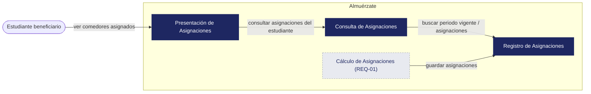
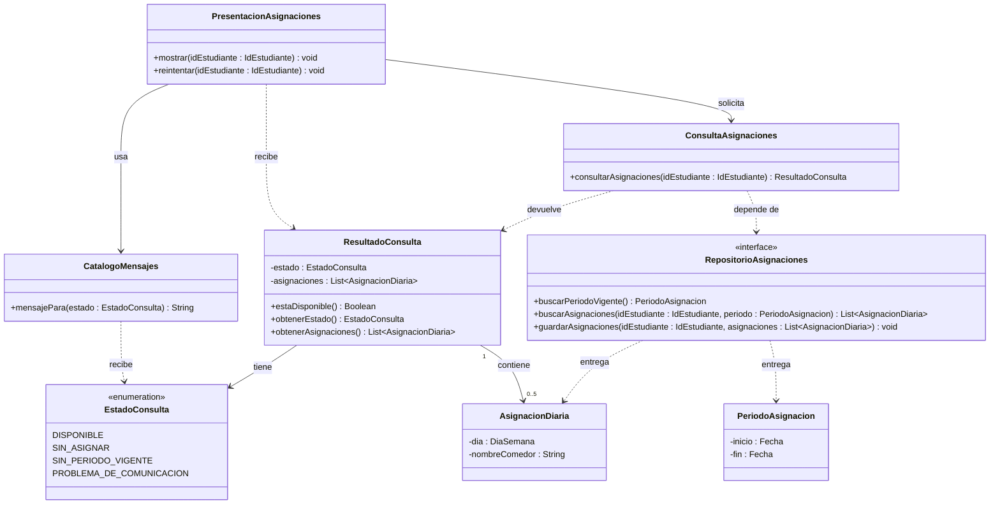

# Almuérzate — Architectural & Detailed Design v1.0

| | |
|---|---|
| **Team** | Almuérzate |
| **Members** | @amadodev07, @juanfpg1, @xedroc422, @alfredoquev, @julondono07 |
| **Status** | Draft |
| **Date** | 02-11-2026 |
| **Inputs** | `docs/requirements/REQ-10.md`, `docs/requirements/REQ-01.md`. |

> **Alcance:** este documento cubre REQ-10 (mostrar asignaciones de comedores), que se alimenta únicamente de REQ-01.

---

## 1. System Overview & Design Drivers

**System purpose**
> Que cada estudiante beneficiario conozca a qué comedor debe ir cada día de la semana, mostrándole las asignaciones que el sistema ya calculó. Cuando las asignaciones no se pueden mostrar, el estudiante debe saber por qué (sin asignar, sin periodo vigente o problema de comunicación).

| Requirement / Use Case ID | Why it shapes the structure | Quality attribute, constraint or business rule involved |
|---|---|---|
| REQ-10 / UC-01 Ver comedores asignados | El flujo tiene cuatro resultados distintos (asignaciones disponibles, no asignadas aún, sin periodo vigente, no se pudieron obtener) que deben distinguirse y comunicarse al estudiante | Riesgo de REQ-10: error de acceso a los datos (probabilidad Low, impacto High). Restricción: el periodo vigente cubre solo la semana en curso. Criterios AC-03 y AC-04 |
| REQ-01 Asignación diaria de comedores durante el semestre | Produce y persiste las asignaciones (un comedor por cada día, de lunes a viernes, igual para todas las semanas del semestre). REQ-10 solo las lee y las muestra | BR-01 y BR-02 (asignaciones solo durante el semestre académico). Restricción: solo estudiantes beneficiarios reciben asignación. Dependencia declarada de REQ-10 |

---

## 2. Architectural Design

### 2.1 System Context & Boundary

| Outside the system | Type (actor / external system / hardware) | How the system interacts with it |
|---|---|---|
| Estudiante beneficiario | Actor | Consulta sus comedores asignados de la semana y recibe las asignaciones o el mensaje que corresponde |

### 2.2 Components, Responsibilities & Capabilities



> *Cálculo de Asignaciones* se muestra solo como productor de los registros que REQ-10 consume. Su diseño interno y sus datos de entrada (horario de clases, capacidad de cada comedor, estudiantes beneficiarios) pertenecen a REQ-01 y no se detallan aquí.

| Component | Main responsibility | Requirements / use cases supported | Provided capabilities | Required capabilities | Main dependencies |
|---|---|---|---|---|---|
| Presentación de Asignaciones | Muestra al estudiante sus comedores asignados con su día, o el mensaje que corresponde cuando no se pueden mostrar, y permite reintentar la consulta | REQ-10 / UC-01 | Ver comedores asignados; reintentar consulta | Consultar asignaciones del estudiante | Consulta de Asignaciones |
| Consulta de Asignaciones | Decide qué debe ver el estudiante: sus asignaciones o la razón por la que no están disponibles | REQ-10 / UC-01 | Consultar asignaciones del estudiante | Buscar periodo vigente; buscar asignaciones | Registro de Asignaciones |
| Registro de Asignaciones | Persiste y entrega las asignaciones y el periodo de asignación vigente | REQ-01, REQ-10 | Buscar periodo vigente; buscar asignaciones; guardar asignaciones | Ninguna | Ninguna |
| Cálculo de Asignaciones | Calcula y asigna a cada estudiante beneficiario un comedor por día de la semana | REQ-01 | Asignar comedor por día a cada estudiante beneficiario | Guardar asignaciones | Registro de Asignaciones |

---

## 3. Detailed Design

### 3.1 Components selected (at least two)

| Component | Why it was selected (risk, complexity, centrality to the drivers) |
|---|---|
| Consulta de Asignaciones | Es el componente central de REQ-10: resuelve los cuatro resultados del flujo, aplica BR-02 (periodo vigente) y contiene el riesgo de error de acceso a los datos |
| Presentación de Asignaciones | Es lo único que ve el estudiante: debe mostrar las asignaciones (AC-03), el aviso de falta de periodo (AC-04) y los mensajes de "no asignadas aún" y "problema de comunicación" con petición de reintento |

### 3.2 Class Diagram(s)



> No se usa composición ni generalización: `AsignacionDiaria` existe en el registro independientemente del resultado de una consulta, y nada en este diseño es un tipo especializado de otra cosa. `ResultadoConsulta` contiene de 0 a 5 asignaciones (lunes a viernes, REQ-01); son 0 cuando el estado no es `DISPONIBLE`.

### 3.3 Class Responsibilities

| Class | Component it belongs to | Responsibility | Key collaborators |
|---|---|---|---|
| PresentacionAsignaciones | Presentación de Asignaciones | Muestra al estudiante el nombre de cada comedor con su día, o el mensaje del estado; permite reintentar | ConsultaAsignaciones, CatalogoMensajes, ResultadoConsulta |
| CatalogoMensajes | Presentación de Asignaciones | Entrega el texto que corresponde a cada estado no disponible (no asignadas aún, sin periodo vigente, problema de comunicación con petición de reintento) | EstadoConsulta |
| ConsultaAsignaciones | Consulta de Asignaciones | Decide el estado de la consulta a partir del periodo vigente y de las asignaciones del estudiante | RepositorioAsignaciones, ResultadoConsulta |
| ResultadoConsulta | Consulta de Asignaciones | Lleva el estado de la consulta y, si está disponible, las asignaciones | EstadoConsulta, AsignacionDiaria |
| EstadoConsulta | Consulta de Asignaciones | Enumera los cuatro resultados posibles del flujo de UC-01 | Ninguno |
| RepositorioAsignaciones | Registro de Asignaciones | Contrato para guardar y recuperar asignaciones y periodo vigente (el almacenamiento queda oculto) | PeriodoAsignacion, AsignacionDiaria |
| PeriodoAsignacion | Registro de Asignaciones | Representa el intervalo cubierto por el periodo de asignación vigente | Ninguno |
| AsignacionDiaria | Registro de Asignaciones | Representa el comedor asignado a un estudiante para un día de la semana | Ninguno |

### 3.4 Behavior of one key operation

```text
consultarAsignaciones(idEstudiante):
    INTENTAR:
        periodo = repositorio.buscarPeriodoVigente()
        SI no hay periodo vigente:
            RETORNAR ResultadoConsulta(SIN_PERIODO_VIGENTE)              // AC-04
        asignaciones = repositorio.buscarAsignaciones(idEstudiante, periodo)
    SI EL ACCESO A LOS DATOS FALLA:
        RETORNAR ResultadoConsulta(PROBLEMA_DE_COMUNICACION)             // flujo de excepción
    SI asignaciones está vacío:
        RETORNAR ResultadoConsulta(SIN_ASIGNAR)                          // flujo alternativo
    RETORNAR ResultadoConsulta(DISPONIBLE, asignaciones)                 // AC-03
```

---

## 4. Design Quality — Cohesion, Coupling, Information Hiding

| Question | Your answer, with evidence from your design |
|---|---|
| **Cohesion:** do the responsibilities inside each class or component belong together? | `ConsultaAsignaciones` solo decide el estado; el texto de cada mensaje vive en `CatalogoMensajes`; `PresentacionAsignaciones` solo muestra y reintenta; `AsignacionDiaria` solo guarda día y comedor. |
| **Coupling:** how far does a change in one element spread? Where are the strongest dependencies? | La dependencia más fuerte es `ConsultaAsignaciones` → `RepositorioAsignaciones`. Un cambio en el almacenamiento llega solo a Registro de Asignaciones. `PresentacionAsignaciones` depende únicamente de `ResultadoConsulta` y `EstadoConsulta`. Agregar un estado nuevo toca tres clases (`EstadoConsulta`, `ConsultaAsignaciones`, `CatalogoMensajes`). |
| **Information hiding:** what did you keep private or internal, and why? | El almacenamiento y el origen de los fallos quedan detrás de `RepositorioAsignaciones` y `ConsultaAsignaciones`; la presentación solo ve un estado. El intervalo del periodo vigente lo usa solo `ConsultaAsignaciones`. |

**At least one real finding** (a problem you found in your own design) **and what you changed or would change:**
> 1. REQ-10 pide en el riesgo que "se reintente periódicamente" y en el flujo de excepción corregido que se "pida reintentar". El diseño ofrece `reintentar()` en `PresentacionAsignaciones`, pero no define quién lo dispara ni con qué frecuencia. Cuando el equipo decida, se mantiene `reintentar()` como está o se agrega una política de reintento dentro de la presentación.
> 2. `RepositorioAsignaciones.buscarPeriodoVigente()` pone en Registro de Asignaciones un dato (el periodo vigente) cuya fuente no está definida en REQ-01 ni en REQ-10. Si proviene de otra fuente, se separa en su propio contrato; el costo es bajo porque solo `ConsultaAsignaciones` lo usa.

---

## 5. Design Decisions & Decision Record

### Decision A — Architectural

| | |
|---|---|
| **Context** | REQ-10 tiene cuatro resultados distintos y un riesgo de error de acceso a los datos (impacto High). El estudiante usa un frontend web y los datos le llegan ya procesados (ADR-0002, ADR-0005). |
| **Decision** | Presentación de Asignaciones nunca accede a Registro de Asignaciones. Toda consulta pasa por Consulta de Asignaciones, que es el único componente que decide el resultado y conoce el acceso a los datos. |
| **Rationale** | Los cuatro resultados y el fallo de acceso se resuelven en un solo lugar, y la presentación recibe siempre una respuesta que sabe mostrar (AC-03, AC-04 y los flujos alternativo y de excepción de UC-01). |
| **Trade-off accepted** | Un componente y un salto adicionales para una función de solo lectura, con algo más de latencia. Se descartó que la presentación consultara el registro directamente porque cada resultado y cada fallo tendrían que manejarse en la interfaz. |

### Decision B — Detailed design

| | |
|---|---|
| **Context** | El flujo de excepción de REQ-10 pasó de mostrar un código de error HTTP a informar un problema de comunicación y pedir reintentar. Hay tres mensajes distintos para los casos no disponibles. |
| **Decision** | `ConsultaAsignaciones` devuelve siempre un `ResultadoConsulta` con un `EstadoConsulta`: nunca textos ni errores que se propaguen. El texto de cada mensaje vive solo en `CatalogoMensajes`. |
| **Rationale** | Un cambio de redacción, como el de la corrección de REQ-10, afecta una sola clase, y `ConsultaAsignaciones` se puede verificar contra AC-03 y AC-04 sin depender de textos. |
| **Trade-off accepted** | Todo estado nuevo exige actualizar tres clases, y si `CatalogoMensajes` olvida un estado, el estudiante no recibe mensaje alguno. |

### ADR

**ADR file:** `docs/decisions/ADR-0006-consulta-unico-punto-de-acceso-a-asignaciones.md` — records Decision A. *(Pendiente de redactar.)*

---

## 6. Traceability

| Requirement ID | Use Case | Component(s) | Class(es) |
|---|---|---|---|
| REQ-10 | UC-01 Ver comedores asignados | Presentación de Asignaciones, Consulta de Asignaciones, Registro de Asignaciones | PresentacionAsignaciones, CatalogoMensajes, ConsultaAsignaciones, ResultadoConsulta, EstadoConsulta, RepositorioAsignaciones, PeriodoAsignacion, AsignacionDiaria |
| REQ-01 | N/A: proceso interno sin caso de uso (REQ-01, sección 4.3) | Cálculo de Asignaciones, Registro de Asignaciones | RepositorioAsignaciones (`guardarAsignaciones`), AsignacionDiaria. Las clases internas de Cálculo de Asignaciones se diseñan con REQ-01 |

---

## 7. Optional — AI-Assisted Design Reflection

> Pendiente: la completa el equipo si registra una recomendación de IA que haya aceptado, modificado o rechazado durante la revisión de este borrador.

---

## 8. Consistency Checklist

- [x] Every component in the diagram appears in the responsibilities table, and the other way around.
- [x] Every class belongs to an identifiable component.
- [x] Components are named by responsibility, not technology.
- [x] Nothing inside the system boundary is something you do not control.
- [x] Provided and required capabilities match across components (what one requires, another provides).
- [ ] Both decisions name a real cost or limitation, and at least one has an ADR. *(Ambas nombran su costo; el ADR-0006 está pendiente de redactar.)*
- [x] The traceability table has no empty rows and no orphan components or classes.
- [x] Diagrams render correctly on GitHub.
