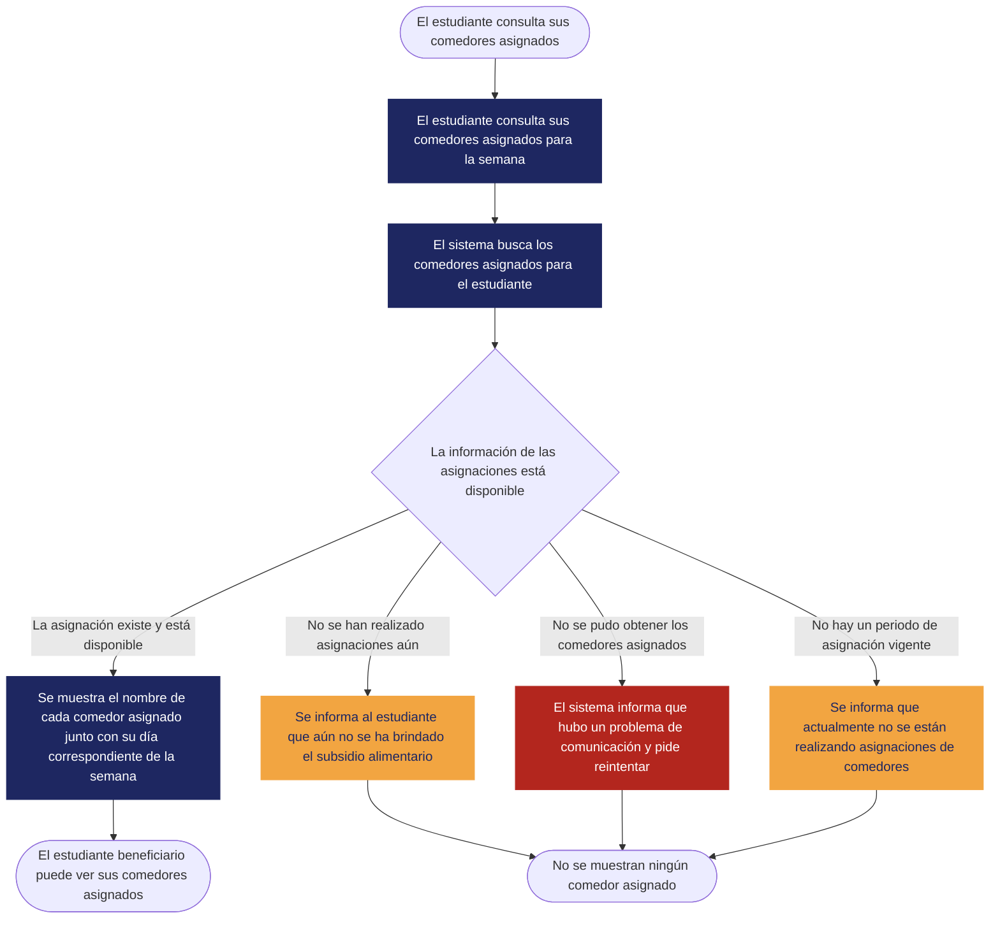

# [REQ-10] — [Mostrar asignaciones de comedores]

| | |
|---|---|
| **Status** | Draft |
| **Team / Author(s)** | @amadodev07, @juanfpg1, @xedroc422, @alfredoquev y @julondono07 |
| **Date** | 2026-01-11 |
| **Linked User Story / AC** | US-01; AC-03; AC-04 |

---

## 1. Overview

**Requirement Statement**
> El sistema debe permitir mostrarle a los estudiantes beneficiarios sus asignaciones de comedor para el periodo de asignacion vigente.

**Type:** Functional

**Source / Evidence**
> Entrevista con los stakeholders realizada en clase: es necesario que el sistema asigne a los estudiantes beneficiarios comedores para cada día de la semana

**Need**
> Los estudiantes beneficiarios necesitan conocer el comedor al que fueron asignados para poder ir a el

**Value / Rationale**
> Hacer conocer a cada estudiante beneficiario el comedor al que debe ir en cada día de la semana

---

## 2. Context — A Requirement Rarely Stands Alone

**Business Rule(s)**
> BR-01 La asignación de comedores a los estudiantes beneficiarios debe tener frecuencia diaria.

> BR-02 Las asignaciones solo se pueden realizar mientras esté cursando un semestre académico.

**Constraint(s)**
> Los periodos de asignación vigentes cubren solo la semana en curso.

> Solo los estudiantes beneficiarios reciben asignación de comedores por cada día de la semana.

> Solo habrá asignaciones durante el transcurso del semestre académico y luego de recibir la información sobre estudiantes beneficiarios.

**Assumption(s)**
> N/A - ninguna identificada

**Dependenc(ies)**
> REQ-01 Asignación diaria de comedores durante el semestre.

> Información persistida sobre las asignaciones de comedores.

> BR-01; BR-02.

> Intervalo cubierto por los periodos de asignación vigentes.

**Risk(s)**

| Risk | Likelihood | Impact | Mitigation (optional) |
|---|---|---|---|
| El acceso a los datos de asignación de comedores no es posible por un error en el backend | Low | High | Se muestra un mensaje de error, y se reintenta conseguir los datos periodicamente |

**Open Questions**
> ¿Qué representación se usará para el horario de comedores de un estudiante?

---

## 3. Priority & Estimation

**Priority model used:** MoSCoW

**Priority assigned:** Must
> Debido a que los estudiantes deben saber a qué comedor ir, se asignó la prioridad Must, aceptando el trade-off de no comunicar de forma efectiva información crítica para el estudiante si se le asigna una prioridad menor. Se consideró Should y no se usó debido a que no hay otra alternativa más que dar a conocer los comedores asignados que igual permita cumplir con la motivación del sistema.

**Estimate (confidence):** High

---

## 4. Representations — Requirement ≠ Representation

### 4.1 User Story

> Como **estudiante beneficiario**,
> Quiero **poder ver mis comedores asignados**,
> Para **saber a que comedor ir**.

### 4.2 Acceptance Criteria

**Scenario 1 — Hay asignaciones disponibles [AC-03]**
> **Dado** que el estudiante tiene asignaciones disponibles para un periodo vigente
> **Cuando** consulta sus asignaciones
> **Entonces** se muestran las asignaciones para esa semana

**Scenario 2 — No hay un periodo vigente [AC-04]**
> **Dado** que no hay un periodo de asignación vigente
> **Cuando** un estudiante consulta sus asignaciones
> **Entonces** se informa que no hay ningún periodo de asignación vigente

### 4.3 Use Case

| Field | |
|---|---|
| **Use Case name** | Ver comedores asignados [UC-01] |
| **Actor** | Estudiante beneficiario |
| **Goal** | Hacer conocer al estudiante el comedor al que deberá ir en cada día de la semana |
| **Trigger** | El estudiante consulta sus comedores asignados |
| **Precondition** | Los comedores ya fueron asignados (aún no se ha brindado el subsidio alimentario, o el semestre ya acabó) |

**Main Flow**
1. El estudiante consulta sus comedores asignados para la semana.
2. El sistema busca los comedores asignados para el estudiante.
3. El sistema muestra el nombre de cada comedor asignado junto con su día correspondiente de la semana.

**Alternative Flow**
> Los comedores no han sido asignados aún → El sistema informa al estudiante que aún no se le ha brindado el subsidio alimentario.
> No hay un periodo de asignación vigente → El sistema informa al estudiante que actualmente no se están realizando asignaciones de comedores.

**Exception**
> No se pudo obtener los comedores asignados desde el backend → El sistema informa que hubo un problema de comunicación y pide reintentar.

**Postcondition**
> El estudiante beneficiario puede ver sus comedores asignados cuando se hayan realizado las asignaciones y entren en efecto los subsidios de alimentación.

**Flow Diagram**

---

## 5. Traceability & Impact

**Backward — why does this requirement exist?**
> Los stakeholders informan que es necesario realizar asignaciones de comedores para cada día de la semana → Si a un estudiante se le asigna un comedor, debe ser capaz de saber cuál es para ir a el → El sistema debe permitir mostrarle a los estudiantes beneficiarios sus asignaciones de comedor para el periodo de asignacion vigente [REQ-10](docs/requirements/Requirements.md).

**Forward — what will this affect?**
> El sistema debe permitir mostrarle a los estudiantes beneficiarios sus asignaciones de comedor para el periodo de asignación vigente [REQ-10](docs/requirements/Requirements.md) → Si surgen más razones por las que se le asigna un comedor a un estudiante, se deberá reflejar eso al consultar asignaciones → Cualquier cambio en las asignaciones deberá modificar la información que se recibe para mostrar asignaciones → Es necesario que toda información informada al usuario sea comparada con lo que se tiene en los registros para validar su consistencia.

**Impact Analysis — if this requirement changes, what else might need to change?**
- [ ] Business Rules
- [ ] Constraints
- [ ] Dependencies
- [X] Risks
- [X] Acceptance Criteria
- [ ] Estimate
- [ ] Priority
- [X] Future Design
- [ ] Future Tests

> Al cambiar este requerimiento puede cambiar la información mostrada a los usuarios y directamente impactar el riesgo de no mostrar información crítica de forma apropiada. Si la información a mostrar cambia, puede que esta información tenga distintas condiciones que la hagan disponible o no, por lo cual los criterios de aceptación cambiarían. Si se hace necesario mostrar información adicional o diferente, esta debe estar persistida en alguna parte, por lo cual se afecta el diseño futuro.

---

## 6. Validation — Quality Gate

- [X] **Valid?** Does it reflect a real, evidenced need — not an invented one?
- [X] **Clear / Unambiguous?** Is there only one reasonable interpretation?
- [X] **Atomic?** Is this one independently testable expectation, not several bundled together?
- [X] **Necessary?** Does removing it actually break something real?
- [X] **Feasible?** Can this realistically be built with what the team has?
- [X] **Verifiable?** Can you demonstrate, concretely, whether it's satisfied?
- [X] **Consistent?** Does it conflict with any other requirement in your set?
- [X] **Complete enough?** Are there important functions or constraints still missing?
- [X] **Traceable?** Can every part of this document be traced back to real evidence — not invented to fill a section?