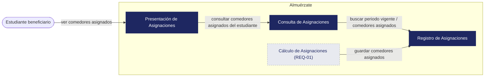
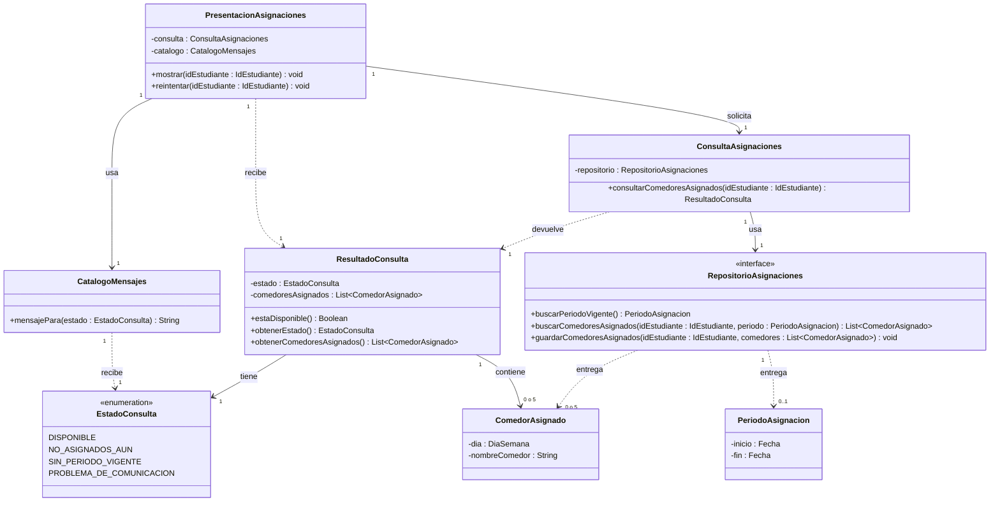

# Almuérzate — Architectural & Detailed Design v1.0

| | |
|---|---|
| **Team** | Almuérzate |
| **Members** | @amadodev07, @juanfpg1, @xedroc422, @alfredoquev, @julondono07 |
| **Status** | Draft |
| **Date** | 11-02-2026 |
| **Inputs** | `docs/requirements/REQ-10.md`, `docs/requirements/REQ-01.md`. |

> **Alcance:** este documento cubre REQ-10 (mostrar asignaciones de comedores), que se alimenta únicamente de REQ-01.

---


## 1. System Overview & Design Drivers
 
**System purpose**
> Que cada estudiante beneficiario conozca a qué comedor debe ir cada día de la semana, mostrándole los comedores asignados que el sistema ya calculó. Cuando no se pueden mostrar, el estudiante debe saber por qué (aún no asignados, sin periodo de asignación vigente o problema de comunicación).
 
| Requirement / Use Case ID | Why it shapes the structure | Quality attribute, constraint or business rule involved |
|---|---|---|
| REQ-10 / UC-01 Ver comedores asignados | El flujo tiene cuatro resultados distintos (la asignación existe y está disponible, no se han realizado asignaciones aún, no hay un periodo de asignación vigente, no se pudo obtener los comedores asignados) que deben distinguirse y comunicarse al estudiante | Riesgo de REQ-10: error de acceso a los datos (probabilidad Low, impacto High). Restricción: el periodo vigente cubre solo la semana en curso. <br> Criterios AC-03 y AC-04 |
| REQ-01 Asignación diaria de comedores durante el semestre | Produce y persiste los comedores asignados (uno por cada día, de lunes a viernes, igual para todas las semanas del semestre). REQ-10 solo los lee y los muestra | Restricción: solo estudiantes beneficiarios reciben asignación. <br> Dependencia declarada de REQ-10.  <br> BR-01 y BR-02 (asignaciones solo durante el semestre académico).|
 
---
 
## 2. Architectural Design
 
### 2.1 System Context & Boundary
 
| Outside the system | Type (actor / external system / hardware) | How the system interacts with it |
|---|---|---|
| Estudiante beneficiario | Actor | Consulta sus comedores asignados de la semana y recibe los comedores asignados o el mensaje que corresponde |
 
### 2.2 Components, Responsibilities & Capabilities
 

 
> *Cálculo de Asignaciones* se muestra solo como productor de los registros que REQ-10 consume. Su diseño interno y sus datos de entrada (horario de clases, capacidad de cada comedor, estudiantes beneficiarios) pertenecen a REQ-01 y no se detallan aquí.
 
| Component | Main responsibility | Requirements / use cases supported | Provided capabilities | Required capabilities | Main dependencies |
|---|---|---|---|---|---|
| Presentación de Asignaciones | Muestra al estudiante el nombre de cada comedor asignado con su día, o el mensaje que corresponde cuando no se puede mostrar (incluida la falta de respuesta de Consulta), y permite reintentar | REQ-10 / UC-01 | Ver comedores asignados; reintentar consulta | Consultar comedores asignados del estudiante | Consulta de Asignaciones |
| Consulta de Asignaciones | Decide qué debe ver el estudiante: sus comedores asignados o la razón por la que no están disponibles | REQ-10 / UC-01 | Consultar comedores asignados del estudiante | Buscar periodo vigente; buscar comedores asignados | Registro de Asignaciones |
| Registro de Asignaciones | Persiste y entrega los comedores asignados y el periodo de asignación vigente | REQ-01, REQ-10 | Buscar periodo vigente; buscar comedores asignados; guardar comedores asignados | Ninguna | Ninguna |
| Cálculo de Asignaciones | Calcula y asigna a cada estudiante beneficiario un comedor por día de la semana | REQ-01 | Asignar comedor por día a cada estudiante beneficiario | Guardar comedores asignados | Registro de Asignaciones |
 
---
 
## 3. Detailed Design
 
### 3.1 Components selected (at least two)
 
| Component | Why it was selected (risk, complexity, centrality to the drivers) |
|---|---|
| Consulta de Asignaciones | Es el componente central de REQ-10: resuelve los resultados del flujo de UC-01, aplica BR-02 (periodo vigente) y contiene el riesgo de error de acceso a los datos |
| Presentación de Asignaciones | Es lo único que ve el estudiante: debe mostrar los comedores asignados (AC-03), el aviso de falta de periodo (AC-04), el aviso de "aún no asignados" y el problema de comunicación con petición de reintentar |
 
### 3.2 Class Diagram(s)



> No se usa composición ni generalización: `ComedorAsignado` existe en el registro independientemente del resultado de una consulta, y nada en este diseño es un tipo especializado de otra cosa. `ResultadoConsulta` contiene 5 comedores asignados (uno por cada día, de lunes a viernes, REQ-01) cuando el estado es `DISPONIBLE`, y ninguno en otro caso: el estudiante tiene un comedor asignado cada día aunque no asista ese día. El periodo es `0..1` porque puede no existir un periodo vigente.
>
> El diseño fija solo la representación **lógica** del horario de comedores de un estudiante (lista de día y nombre de comedor). La representación visual sigue siendo la Open Question de REQ-10.
 
### 3.3 Class Responsibilities
 
| Class | Component it belongs to | Responsibility | Key collaborators |
|---|---|---|---|
| PresentacionAsignaciones | Presentación de Asignaciones | Muestra, sin transformarlos, el nombre de cada comedor asignado con su día cuando el estado es `DISPONIBLE`; en otro caso muestra el mensaje del estado. Si `ConsultaAsignaciones` no responde, aplica `PROBLEMA_DE_COMUNICACION`. Permite reintentar | ConsultaAsignaciones, CatalogoMensajes, ResultadoConsulta |
| CatalogoMensajes | Presentación de Asignaciones | Entrega el texto de cada estado no disponible: `NO_ASIGNADOS_AUN` (aún no se ha brindado el subsidio alimentario), `SIN_PERIODO_VIGENTE` (actualmente no se están realizando asignaciones de comedores) y `PROBLEMA_DE_COMUNICACION` (hubo un problema de comunicación y se pide reintentar). `DISPONIBLE` no tiene mensaje | EstadoConsulta |
| ConsultaAsignaciones | Consulta de Asignaciones | Busca el periodo vigente y los comedores asignados del estudiante y decide el estado de la consulta | RepositorioAsignaciones, ResultadoConsulta |
| ResultadoConsulta | Consulta de Asignaciones | Lleva el estado de la consulta y, si está disponible, los comedores asignados | EstadoConsulta, ComedorAsignado |
| EstadoConsulta | Consulta de Asignaciones | Enumera los resultados del flujo de UC-01: `DISPONIBLE` (la asignación existe y está disponible), `NO_ASIGNADOS_AUN` (no se han realizado asignaciones aún), `SIN_PERIODO_VIGENTE` (no hay un periodo de asignación vigente) y `PROBLEMA_DE_COMUNICACION` (no se pudo obtener los comedores asignados) | Ninguno |
| RepositorioAsignaciones | Registro de Asignaciones | Contrato para guardar y recuperar comedores asignados y periodo vigente (el almacenamiento queda oculto) | PeriodoAsignacion, ComedorAsignado |
| PeriodoAsignacion | Registro de Asignaciones | Representa el intervalo cubierto por el periodo de asignación vigente | Ninguno |
| ComedorAsignado | Registro de Asignaciones | Representa el comedor asignado a un estudiante para un día de la semana | Ninguno |
 
### 3.4 Behavior of one key operation
 
```text
consultarComedoresAsignados(idEstudiante):
    INTENTAR:                                                    // "El sistema busca los comedores asignados"
        periodo = repositorio.buscarPeriodoVigente()
        SI no hay periodo vigente:
            RETORNAR ResultadoConsulta(SIN_PERIODO_VIGENTE)      // AC-04
        comedores = repositorio.buscarComedoresAsignados(idEstudiante, periodo)
    SI EL ACCESO A LOS DATOS FALLA:
        RETORNAR ResultadoConsulta(PROBLEMA_DE_COMUNICACION)     // flujo de excepción
    SI comedores está vacío:
        RETORNAR ResultadoConsulta(NO_ASIGNADOS_AUN)             // flujo alternativo
    RETORNAR ResultadoConsulta(DISPONIBLE, comedores)            // AC-03
```
 
> El flujo de UC-01 no define cuál rama prevalece si no hay periodo vigente y tampoco hay asignaciones. Se evalúa primero el periodo porque AC-04 no depende de que existan asignaciones.
 
---
 
## 4. Design Quality — Cohesion, Coupling, Information Hiding
 
| Question | Your answer, with evidence from your design |
|---|---|
| **Cohesion:** do the responsibilities inside each class or component belong together? | `ConsultaAsignaciones` solo decide el estado; el texto de cada mensaje vive en `CatalogoMensajes`; `PresentacionAsignaciones` solo muestra y reintenta; `ComedorAsignado` solo guarda día y comedor. |
| **Coupling:** how far does a change in one element spread? Where are the strongest dependencies? | La dependencia más fuerte es `ConsultaAsignaciones` → `RepositorioAsignaciones`. Un cambio en el almacenamiento llega solo a Registro de Asignaciones. `PresentacionAsignaciones` depende únicamente de `ResultadoConsulta` y `EstadoConsulta`. Agregar un estado nuevo toca tres clases (`EstadoConsulta`, `ConsultaAsignaciones`, `CatalogoMensajes`). |
| **Information hiding:** what did you keep private or internal, and why? | El almacenamiento y el origen de los fallos de acceso quedan detrás de `RepositorioAsignaciones` y `ConsultaAsignaciones`; la presentación solo ve un estado. El intervalo del periodo vigente lo provee `RepositorioAsignaciones` y lo usa `ConsultaAsignaciones`. |
 
**At least one real finding** (a problem you found in your own design) **and what you changed or would change:**
> 1. `PROBLEMA_DE_COMUNICACION` solo lo producía `ConsultaAsignaciones` cuando fallaba el registro, pero el riesgo de REQ-10 (error de acceso a los datos) también ocurre si la propia consulta no responde. Se decidió: `PresentacionAsignaciones` trate la falta de respuesta de Consulta como ese mismo estado y toma el mensaje de `CatalogoMensajes`.
> 2. El riesgo de REQ-10 menciona un reintento periódico, pero el flujo de excepción corregido solo pide al estudiante reintentar. El diseño sigue el flujo de excepción: `reintentar()` lo dispara el estudiante. Pendiente: alinear la mitigación del riesgo en REQ-10 (no requiere cambios en el diseño).
> 3. `RepositorioAsignaciones.buscarPeriodoVigente()` pone en Registro de Asignaciones un dato (el periodo vigente) cuya fuente no está definida en REQ-01 ni en REQ-10. Si proviene de otra fuente, se separa en su propio contrato; el costo es bajo porque solo `ConsultaAsignaciones` lo usa.
 
---
 
## 5. Design Decisions & Decision Record
 
### Decision A — Architectural
 
| | |
|---|---|
| **Context** | REQ-10 tiene cuatro resultados distintos y un riesgo de error de acceso a los datos (impacto High). El estudiante usa un frontend web y los datos le llegan ya procesados (ADR-0002, ADR-0005). |
| **Decision** | Presentación de Asignaciones nunca accede a Registro de Asignaciones. Toda consulta pasa por Consulta de Asignaciones, que es el único componente que decide el resultado y conoce el acceso a los datos. |
| **Rationale** | Los resultados del flujo y el fallo de acceso a los datos se resuelven en un solo lugar; a la presentación solo le queda tratar la falta de respuesta de Consulta como `PROBLEMA_DE_COMUNICACION` (AC-03, AC-04 y los flujos alternativo y de excepción de UC-01). |
| **Trade-off accepted** | Un componente y un salto adicionales para una función de solo lectura, con algo más de latencia, y un estado (`PROBLEMA_DE_COMUNICACION`) que puede originarse en dos puntos. Se descartó que la presentación consultara el registro directamente porque cada resultado y cada fallo tendrían que manejarse en la interfaz. |
 
### Decision B — Detailed design
 
| | |
|---|---|
| **Context** | El flujo de excepción de REQ-10 pasó de mostrar un código de error HTTP a informar un problema de comunicación y pedir reintentar. Hay tres mensajes distintos para los casos no disponibles. |
| **Decision** | `ConsultaAsignaciones` devuelve siempre un `ResultadoConsulta` con un `EstadoConsulta`: nunca textos ni errores que se propaguen. El texto de cada mensaje vive solo en `CatalogoMensajes`. |
| **Rationale** | Un cambio de redacción, como el de la corrección de REQ-10, afecta una sola clase, y `ConsultaAsignaciones` se puede verificar contra AC-03 y AC-04 sin depender de textos. |
| **Trade-off accepted** | Todo estado nuevo exige actualizar tres clases, y si `CatalogoMensajes` olvida un estado, el estudiante no recibe mensaje alguno. |
 
### ADR
 
**ADR file:** `docs/adr/0006-consulta-de-asignaciones-unico-punto-de-acceso.md` — records Decision A.
 
---
 
## 6. Traceability
 
| Requirement ID | Use Case | Component(s) | Class(es) |
|---|---|---|---|
| REQ-10 | UC-01 Ver comedores asignados | Presentación de Asignaciones, Consulta de Asignaciones, Registro de Asignaciones | PresentacionAsignaciones, CatalogoMensajes, ConsultaAsignaciones, ResultadoConsulta, EstadoConsulta, RepositorioAsignaciones, PeriodoAsignacion, ComedorAsignado |
| REQ-01 | N/A: proceso interno sin caso de uso (REQ-01, sección 4.3) | Cálculo de Asignaciones, Registro de Asignaciones | RepositorioAsignaciones (`guardarComedoresAsignados`), ComedorAsignado. Las clases internas de Cálculo de Asignaciones se diseñan con REQ-01 |

---

## 7. Optional — AI-Assisted Design Reflection

Se usó una IA para revisar este borrador contra ai_context_design.md y ai_context_adrs.md.
Estas son las recomendaciones recibidas y lo que hizo el equipo con cada una.

| Recomendación de la IA |	Decisión del equipo |	Motivo |
| ADR-0006: dejar una sola decisión (toda consulta pasa por Consulta de Asignaciones y Presentación no accede a Registro de Asignaciones) y mover la regla de falta de respuesta a Consecuencias |	Modificada: se aceptó la estructura y el equipo ajustó la redacción de la Decisión |	Pendiente |
| Diagrama de componentes: ampliar el rótulo a "ver comedores asignados / reintentar consulta" y agregar una nota sobre el ADR-0002 |	Pendiente |	Pendiente |
| Diagrama de clases: agregar multiplicidad a todas las asociaciones continuas y accesores a PeriodoAsignacion y ComedorAsignado |	Pendiente	| Pendiente
| Documento: corregir la fecha, marcar los Inputs faltantes como Pendiente, reformular el hallazgo 1 y dejar como brecha la rama que prevalece en 3.4	| Pendiente	| Pendiente |
| Documento: señalar las brechas de identificación del estudiante, la precondición de UC-01, BR-01 frente a "semana en curso" y quién escribe el periodo vigente |	Pendiente |	Pendiente |
| Segunda revisión: comedores parciales, contrato de buscarPeriodoVigente(), dependencia faltante hacia EstadoConsulta y contradicciones en las secciones 4 y 5 |	Pendiente |	Pendiente |

---

## 8. Consistency Checklist

- [x] Every component in the diagram appears in the responsibilities table, and the other way around.
- [x] Every class belongs to an identifiable component.
- [x] Components are named by responsibility, not technology.
- [x] Nothing inside the system boundary is something you do not control.
- [x] Provided and required capabilities match across components (what one requires, another provides).
- [ ] Both decisions name a real cost or limitation, and at least one has an ADR. *(Ambas nombran su costo; el ADR-0006 está pendiente de redactar.)*
- [x] The traceability table has no empty rows and no orphan components or classes.
- [x] Diagrams render correctly on GitHub.
