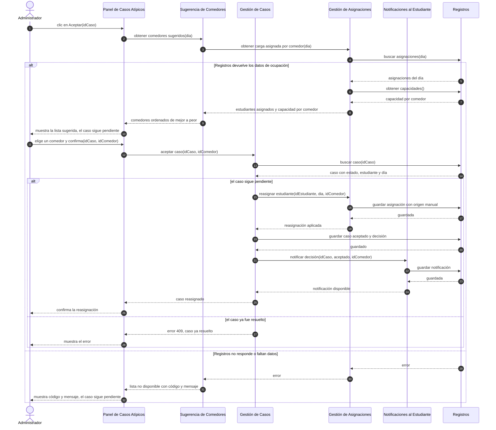
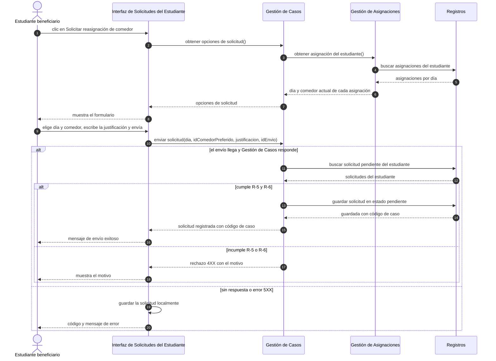
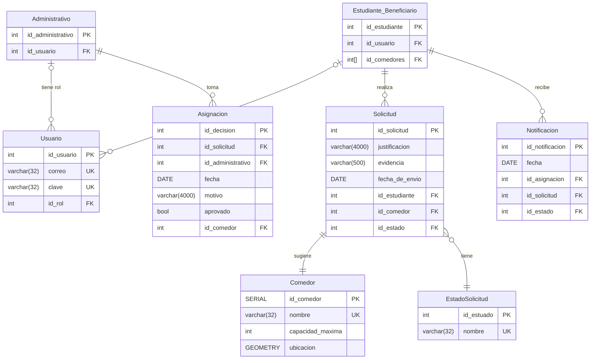

<!--
HOW TO USE THIS TEMPLATE
------------------------
1. Copy this file to docs/design/02_Interaction_and_Data_Design.md in your team repository.
2. This is v1.0 of work you started in Class 13 ("Interaction & Contracts Design v0.1").
   It builds on Deliverable 1 and must stay consistent with it. If making behavior and data
   concrete reveals a problem in Deliverable 1, update Deliverable 1 and say so in Section 4.
3. Use YOUR project. Generic examples are reference material only.
4. Sequence diagrams are derived from the Use Cases in your requirements. Do not invent
   business behavior. If something is not specified, mark it as an assumption or an Open Question.
5. If nothing in your system needs to persist, say so in Section 2.1 with your reasons. Do not
   invent a database.
6. Diagrams: Mermaid is preferred (renders on GitHub). PlantUML or another tool is accepted if
   the exported image is committed and embedded in this file.
   Optionally, also add a JPG of each diagram in docs/design/diagrams/ (the Markdown prevails if they differ).
7. Read Design_Deliverable_2_Example.md for the expected level of detail. Do not copy it.
-->

# Almuérzate — Interaction & Data Design v1.0

| | |
|---|---|
| **Team** | Equipo Almuérzate |
| **Members** | Brayan Santiago Amado Mejia, Diego Alejandro Gaviria Sabogal, Julian Camilo Londoño Zarate, Juan Felipe Pineda Gonzalez, Jose Alfredo Quevedo Suarez. |
| **Status** | Draft |
| **Date** | 2026-10-24 |
| **Inputs** | `docs/design/01_Architectural_and_Detailed_Design.md`, Casos de `docs/requirements/REQ-01-Sistema-de-manejo-de-casos-especiales.md`, Interaction & Contracts Design v0.1 (Class 13) |

---

## 1. Behavior — Selected Use Cases

Se seleccionan los casos UC-2 y UC-5. UC-2 representa nuestro caso base (capstone) de REQ-01 debido a que aquí es donde el sistema de casos especiales modifica la asignacion base de R1 ligado a la regla de dominio R-4, recorre 6 de 7 componentes con cambios de escrituras y sustenta 3 de las 4 filas de design drivers (Architectural & Detailed Design v1.0) y es Must Have en US-02, US-04.
Por otro lado UC-5 lo complementa, origina el caso, usa 'Interfaz de Solicitudes del Estudiante' (unico componente que no concierne UC-2) y además cubre el fallo de envio con guardado local AC-10.

### 1.1 UC-2 (Se acepta un caso pendiente) — from requirement REQ-01

| Use Case step or flow | Message(s) in the diagram | Information exchanged | Operation defined in (Deliverable 1) |
|---|---|---|---|
| Main flow, paso 1 | 1 | idCaso, tomado de la lista de UC-1 | Panel de Casos Atípicos: «Mostrar y resolver casos pendientes» (2.2) |
| Main flow, paso 2 | 2 a 9 | Va el día del caso. Vuelven estudiantes asignados y capacidad por comedor, y la lista ordenada de mejor a peor | Sugerencia de Comedores: «obtener comedores sugeridos». Gestión de Asignaciones: «obtener carga asignada por comedor». Registros: «buscar / guardar asignaciones» y «obtener capacidades» (2.2). Sin clase en 3.2 |
| Main flow, paso 3 | 10 | Lista sugerida. No se escribe nada: el caso sigue pendiente | Panel de Casos Atípicos (2.2) |
| Main flow, pasos 4 y 5 | 11 y 12 | idCaso e idComedor | «aceptar caso» (2.2) = ManejoSolicitudes.responderSolicitud(idSolicitud, decision, mensaje, idAdministrador) (3.2). Falta el comedor destino |
| Main flow, paso 6 (validar y reasignar) | 13 a 18 | Caso con estado, estudiante y día. Luego estudiante, día y comedor, y la asignación guardada con origen manual (R-4) | RepositorioSolicitudes.buscarPorId (3.2). «reasignar estudiante» (2.2), sin clase |
| Main flow, paso 6 (registrar y notificar) | 19 a 24 | Caso aceptado con la decisión (quién, cuándo, resultado, comedor; R-9). Luego idCaso, resultado y comedor | Solicitud.aprobar (se ejecuta dentro de Gestión de Casos antes del mensaje 19) y RepositorioSolicitudes.guardar (3.2). «notificar decisión» (2.2), sin clase |
| Main flow, paso 6 (respuesta) | 25 y 26 | Caso reasignado y confirmación al administrador | Resultado (3.2) |
| Alternative flow (propuesta, no está en UC-2) | 27 y 28 | Error 409, caso ya resuelto, que sube al administrador | Solicitud controla las transiciones válidas (3.3). Falta YA_RESUELTA en ErrorSolicitud |
| Exception (AC-07) | 29 a 32 | El error sube de Registros al administrador con código y mensaje | Sugerencia de Comedores «responde explícitamente que no pudo» (2.2). Resultado con error (Decision A) |

### 1.2 UC-5 (Se solicita reasignar un comedor) — from requirement REQ-01

| Use Case step or flow | Message(s) in the diagram | Information exchanged | Operation defined in (Deliverable 1) |
|---|---|---|---|
| Main flow, paso 1 | 1 | Clic del estudiante con sesión abierta. | Interfaz de Solicitudes del Estudiante: «Reportar un caso» (2.2) |
| Main flow, paso 2 | 2 a 8 | Se piden las opciones. Vuelven día y comedor actual de cada asignación, y se muestra el formulario. | «obtener opciones de solicitud», «obtener asignación del estudiante», «buscar / guardar asignaciones» (2.2). Sin clase en 3.2 |
| Main flow, paso 3 a 5 (captura) | 9 | Día, comedor preferido y justificación (R-5). | «Reportar un caso» (2.2) |
| Main flow, paso 5 (envio) | 10 | dia, idComedorPreferido, justificacion, idEnvio | «enviar solicitud» (2.2) = ManejoSolicitudes.realizarSolicitud(motivo, idEstudiante) (3.2). Faltan día, comedor e idEnvio |
| Main flow, poscondición | 11 a 16 | Solicitudes del estudiante. Solicitud en estado pendiente. Código del caso y mensaje de éxito. | RepositorioSolicitudes.buscarPorEstudiante y guardar (3.2), EstadoSolicitud |
| Alternative flow (propuesta, no está en UC-5) | 17 y 18 | 4XX con el motivo (R-5 o R-6) | Resultado con ErrorSolicitud (3.2). Faltan JUSTIFICACION_VACIA y YA_HAY_PENDIENTE |
| Exception (AC-10) | 19 y 20 | Solicitud completa con idEnvio, guardada en el cliente. Código y mensaje de error | No existe como capacidad de la interfaz en 2.2 (driver de la cola de sincronización) |

---

## 2. Data Design

### 2.1 Principal information the system needs

| Information | Needed by (use cases) | Persisted? | Why (or why not) |
|---|---|---|---|
| Usuario y clave de usuario | UC-1; UC-4 | Yes | Las credenciales de usuario deben persistir para poder realizar autenticación varias veces. |
| Estado y Justificación de solicitudes de reasignación | UC-1; UC-4; UC-5 | Yes | Una o varias solicitudes pueden ser consultadas varias veces en un periodo arbitrario de tiempo por un administrador o estudiante. Además, al crearse una solicitud, un administrador debe poder revisarla después. |
| Asignaciones de comedores | UC-2; UC-4 | Yes | Un usuario administrativo puede reasignar un comedor y el sistema luego notificará al estudiante; estas notificaciones deben ser guardadas en un historial |
| Capacidad y ubicación de comedores | UC-2 | Yes | Este dato no se puede inferir a partir de otros, está relacionado a los comedores y es utilizado al recomendar comedores |
| Distancia del comedor al estudiante | UC-2 | No | Este dato se calcula a partir de la capacidad del comedor y depende también del horario del estudiante. Al haber tantos escenarios posibles que resulten en distintas distancias, es necesario calcular este dato dinámicamente en vez de guardarlo en un registro |

*(Data owned by an external system, or recomputable on demand, is often better not persisted. If that is your decision, say so.)*

### 2.2 Data model
**Justificación del modelo de datos elegido:** Acorde a [ADR-0001](docs/adr/0001-Usar-postgresql-como-base-de-datos-principal.md), se acordó usar un tipo de almacenamiento relacional, además las relaciones son el centro del dominio (solicitudes enviadas por estudiantes y evaluadas por un administrativo). Por esto, conviene usar un diagrama ER.

### 2.3 Data Ownership

| Information | Authoritative owner (component responsible for maintaining it) | Consumed by (uses it without owning it) | Access through |
|---|---|---|---|
| **Casos Atípicos (Solicitudes, justificación, estado y decisiones)** | `Gestión de Casos` *(Nota: delega el almacenamiento físico a `Registros`)* | `Interfaz de Solicitudes del Estudiante`, `Panel de Casos Atípicos` | Métodos de clase (Sección 3.2): `ManejoSolicitudes.consultarSolicitudes()` `ManejoSolicitudes.responderSolicitud()` `ManejoSolicitudes.realizarSolicitud()` |
| **Asignaciones individuales vigentes** (incluye flag `origen: manual \| automatica` según R-4) | `Gestión de Asignaciones` *(Nota: delega el almacenamiento físico a `Registros`)* | `Gestión de Casos` | Capacidades de componente (Sección 2.2): `Asignación` `Administrativo` |
| **Carga asignada por comedor** (métrica calculada de estudiantes por día) | `Gestión de Asignaciones` | `Sugerencia de Comedores` | Capacidad de componente (Sección 2.2): Derivada de `Asignacion` agrupada por `id_comedor` y día; no es una tabla.|
| **Capacidades máximas estáticas de los comedores** | `Registros` (Datos de configuración administrativa) | `Gestión de Asignaciones` | Capacidad de componente (Sección 2.2): `Comedor` |
| **Historial de Notificaciones** (Estado de visualización pull in-app, L9) | `Notificaciones al Estudiante` (Lee la decisión maestra desde `Registros`) | `Interfaz de Solicitudes del Estudiante` | Capacidad de componente (Sección 2.2): `Notificacion`|
| **Borradores y solicitudes locales encoladas** (Offline / AC-10) | `Interfaz de Solicitudes del Estudiante` / `Panel de Casos Atípicos` | Ninguno (uso interno del cliente) | Almacenamiento local de la PWA (`LocalStorage` / `IndexedDB`) |
| **Cuentas, Usuarios y Roles** | Sistema de usuarios de la universidad (Externo) | `Interfaz de Solicitudes del Estudiante`, `Panel de Casos Atípicos` | API externa (simulada) de verificación |

## 2.4 Business rules and invariants enforced in data

| Business rule or invariant | Where it is enforced (component logic / data constraint / both) | How |
|---|---|---|
| **R-6: Un estudiante puede tener una sola solicitud pendiente a la vez** | Ambos | **Logica:** `Gestión de Casos` verifica la existencia de solicitudes pendientes antes de crear una nueva.  **Data constraint:** Índice único parcial en la base de datos sobre `(id_estudiante)` donde el `estado = 'PENDIENTE'`. |
| **R-5: Toda solicitud debe incluir una justificación escrita** | Ambos | **Logica:** `ManejoSolicitudes.realizarSolicitud()` rechaza cadenas vacías o compuestas solo de espacios. **Data constraint:** La columna `justificacion` tiene una restricción `NOT NULL` y un `CHECK (length(trim(justificacion)) > 0)`. |
| **R-4: Un cambio aprobado es permanente y sobrevive al recálculo** | Ambos | **Logica:** El script de recálculo (Entrega 2) excluye o salta los registros marcados como manuales. **Data constraint:** La entidad de asignación tiene el atributo obligatorio `origen` con valores permitidos `(AUTOMATICA, MANUAL)`. `Gestión de Asignaciones` fija este valor en `MANUAL` al reasignar. |
| **R-9: Cada decisión queda registrada (quién, cuándo, resultado y motivo)** | Data constraint | La tabla/documento de resolución de la solicitud exige restricciones `NOT NULL` para `id_administrador`, `fecha_decision`, y `resultado`. Si el resultado es `RECHAZADO`, la columna `motivo_rechazo` debe ser obligatoria mediante un constraint condicional (`CHECK`). |
| **AC-10: Idempotencia en el envío de solicitudes frente a fallos de red** | Ambos | **Logica:** El cliente genera un UUID `idEnvio` antes de intentar la petición. Si falla y reintenta, envía el mismo ID. **Data constraint:** La columna `id_envio` en la tabla de solicitudes tiene una restricción `UNIQUE`. Un reintento duplicado genera un error de conflicto (409) manejado sin crear registros extra. |
| **R-8 (propuesta): El administrador debe justificar explícitamente si la asignación supera el aforo operativo** | Component logic (supuesto, ver Q3) | Se asume que `Sugerencia de Comedores` usa la carga asignada por comedor que obtiene de `Gestión de Asignaciones` (mensaje 3 de UC-2) para marcar los comedores que superarían el aforo operativo. El umbral está por confirmar: R-3 y las AI rules indican 80 %, y el texto de R-8 en REQ-01 indica 85 % (Q3). La captura de la justificación escrita no está modelada en UC-2 y queda como pregunta abierta (Q3). No se fuerza en DB para permitir la contingencia administrativa. |
---

## 3. Interface Contract

**Interaction chosen** (del diagrama 1.1, mensaje `aceptarCaso` de *Panel de Casos Atípicos* a *Gestión de Casos*): flujo principal de UC-2, "Se acepta un caso pendiente". Cuando la operación se ejecuta correctamente, el caso queda aceptado.
> El administrador acepta un caso pendiente y asigna al estudiante el comedor elegido.

| Element | Specification |
|---|---|
| **Operation and purpose** | `aceptarCaso(idCaso, idComedor)`: recibe el identificador del caso y el del comedor al que se cambiará al estudiante. Reasigna el comedor del estudiante beneficiario, guarda la decisión en `Registros` (R-9) y deja la notificación disponible para el estudiante dentro de la PWA (R-10). |
| **Input** | `idCaso`: identificador no vacío de un caso existente.   `idComedor`: identificador no vacío de un comedor existente. |
| **Output** | **Éxito:** confirmación de la resolución del caso (`Caso reasignado`).   **Error:** mensaje descriptivo según el tipo de fallo, por ejemplo `409: caso ya resuelto` cuando la solicitud ya fue aprobada o rechazada. |
| **Preconditions** | - El llamante es un usuario con rol de **administrador**.   - Se indican `idCaso` e `idComedor`.   - El caso existe y está en estado **pendiente**. |
| **Postconditions** | **Caso favorable:** el caso queda como aceptado, la asignación manual del estudiante apunta al nuevo comedor, la decisión queda registrada (quién, cuándo, resultado) y la notificación queda disponible para el estudiante en la aplicación.   **Caso no favorable:** no se modifica ninguna asignación ni el estado del caso, y se devuelve un mensaje de error que explica lo ocurrido. |
| **Failure outcomes** (flujos alternos de UC-2) | 1. **Parámetros erróneos:** faltan, están vacíos o no existen en la base de datos. Se devuelve un mensaje indicándolo.   2. **Solicitud ya revisada:** el caso ya fue resuelto. Se detiene la ejecución y se informa al administrador (`409`).   3. **Excepción inesperada:** falla durante la ejecución. Se devuelve un mensaje indicativo junto con la sugerencia de reintentar. |
| **Invariants and side effects**  | **Invariantes:** los identificadores del caso y del comedor no cambian; una asignación manual aprobada no es sobrescrita por el recálculo automático (R-4).   **Efectos secundarios:** cambia el comedor asignado al estudiante y el estado del caso, y se crean un registro de la decisión y una notificación. |

| Case | Before | Request | Expected |
|---|---|---|---|
| Datos correctos | Caso pendiente existente; comedor existente | `aceptarCaso(idCaso, idComedor)` | `Caso reasignado`; asignación del estudiante actualizada al nuevo comedor, decisión registrada y notificación disponible |
| Datos no identificados | `idCaso` o `idComedor` no existen en los registros | `aceptarCaso(idCaso, idComedor)` | Error: `datos no concordantes` |
| Datos incompletos | `idCaso` o `idComedor` no definidos | `aceptarCaso(idCaso, -)` o `aceptarCaso(-, idComedor)` o `aceptarCaso(-, -)`| Error: `algún dato no fue definido` |
| Caso ya resuelto | El caso ya fue aceptado o rechazado | `aceptarCaso(idCaso, idComedor)` | Error `409`: `caso ya resuelto`; sin cambios en la asignación |
| Excepción / Timeout | El servicio no responde o falla durante la ejecución | `aceptarCaso(idCaso, idComedor)` | Error: `no se pudo ejecutar la operación, intente de nuevo` |

---

## 4. Cross-Consistency & Changes to Deliverable 1

| Check | Result |
|---|---|
| Every participant in a sequence diagram is an actor, a component, a class or an external system from Deliverable 1 | Sí. Los participantes de los diagramas 1.1 y 1.2 hacen parte de la arquitectura definida en el Deliverable 1. |
| Every message corresponds to a capability, operation or contract | Sí. Los mensajes se agrupan por responsabilidad: `Panel de Casos Atípicos` recibe las acciones de los administradores y usuarios; `Gestión de Casos` y `Gestión de Asignaciones` se encargan principalmente (aunque no exclusivamente) de las operaciones internas del sistema; y `Registros` se encarga del almacenamiento de la información. |
| Every entity or document type is reflected in the class diagrams, or the reason it is not is stated | Los usuarios (`Estudiante beneficiario` y `Administrador`) participan directamente en el flujo. Las asignaciones y las solicitudes (con sus estados) se manejan en el flujo general de `Gestión de Casos` y `Gestión de Asignaciones`. Los comedores se manejan de forma indirecta, ya que estos requerimientos solo asignan un comedor al estudiante y no modifican sus datos. |
| Every persisted information element has exactly one authoritative owner | Sí (ver tabla 2.2). |
| The contract agrees with the sequence diagram and with the data model (same behavior in all three views) | Sí. El contrato considera todas las alternativas del diagrama 1.1 y respeta las restricciones del modelo de datos de 2.1. |

**Changes made to Deliverable 1 because of this deliverable** *(real designs change when behavior and data become concrete. List what you updated, or write "None" and why.)*
> Se añadió el análisis de comedores por parte del administrador, junto con la información de cada comedor, como apoyo para la toma de decisiones al aceptar o rechazar un caso.

---

## 5. Open Questions

> Anything unresolved about behavior or data. List it here instead of guessing.

| # | Pregunta | Dónde afecta | Supuesto mientras tanto |
|---|---|---|---|
| Q1 | ¿La reasignación aplica solo al día de la solicitud o a todo el semestre? (REQ-01, P1: UC-5 pide un día, R-4 dice permanente) | UC-5 (formulario con día), UC-2 (mensaje 15, `reasignar(dia)`), entidad de asignación | Aplica solo a ese día, y R-4 hace permanente ese cambio durante el semestre |
| Q2 | ¿Reasignar, guardar el caso y notificar (mensajes 15 a 24 de UC-2) van en una sola transacción? Si falla uno en medio, el estudiante puede quedar reasignado con el caso aún pendiente | UC-2, sección 2.4 | Sin definir; el diagrama no dibuja fallos en esos pasos |
| Q3 | ¿Cuál es el umbral de R-8 y dónde se aplica? REQ-01 dice 85 % en R-8, pero R-3, la sección 2.4 y las AI rules dicen 80 % (REQ-01, P6). Además, UC-2 no tiene un paso donde el administrador escriba la justificación al superarlo | UC-2 (mensajes 10 a 12), sección 2.4 (R-8) | 80 % del aforo, con Sugerencia de Comedores solo marcando el exceso. La captura de la justificación queda fuera del diagrama |
| Q4 | ¿Cómo se calcula el estimado de ocupación? (REQ-01, P3) | UC-2 (mensajes 2 a 9) | Estudiantes asignados frente a capacidad, sin datos reales de ocupación (L7) |
| Q5 | ¿Qué mensajes pasan por la API en C++ y con qué formato y códigos de error? (REQ-01, P8, falta el ADR nuevo) | Códigos 409, 4XX y 5XX de ambos diagramas, y el contrato de la sección 3 | Los códigos son propuestos hasta que exista el ADR |
| Q6 | ¿Se agregan a REQ-01 los flujos "caso ya resuelto" (409) en UC-2 y "incumple R-5 o R-6" (4XX) en UC-5? Además, las reglas R-5 a R-10 no están validadas (REQ-01, P4), incluido el plazo de 3 días de R-7, que ningún diagrama modela | UC-2 (mensajes 27 y 28), UC-5 (mensajes 17 y 18) | Se mantienen como propuesta, marcados así en las tablas |
| Q7 | Tras un fallo de envío (AC-10), ¿quién reintenta, cuándo y cuánto tiempo se conserva la solicitud guardada? REQ-01 solo dice que se guarda localmente | UC-5 (mensajes 19 y 20) | El cliente genera `idEnvio` una vez; el reenvío no se dibuja |
| Q8 | ¿Dónde se guarda la evidencia adjunta y con qué límites? (REQ-01, P5, R-5 la deja opcional) | UC-5, modelo de datos (2.2) | Fuera de este deliverable: ni UC-5 ni el modelo la incluyen |

---

## 6. Optional — AI-Assisted Design Reflection

>Rejected porque ya hay una verficacion previa en los registros de informacion. Se considera que hay un error de time out por ende se implementaria un verificacion de ejecucion correcta al final.

> Una IA nos recomendó decidir que reasignar al estudiante, guardar el caso y notificar (mensajes 15 a 24 de UC-2) se ejecuten en una sola transacción, porque si falla un paso intermedio el estudiante queda reasignado con el caso todavía pendiente. La aceptamos solo en parte: reconocemos el riesgo, pero no tomamos la decisión. Ni REQ-01 ni un ADR definen cómo se manejan las transacciones ni qué pasa por la API en C++, y fijarlo ahora sería inventar comportamiento. Lo dejamos como pregunta abierta (Q2) y el diagrama no dibuja ese fallo.

---

## 7. Consistency Checklist

- [x] Two use cases from the project, each traceable to a Use Case written in the requirements. *(UC-2 y UC-5)*
- [x] Each sequence diagram shows the main flow and at least one alternative or exception flow. *(UC-2: caso ya resuelto y AC-07. UC-5: R-5/R-6 y AC-10)*
- [x] No business behavior is invented: anything unspecified is marked as an assumption or Open Question. *(Q1 a Q8)*
- [ ] Section 2.1 explains what is NOT persisted as well as what is. *(pendiente: sección sin llenar)*
- [ ] The data model has identifiers, relationships and constraints, not only boxes. *(pendiente: 2.2 sin llenar)*
- [x] Every piece of principal information has one authoritative owner, and consumers are listed (Section 2.3). *(corregido: "Borradores y solicitudes locales" queda solo con la interfaz del estudiante)*
- [ ] The contract defines input, output, preconditions, postconditions and failure outcomes. *(pendiente: sección 3 sin llenar)*
- [ ] Sequence, data model and contract describe the same behavior. *(pendiente hasta cerrar 2.2 y 3)*
- [ ] Diagrams render correctly on GitHub (or the exported images are embedded). *(pendiente de verificar)*