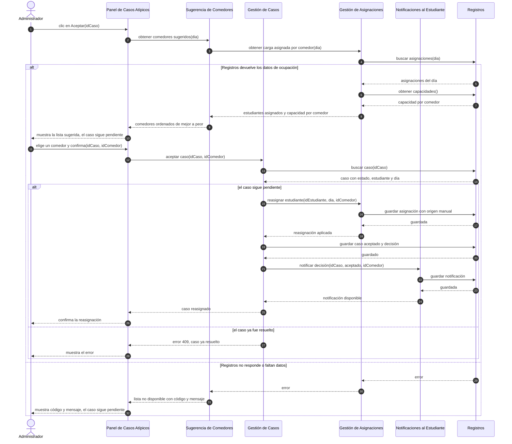
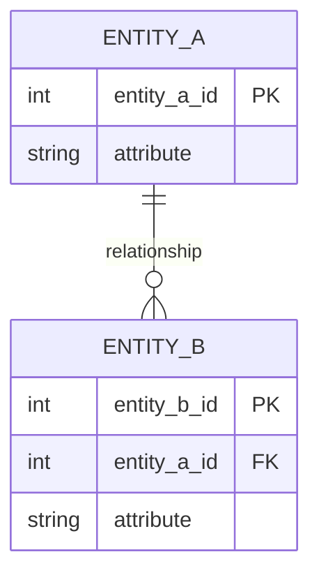

<!--
HOW TO USE THIS TEMPLATE
------------------------
1. Copy this file to docs/design/02_Interaction_and_Data_Design.md in your team repository.
2. This is v1.0 of work you started in Class 13 ("Interaction & Contracts Design v0.1").
   It builds on Deliverable 1 and must stay consistent with it. If making behavior and data
   concrete reveals a problem in Deliverable 1, update Deliverable 1 and say so in Section 4.
3. Use YOUR project. Generic examples are reference material only.
4. Sequence diagrams are derived from the Use Cases in your requirements. Do not invent
   business behavior. If something is not specified, mark it as an assumption or an Open Question.
5. If nothing in your system needs to persist, say so in Section 2.1 with your reasons. Do not
   invent a database.
6. Diagrams: Mermaid is preferred (renders on GitHub). PlantUML or another tool is accepted if
   the exported image is committed and embedded in this file.
   Optionally, also add a JPG of each diagram in docs/design/diagrams/ (the Markdown prevails if they differ).
7. Read Design_Deliverable_2_Example.md for the expected level of detail. Do not copy it.
-->

# Almuérzate — Interaction & Data Design v1.0

| | |
|---|---|
| **Team** | Equipo Almuérzate |
| **Members** | Brayan Santiago Amado Mejia, Diego Alejandro Gaviria Sabogal, Julian Camilo Londoño Zarate, Juan Felipe Pineda Gonzalez, Jose Alfredo Quevedo Suarez. |
| **Status** | Draft |
| **Date** | 2026-10-24 |
| **Inputs** | `docs/design/01_Architectural_and_Detailed_Design.md`, Casos de `docs/requirements/REQ-01-Sistema-de-manejo-de-casos-especiales.md`, Interaction & Contracts Design v0.1 (Class 13) |

---

## 1. Behavior — Selected Use Cases

Se seleccionan los casos UC-2 y UC-5. UC-2 representa nuestro caso base (capstone) de REQ-01 debido a que aquí es donde el sistema de casos especiales modifica la asignacion base de R1 ligado a la regla de dominio R-4, recorre 6 de 7 componentes con cambios de escrituras y sustenta 3 de las 4 filas de design drivers (Architectural & Detailed Design v1.0) y es Must Have en US-02, US-04.
Por otro lado UC-5 lo complementa, origina el caso, usa 'Interfaz de Solicitudes del Estudiante' (unico componente que no concierne UC-2) y además cubre el fallo de envio con guardado local AC-10.

### 1.1 UC-2 (Se acepta un caso pendiente) — from requirement REQ-01



| Use Case step or flow | Message(s) in the diagram | Information exchanged | Operation defined in (Deliverable 1) |
|---|---|---|---|
| Main flow, paso 1 | 1 | idCaso, tomado de la lista de UC-1 | Panel de Casos Atípicos: «Mostrar y resolver casos pendientes» (2.2) |
| Main flow, paso 2 | 2 a 9 | Va el día del caso. Vuelven estudiantes asignados y capacidad por comedor, y la lista ordenada de mejor a peor | Sugerencia de Comedores: «obtener comedores sugeridos». Gestión de Asignaciones: «obtener carga asignada por comedor». Registros: «buscar / guardar asignaciones» y «obtener capacidades» (2.2). Sin clase en 3.2 |
| Main flow, paso 3 | 10 | Lista sugerida. No se escribe nada: el caso sigue pendiente | Panel de Casos Atípicos (2.2) |
| Main flow, pasos 4 y 5 | 11 y 12 | idCaso e idComedor | «aceptar caso» (2.2) = ManejoSolicitudes.responderSolicitud(idSolicitud, decision, mensaje, idAdministrador) (3.2). Falta el comedor destino |
| Main flow, paso 6 (validar y reasignar) | 13 a 18 | Caso con estado, estudiante y día. Luego estudiante, día y comedor, y la asignación guardada con origen manual (R-4) | RepositorioSolicitudes.buscarPorId (3.2). «reasignar estudiante» (2.2), sin clase |
| Main flow, paso 6 (registrar y notificar) | 19 a 24 | Caso aceptado con la decisión (quién, cuándo, resultado, comedor; R-9). Luego idCaso, resultado y comedor | Solicitud.aprobar (se ejecuta dentro de Gestión de Casos antes del mensaje 19) y RepositorioSolicitudes.guardar (3.2). «notificar decisión» (2.2), sin clase |
| Main flow, paso 6 (respuesta) | 25 y 26 | Caso reasignado y confirmación al administrador | Resultado (3.2) |
| Alternative flow (propuesta, no está en UC-2) | 25 y 26 | Caso reasignado y confirmación al administrador | Solicitud controla las transiciones válidas (3.3). Falta YA_RESUELTA en ErrorSolicitud |
| Exception (AC-07) | 29 a 32 | El error sube de Registros al administrador con código y mensaje | Sugerencia de Comedores «responde explícitamente que no pudo» (2.2). Resultado con error (Decision A) |


### 1.2 UC-5 (Se solicita reasignar un comedor) — from requirement REQ-01

*(Same structure as 1.1.)*

---

## 2. Data Design

### 2.1 Principal information the system needs

| Information | Needed by (use cases) | Persisted? | Why (or why not) |
|---|---|---|---|
| | | Yes / No | |

*(Data owned by an external system, or recomputable on demand, is often better not persisted. If that is your decision, say so.)*

### 2.2 Data model

Choose the representation that fits your persistence approach and **justify it in one or two sentences**:
>

**Option A — Relational:** an Entity-Relationship diagram with entities, relevant attributes, primary identifiers, relationships, cardinalities and constraints.



*(Cardinality: `||` exactly one, `o|` zero or one, `}o` zero or many, `}|` one or many.)*

**Option B — Document-oriented:** collections or document types, structure, identifiers, embedded structures, references and constraints.

```json
{
  "collection_name": {
    "id": "identifier",
    "embedded_structure": [ { "field": "value" } ],
    "reference_to_other_collection": "identifier"
  }
}
```

**Other representation:** allowed if you justify why it suits your project. The goal is not to force a relational or document database. The goal is to design the information the software needs.

| Entity / document type | Meaning in the system | Identifier | Constraints (required, unique, allowed values) |
|---|---|---|---|
| | | | |

### 2.3 Data Ownership

| Information | Authoritative owner (component responsible for maintaining it) | Consumed by (uses it without owning it) | Access through |
|---|---|---|---|
| | | | |

*(Do not assume every component needs its own database. Sharing information does not mean sharing ownership. No component reads or writes another component's data directly.)*

### 2.4 Business rules and invariants enforced in data

| Business rule or invariant | Where it is enforced (component logic / data constraint / both) | How |
|---|---|---|
| | | |

---

## 3. Interface Contract

Select **one** important interaction from your sequence diagrams and specify the agreement between the two components. Technology (REST, JSON, OpenAPI) is not required.

**Interaction chosen** (from diagram 1.X, message `...`):
>

| Element | Specification |
|---|---|
| **Operation and purpose** | |
| **Input** (parameters and types) | |
| **Output** (successful result and data structure) | |
| **Preconditions** (what the caller must satisfy before invoking) | |
| **Postconditions** (what is guaranteed on successful completion) | |
| **Failure outcomes** (each failure, and what state is left after it) | |
| **Invariants and side effects** (what must stay true, what may change) | |

**Testable examples** *(optional but recommended: concrete values make guarantees checkable)*

| Case | Before | Request | Expected |
|---|---|---|---|
| | | | |

---

## 4. Cross-Consistency & Changes to Deliverable 1

| Check | Result |
|---|---|
| Every participant in a sequence diagram is an actor, a component, a class or an external system from Deliverable 1 | |
| Every message corresponds to a capability, operation or contract | |
| Every entity or document type is reflected in the class diagrams, or the reason it is not is stated | |
| Every persisted information element has exactly one authoritative owner | |
| The contract agrees with the sequence diagram and with the data model (same behavior in all three views) | |

**Changes made to Deliverable 1 because of this deliverable** *(real designs change when behavior and data become concrete. List what you updated, or write "None" and why.)*
>

---

## 5. Open Questions

> Anything unresolved about behavior or data. List it here instead of guessing.

---

## 6. Optional — AI-Assisted Design Reflection

> One design recommendation generated by AI that the team accepted, modified or rejected, and why.

---

## 7. Consistency Checklist

- [ ] Two use cases from the project, each traceable to a Use Case written in the requirements.
- [ ] Each sequence diagram shows the main flow and at least one alternative or exception flow.
- [ ] No business behavior is invented: anything unspecified is marked as an assumption or Open Question.
- [ ] Section 2.1 explains what is NOT persisted as well as what is.
- [ ] The data model has identifiers, relationships and constraints, not only boxes.
- [ ] Every piece of principal information has one authoritative owner, and consumers are listed (Section 2.3).
- [ ] The contract defines input, output, preconditions, postconditions and failure outcomes.
- [ ] Sequence, data model and contract describe the same behavior.
- [ ] Diagrams render correctly on GitHub (or the exported images are embedded).
