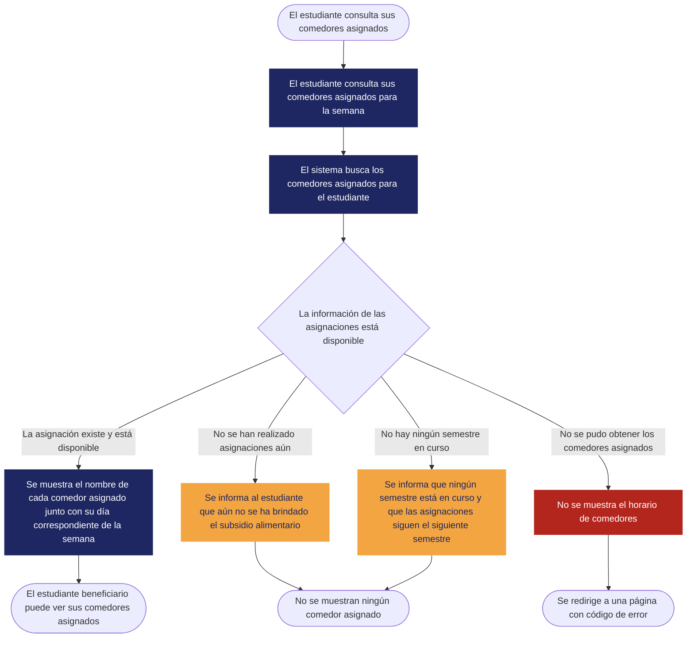

<!--
HOW TO USE THIS TEMPLATE
------------------------
1. Copy this file and rename it to the requirement's ID, e.g. REQ-01.md.
2. Fill in every section. If a section genuinely does not apply to this
   requirement (not every requirement has a Business Rule or a Constraint),
   write "N/A — none identified" and say why in one line. Never invent
   content to fill a blank cell — that breaks the rule we've followed since
   Class 8: specification is not invention.
3. If something is unknown rather than inapplicable, use the Open
   Questions section instead of guessing.
4. See REQ-07_Example.md (Food Delivery System) for a fully filled-in
   reference before you start.
-->

# [REQ-01] — [Asignación diaria de comedores durante el semestre]

| | |
|---|---|
| **Status** | Draft |
| **Team / Author(s)** | @amadodev07, @juanfpg1, @xedroc422, @alfredoquev y @julondono07 |
| **Date** | 2026-01-11 |
| **Linked User Story / AC** | US-01; AC-01; AC-02 |

---

## 1. Overview

**Requirement Statement**
> El sistema debe asignar a cada estudiante beneficiario un comedor para cada día de la semana, y esa asignación debe mantenerse constante hasta el final del semestre

**Type:** Functional

**Source / Evidence**
> Entrevista con los stakeholders realizada en clase, es necesario que el sistema asigne a los estudiantes beneficiarios comedores para cada día de la semana.

**Need**
> Poder almorzar en los comedores más convenientes según el horario del estudiante beneficiario.

**Value / Rationale**
> Se reduce el tiempo que toma almorzar al asignar comedores para cada día de la semana según las condiciones en las que sale el estudiante a almorzar cada día.

---

## 2. Context — A Requirement Rarely Stands Alone

**Business Rule(s)**
> BR-01 La asignación de comedores a los estudiantes beneficiarios debe tener frecuencia diaria
> BR-02 Las asignaciones solo se pueden realizar mientras esté cursando un semestre académico

**Constraint(s)**
> Los comedores que ya se encuentren a su capacidad máxima no podrán ser asignados además, solo los estudiantes beneficiarios reciben asignación de comedores por cada día de la semana. Las asignaciones solo se podrán realizar mientras se esté cursando un semestre académico (no hay razón por la cual asignar comedores en vacaciones entre semestres).

**Assumption(s)**
> El impacto de estudiantes no beneficiarios sobre el aforo de los comedores no tendrá un efecto lo suficientemente grande como para que los datos conocidos de cada comedor no ayuden a asignar un comedor

**Dependenc(ies)**
> El momento en el que entren en efecto los subsidios de alimentación dentro de la Universidad Nacional de Colombia sede Bogotá.

**Risk(s)**

| Riesgo | Probabilidad | Impacto | Mitigación (opcional) |
|---|---|---|---|
| La cantidad de estudiantes no beneficiarios en un comedor tiene un efecto sobre la capacidad de atención de un comedor que el sistema no es capaz de medir, y se termina sobreestimando la capacidad de un comedor | Alta | Medio |---|

**Open Questions**
> ¿Qué se debe hacer cuando no se puede medir acertadamente la capacidad de atención de un comedor?

---

## 3. Priority & Estimation

**Priority model used:** MoSCoW

**Priority assigned:** Must
> Debido a la motivación del sistema definida en [rfc_almuerzate.md](docs/rfc_almuerzate.md) y a los aportes de los stakeholders, se asigna la prioridad Must, aceptando el trade-off de que la tarea principal que cumple el sistema no se cumpla satisfactoriamente si se asigna una prioridad más baja.

**Estimate (confidence):** High / Medium / Low
> High
---

## 4. Representations — Requirement ≠ Representation

### 4.1 User Story
**US-01**
> Como **Estudiante**,
> Quiero **ser asignad@ un comedor cada día de la semana**,
> Para que **sea el que esté en mejores condiciones cuando vaya a el**.

### 4.2 Acceptance Criteria

*(At least two scenarios: one normal path, one alternative or exception.)*

**Scenario 1 — Comedor disponible [AC-01]**
> **Dado** un comedor que no esté lleno
> **Cuando** se vaya a asignar comedores para toda la semana
> **Entonces** se asigna el comedor a un estudiante

**Scenario 2 — Comedor lleno [AC-02]**
> **Dado** un comedor que esté lleno
> **Cuando** se vaya a asignar comedores para toda la semana
> **Entonces** no se podrá asignar el comedor y se opta por otro

### 4.3 Use Case

| Field | |
|---|---|
| **Use Case name** | Ver comedores asignados [UC-01] |
| **Actor** | Estudiante beneficiario |
| **Goal** | Hacer conocer al estudiante el comedor al que deberá ir en cada día de la semana |
| **Trigger** | El estudiante consulta sus comedores asignados |
| **Precondition** | Los comedores ya fueron asignados (aún no se ha brindado el subsidio alimentario, o el semestre ya acabó) |

**Main Flow**
1. El estudiante consulta sus comedores asignados para la semana
2. El sistema busca los comedores asignados para el estudiante
3. El sistema muestra el nombre de cada comedor asignado junto con su día correspondiente de la semana

**Alternative Flow**
> Los comedores no han sido asignados aún → El sistema informa al estudiante que aún no se le ha brindado el subsidio alimentario
> El semestre ya acabó → El sistema informa al estudiante que ningún semestre está siendo cursado actualmente y que las asignaciones continuarán hasta el siguiente semestre

**Exception**
> No se pudo obtener los comedores asignados desde el backend → No se muestra el horario de comedores y se redirige a una página con el código del error que llevó a este resultado (códigos de estado HTTP)

**Postcondition**
> El estudiante beneficiario puede ver sus comedores asignados cuando ya se hayan realizado las asignaciones y entren en efecto los subsidios de alimentación

**Flow Diagram**

---

## 5. Traceability & Impact

**Backward — why does this requirement exist?**
> Los stakeholders manifiestan que es necesario que se asigne un comedor por día de la semana → Los estudiantes necesitan reducir el tiempo que les toma recibir almuerzo en un comedor

**Forward — what will this affect?**
> El sistema debe asignar a cada estudiante beneficiario un comedor para cada día de la semana, y esa asignación debe mantenerse constante hasta el final del semestre → La información de las asignaciones deberá ser persistida, y es necesario ya haber realizado las asignaciones para cuando entre en efecto el subsidio alimentario → Futuros criterios de asignación estarán ligados a el momento en el que inician las asignaciones → Al realizar tests, se deberá verificar que la asignación se puede realizar en el instante que se requiera de forma rápida.

**Impact Analysis — if this requirement changes, what else might need to change?**
- [X] Business Rules
- [ ] Constraints
- [ ] Dependencies
- [X] Risks
- [X] Acceptance Criteria
- [ ] Estimate
- [ ] Priority
- [X] Future Design
- [X] Future Tests

> Si cambia la frecuencia o forma en la que se asignan comedores, esto implicaría cambios en BR-01, podrían surgir nuevos riesgos en base a la precisión de la asignación, cambiarían los criterios de aceptación y el diseño y testeo de capacidades futuras en torno a los criterios de asignación. Las limitaciones y dependencias dependen del dominio por lo cual no cambian, y la prioridad tampoco cambia debido a que la motivación del sistema sigue siendo la misma

---

## 6. Validation — Quality Gate

- [X] **Valid?** Does it reflect a real, evidenced need — not an invented one?
- [X] **Clear / Unambiguous?** Is there only one reasonable interpretation?
- [X] **Atomic?** Is this one independently testable expectation, not several bundled together?
- [X] **Necessary?** Does removing it actually break something real?
- [X] **Feasible?** Can this realistically be built with what the team has?
- [X] **Verifiable?** Can you demonstrate, concretely, whether it's satisfied?
- [X] **Consistent?** Does it conflict with any other requirement in your set?
- [X] **Complete enough?** Are there important functions or constraints still missing?
- [X] **Traceable?** Can every part of this document be traced back to real evidence — not invented to fill a section?
