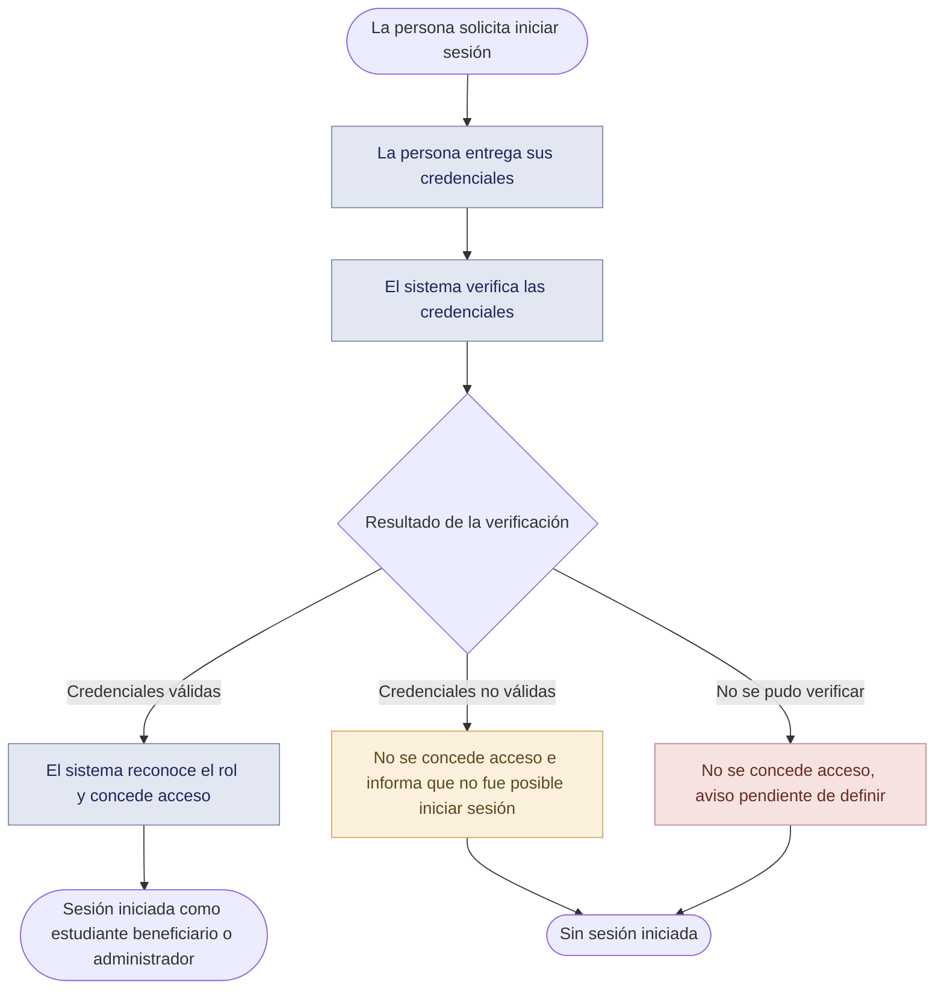

# [REQ-11] — [Inicio de sesión de estudiantes beneficiarios y administradores]

| | |
|---|---|
| **Status** | Draft |
| **Team / Author(s)** | Pendiente |
| **Date** | Pendiente |
| **Linked User Story / AC** | US-02; AC-05; AC-06 |

---

## 1. Overview

**Requirement Statement**
> El sistema debe permitir que el estudiante beneficiario y el administrador inicien sesión en la página de Almuérzate.

**Type:** Functional
> Perfect Technology Filter: con un computador perfecto (velocidad infinita, memoria ilimitada, cero fallas, costo cero) el sistema seguiría necesitando saber quién lo usa y con qué rol, por lo que el requerimiento sigue importando.

**Source / Evidence**
> `Requirements.md`, Requerimiento 11; de forma indirecta, RFC, sección Seguridad (el acceso a los datos de los estudiantes debe estar restringido y protegido). Discovery Sheet: Pendiente. No reutiliza la entrevista citada en REQ-01 y REQ-10, que trata de la asignación de comedores por día.

**Need**
> Que el sistema reconozca quién lo usa y con qué rol, para que cada estudiante beneficiario y cada administrador accedan al sistema como lo que son.

**Value / Rationale**
> Que cada persona acceda con su identidad y su rol, y que la información personal de los estudiantes quede protegida frente a terceros (RFC, Seguridad).

---

## 2. Context — A Requirement Rarely Stands Alone

**Business Rule(s)**
> N/A — none identified. BR-01 y BR-02 regulan la asignación de comedores, no el acceso al sistema, y ninguna fuente define reglas del dominio sobre quién puede iniciar sesión.

**Constraint(s)**
> Solo el estudiante beneficiario y el administrador inician sesión (enunciado del Requerimiento 11).

> El acceso a los datos de los estudiantes debe estar restringido y protegido (RFC, sección Seguridad).

> Lo que la persona escribe al iniciar sesión llega al backend a través de PHP, y los argumentos que PHP pasa al ejecutable deben validarse (ADR-0002, Aceptado).

> El inicio de sesión se hace en una página web accesible desde un navegador, sin aplicación móvil (ADR-0005, Aceptado).

**Assumption(s)**
> El estudiante beneficiario y el administrador ya cuentan con credenciales cuando intentan iniciar sesión. `Requirements.md` no define cómo se crean las cuentas ni quién las mantiene.

**Dependenc(ies)**
> Información sobre quiénes son estudiantes beneficiarios, entregada por las entidades correspondientes (dependencia ya declarada en REQ-01).

> Origen de la información que identifica a los administradores: Pendiente.

> Requerimientos que probablemente se apoyan en este (por confirmar): REQ-10 (identificar al estudiante que consulta), REQ-07 (usuarios que registran reportes) y REQ-09 (administradores que consultan el desempeño de los comedores).

**Risk(s)**

| Risk | Likelihood | Impact | Mitigation (optional) |
|---|---|---|---|
| Un estudiante accede a datos personales de otra persona por una verificación de identidad deficiente (relacionado con la fuga de información privada del RFC) | Medium (estimación a validar) | High (estimación a validar) | Pendiente |
| Inyección de comandos a través de lo que la persona escribe al iniciar sesión, al pasar por PHP hacia el backend | Medium (estimación a validar) | High (estimación a validar) | Validar los argumentos que PHP pasa al ejecutable (ADR-0002) |
| Una falla de acceso a los datos impide verificar credenciales y nadie puede iniciar sesión (análogo al riesgo de acceso a los datos de REQ-10) | Low (estimación a validar) | High (estimación a validar) | Pendiente |

**Open Questions**
> ¿Con qué credenciales inicia sesión cada rol (estudiante beneficiario y administrador)?

> ¿Quién crea y mantiene las cuentas, y cómo se determina que una persona es estudiante beneficiario o administrador?

> ¿Qué ocurre con otras personas que usen el sistema (por ejemplo, estudiantes no beneficiarios o trabajadores de los comedores) y con los "usuarios" que pueden registrar reportes en REQ-07?

> ¿Qué políticas de sesión aplican (duración, cierre de sesión e intentos fallidos repetidos)?

> ¿Qué se informa a la persona, y puede reintentar, cuando no se pueden verificar las credenciales por una falla de acceso a los datos?

---

## 3. Priority & Estimation

**Priority model used:** MoSCoW

**Priority assigned:** Must
> Debido a que REQ-10 (entrega 1 del RFC) muestra al estudiante sus propias asignaciones y a que el RFC exige acceso restringido y protegido a los datos de los estudiantes, se asignó la prioridad Must, aceptando el trade-off de sumar a la entrega 1 una funcionalidad que no es el núcleo de la asignación y cuyo alcance aún tiene Open Questions. Se consideró Should y no se usó porque, sin iniciar sesión, el sistema no puede saber a qué estudiante mostrarle sus asignaciones ni restringir el acceso a sus datos. Propuesta por validar con el equipo: REQ-11 no figura en el RFC y su asociación con la entrega 1 es una hipótesis.

**Estimate (confidence):** Medium
> El comportamiento principal es claro, pero las credenciales, el origen de las cuentas y el tratamiento de otros usuarios no están definidos.

---

## 4. Representations — Requirement ≠ Representation

### 4.1 User Story

**US-02**
> Como **estudiante beneficiario o administrador**,
> Quiero **iniciar sesión en Almuérzate**,
> Para que **el sistema me reconozca y pueda acceder a lo que corresponde a mi rol, con mi información protegida frente a terceros**.

### 4.2 Acceptance Criteria

**Scenario 1 — Credenciales válidas [AC-05]**
> **Dado** que la persona es un estudiante beneficiario o un administrador con credenciales válidas y no ha iniciado sesión
> **Cuando** inicia sesión
> **Entonces** el sistema le concede acceso según su rol

**Scenario 2 — Credenciales no válidas [AC-06]**
> **Dado** que una persona entrega credenciales que no son válidas
> **Cuando** intenta iniciar sesión
> **Entonces** el sistema no le concede acceso e informa que no fue posible iniciar sesión

### 4.3 Use Case

| Field | |
|---|---|
| **Use Case name** | Iniciar sesión [UC-02] |
| **Actor** | Estudiante beneficiario o administrador |
| **Goal** | Acceder al sistema con su identidad y su rol |
| **Trigger** | La persona decide iniciar sesión en la página de Almuérzate |
| **Precondition** | La persona no ha iniciado sesión y dispone de credenciales (supuesto) |

**Main Flow**
1. La persona solicita iniciar sesión.
2. La persona entrega sus credenciales.
3. El sistema verifica las credenciales.
4. El sistema reconoce el rol de la persona (estudiante beneficiario o administrador) y le concede acceso.

**Alternative Flow**
> Las credenciales no son válidas → El sistema no concede acceso e informa que no fue posible iniciar sesión.

**Exception**
> No se pueden verificar las credenciales por una falla de acceso a los datos → El sistema no concede acceso. El aviso que recibe la persona y si puede reintentar no están definidos por el equipo (ver Open Questions).

**Postcondition**
> La persona tiene una sesión iniciada con su rol y puede acceder al sistema como estudiante beneficiario o como administrador.

**Flow Diagram**

---

## 5. Traceability & Impact

**Backward — why does this requirement exist?**
> Evidencia: `Requirements.md`, Requerimiento 11, y de forma indirecta RFC, sección Seguridad (acceso a datos de estudiantes restringido y protegido); Discovery Sheet: Pendiente → Necesidad: que el sistema reconozca a quien lo usa y su rol (referencia de necesidad: Pendiente) → El sistema debe permitir que el estudiante beneficiario y el administrador inicien sesión en la página de Almuérzate [REQ-11](docs/requirements/Requirements.md).

**Forward — what will this affect?**
> El sistema debe permitir que el estudiante beneficiario y el administrador inicien sesión [REQ-11](docs/requirements/Requirements.md) → Diseño: hará falta el componente que verifica la identidad y el rol de quien inicia sesión y comunica el resultado a la presentación; el diseño v1.0 cubre solo REQ-10 y no lo incluye, y la forma de entregar la identidad a quien consulta asignaciones queda por diseñar → Implementación: Pendiente → Pruebas: verificar AC-05 y AC-06, incluidas entradas de credenciales no válidas o malformadas.

**Impact Analysis — if this requirement changes, what else might need to change?**
- [ ] Business Rules
- [X] Constraints
- [X] Dependencies
- [X] Risks
- [X] Acceptance Criteria
- [X] Estimate
- [ ] Priority
- [X] Future Design
- [X] Future Tests

> Si cambian los roles que inician sesión o la forma de verificar la identidad, cambian las restricciones (protección de datos, validación de entradas) y las dependencias con REQ-10, REQ-07 y REQ-09. También cambian los riesgos, los criterios de aceptación, la estimación (hoy Medium por las Open Questions), el diseño del componente de verificación y las pruebas. No se afectan reglas de negocio porque no hay ninguna asociada, y la prioridad no cambia por ajustes de alcance de este requerimiento.

---

## 6. Validation — Quality Gate

- [ ] **Valid?** Does it reflect a real, evidenced need — not an invented one?
- [ ] **Clear / Unambiguous?** Is there only one reasonable interpretation?
- [X] **Atomic?** Is this one independently testable expectation, not several bundled together?
- [X] **Necessary?** Does removing it actually break something real?
- [ ] **Feasible?** Can this realistically be built with what the team has?
- [X] **Verifiable?** Can you demonstrate, concretely, whether it's satisfied?
- [X] **Consistent?** Does it conflict with any other requirement in your set?
- [ ] **Complete enough?** Are there important functions or constraints still missing?
- [X] **Traceable?** Can every part of this document be traced back to real evidence — not invented to fill a section?

> **Valid?** Falta evidencia directa: solo hay `Requirements.md` y una referencia indirecta al RFC (Seguridad). Pasa a Open Question y a completar la Discovery Sheet.
> **Clear / Unambiguous?** "Iniciar sesión" no define credenciales, origen de las cuentas ni el tratamiento de otros usuarios. Pasa a Open Questions (volver a elicitar con el equipo).
> **Atomic?** Es una sola capacidad (identificar y dar acceso) para dos roles. Si las credenciales o el origen de las cuentas resultan distintos por rol, habría que revisar si se divide.
> **Necessary?** Sin inicio de sesión no se puede identificar al estudiante que consulta sus asignaciones (brecha abierta en REQ-10) ni restringir el acceso a sus datos (RFC, Seguridad).
> **Feasible?** No verificado: depende de las respuestas sobre el origen de las cuentas y los datos de beneficiarios, y PHP es una tecnología nueva para el equipo.
> **Consistent?** No se encontró contradicción con REQ-01 a REQ-10. Queda por aclarar el alcance de "usuarios" en REQ-07 (Open Question).
> **Complete enough?** Las Open Questions (credenciales, cuentas, otros usuarios, políticas de sesión, falla de verificación) afectan el comportamiento.
> **Traceable?** Cada parte se apoya en `Requirements.md`, el RFC o los ADR citados; lo desconocido está marcado como Pendiente u Open Question.
