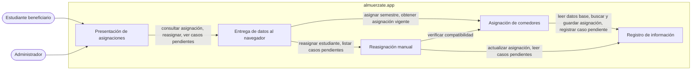
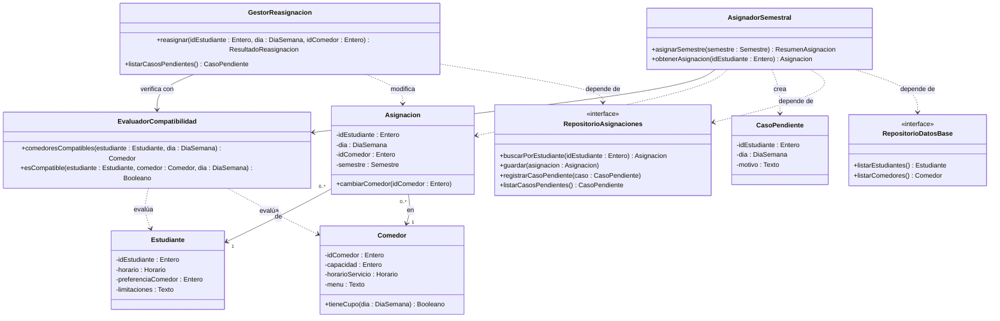

# almuerzate.app — Architectural & Detailed Design v1.0

| | |
|---|---|
| **Team** | Pendiente |
| **Members** | Pendiente |
| **Status** | Draft |
| **Date** | Pendiente |
| **Inputs** | `docs/requirements/`, Architectural Hypothesis v0.1 (Class 11), Detailed Design v0.1 (Class 12) |

---

## 1. System Overview & Design Drivers

**System purpose** (2–3 sentences, in terms of the need it satisfies)
> almuerzate.app asigna a cada estudiante beneficiario un comedor para cada día de la semana, de modo que sepa dónde recibe su beneficio sin tener que gestionarlo. La asignación se calcula una vez y se mantiene constante hasta el final del semestre, porque se asume que el horario del estudiante no cambia. Las novedades se atienden como casos aislados con intervención del administrador.

**Requirements that shape the structure**

| Requirement / Use Case ID | Why it shapes the structure | Quality attribute, constraint or business rule involved |
|---|---|---|
| REQ-01 / Pendiente | La asignación por día debe persistirse y conservarse todo el semestre, no recalcularse cada semana. Por eso la asignación y su registro son piezas separadas de la presentación | Regla de negocio: la asignación es constante hasta el final del semestre porque el horario del estudiante no cambia. Calidad: integridad transaccional (ADR-0001). Restricción: el backend en C++ corre en el servidor y entrega los datos al navegador mediante PHP (ADR-0002, ADR-0004) |
| REQ-02 a REQ-05 / Pendiente | Horario del estudiante, preferencia de comedor, condiciones del comedor y limitaciones del estudiante son los criterios de la asignación. Deben estar en un solo lugar para que un cambio de regla no se disperse | Restricción: la lógica de decisión (árbol decisional) vive en el backend (ADR-0004) |
| REQ-06 / Pendiente | La asignación es automática y solo los casos aislados se atienden a mano. Esto obliga a separar la asignación automática de la reasignación manual | Regla de negocio: una novedad se resuelve con intervención manual del administrador, no con reasignación automática |

---

## 2. Architectural Design

### 2.1 System Context & Boundary

| Outside the system | Type (actor / external system / hardware) | How the system interacts with it |
|---|---|---|
| Estudiante beneficiario | Actor | Consulta el comedor que tiene asignado para cada día de la semana |
| Administrador | Actor | Reasigna manualmente a un estudiante y consulta los casos que requieren intervención |
| Sistemas externos | N/A: no se identifica ningún sistema externo para el alcance de REQ-01. El origen del horario del estudiante está Pendiente | N/A |

### 2.2 Components, Responsibilities & Capabilities



| Component | Main responsibility | Requirements / use cases supported | Provided capabilities | Required capabilities | Main dependencies |
|---|---|---|---|---|---|
| Presentación de asignaciones | Muestra al estudiante su comedor por día y recibe las acciones del administrador | REQ-01, REQ-06 | Mostrar asignación, capturar reasignación | Consultar asignación, reasignar estudiante, ver casos pendientes | Entrega de datos al navegador |
| Entrega de datos al navegador | Entrega al navegador solo los datos ya procesados que cada usuario necesita ver | REQ-01, REQ-06 | Consultar asignación, reasignar estudiante, ver casos pendientes | Asignar semestre, obtener asignación vigente, reasignar estudiante, listar casos pendientes | Asignación de comedores, Reasignación manual |
| Asignación de comedores | Decide el comedor de cada estudiante para cada día según horario, preferencia, condiciones del comedor y limitaciones, y la conserva todo el semestre | REQ-01 a REQ-06 | Asignar semestre, obtener asignación vigente, verificar compatibilidad | Leer datos base, buscar asignación, guardar asignación, registrar caso pendiente | Registro de información |
| Reasignación manual | Aplica los cambios que hace el administrador sobre una asignación vigente y expone los casos que requieren intervención | REQ-06 | Reasignar estudiante, listar casos pendientes | Verificar compatibilidad, actualizar asignación, leer casos pendientes | Asignación de comedores, Registro de información |
| Registro de información | Persiste y recupera estudiantes, comedores, asignaciones y casos pendientes | REQ-01 a REQ-06 | Leer datos base, buscar asignación, guardar asignación, actualizar asignación, registrar caso pendiente, leer casos pendientes | Ninguna | Ninguna |

*Nota: la relación con las tecnologías de los ADR es la siguiente. La entrega de datos al navegador se implementa con PHP (ADR-0002). La asignación de comedores y la reasignación manual se implementan en C++ en el servidor, y la asignación incluye el árbol decisional (ADR-0004). El registro de información usa PostgreSQL (ADR-0001). La presentación usa HTML, JavaScript y CSS con Tailwind CSS (ADR-0003, ADR-0005). Quién dispara "asignar semestre" (por ejemplo, el administrador al inicio del semestre) está Pendiente.*

---

## 3. Detailed Design

### 3.1 Components selected (at least two)

| Component | Why it was selected (risk, complexity, centrality to the drivers) |
|---|---|
| Asignación de comedores | Es el componente central: concentra REQ-01 a REQ-05 y tiene la regla de negocio de la asignación constante. Su riesgo está en el caso en que ningún comedor es compatible o tiene cupo |
| Reasignación manual | Es el único camino por el que una asignación vigente puede cambiar (REQ-06). Un error aquí rompe la constancia de la asignación o supera la capacidad de un comedor |

### 3.2 Class Diagram(s)



*(No se usa composición ni generalización: ninguna clase deja de tener sentido sin otra ni es un tipo especializado de otra. Los tipos `Semestre`, `DiaSemana`, `Horario`, `ResumenAsignacion` y `ResultadoReasignacion` son tipos simples de apoyo y no se detallan.)*

### 3.3 Class Responsibilities

| Class | Component it belongs to | Responsibility | Key collaborators |
|---|---|---|---|
| AsignadorSemestral | Asignación de comedores | Recorre estudiantes y días, elige el comedor de cada uno y conserva la asignación vigente sin recalcularla | EvaluadorCompatibilidad, RepositorioAsignaciones, RepositorioDatosBase |
| EvaluadorCompatibilidad | Asignación de comedores | Aplica los criterios de horario, preferencia, condiciones del comedor y limitaciones para decir qué comedores sirven a un estudiante un día dado | Estudiante, Comedor |
| Asignacion | Asignación de comedores | Representa el comedor de un estudiante para un día del semestre y permite cambiarlo | Estudiante, Comedor |
| CasoPendiente | Asignación de comedores | Representa un estudiante y día sin comedor compatible, con el motivo | Ninguno |
| GestorReasignacion | Reasignación manual | Aplica un cambio manual del administrador si el comedor es compatible y expone los casos pendientes | EvaluadorCompatibilidad, Asignacion, RepositorioAsignaciones |
| Estudiante | Registro de información | Contiene horario, preferencia de comedor y limitaciones del estudiante beneficiario | Ninguno |
| Comedor | Registro de información | Contiene capacidad, horario de servicio y menú, y dice si tiene cupo un día | Ninguno |
| RepositorioAsignaciones | Registro de información | Guarda y recupera asignaciones y casos pendientes (solo el contrato; los detalles de almacenamiento quedan ocultos) | Asignacion, CasoPendiente |
| RepositorioDatosBase | Registro de información | Entrega estudiantes y comedores registrados (solo el contrato) | Estudiante, Comedor |

*Los componentes Presentación de asignaciones y Entrega de datos al navegador no se detallan en clases porque no fueron seleccionados en 3.1.*

### 3.4 Behavior of one key operation

```text
asignarSemestre(semestre):
    PARA CADA estudiante beneficiario:
        PARA CADA día de la semana:
            SI ya existe asignación vigente de (estudiante, día, semestre): CONTINUAR
            compatibles = EvaluadorCompatibilidad.comedoresCompatibles(estudiante, día)
            SI compatibles está vacío:
                registrarCasoPendiente(estudiante, día, "sin comedor compatible con cupo")
                CONTINUAR
            comedor = el de compatibles que mejor coincide con la preferencia del estudiante
            guardar(Asignacion(estudiante, día, comedor, semestre))
    RETORNAR resumen (asignaciones hechas, casos pendientes)
```

---

## 4. Design Quality — Cohesion, Coupling, Information Hiding

| Question | Your answer, with evidence from your design |
|---|---|
| **Cohesion:** do the responsibilities inside each class or component belong together? | `AsignadorSemestral` solo coordina el recorrido y la elección. Las reglas de compatibilidad viven únicamente en `EvaluadorCompatibilidad`. `GestorReasignacion` solo aplica cambios manuales y lista casos pendientes. Los repositorios solo guardan y recuperan. |
| **Coupling:** how far does a change in one element spread? Where are the strongest dependencies? | Las dependencias más fuertes son de `AsignadorSemestral` y `GestorReasignacion` hacia `EvaluadorCompatibilidad` y hacia `RepositorioAsignaciones`. Un cambio en un criterio de asignación (REQ-02 a REQ-05) llega solo a `EvaluadorCompatibilidad`. Un cambio de almacenamiento llega solo a las implementaciones de los repositorios. |
| **Information hiding:** what did you keep private or internal, and why? | Cómo se evalúa cada criterio queda dentro de `EvaluadorCompatibilidad`: los demás solo ven la lista de comedores compatibles. Los detalles de almacenamiento quedan detrás de las interfaces de repositorio. Los atributos de `Asignacion`, `Estudiante` y `Comedor` son privados. |

**At least one real finding** (a problem you found in your own design) **and what you changed or would change:**
> Pendiente: el equipo debe aportar un hallazgo real encontrado en su propio diseño. No se inventa.

---

## 5. Design Decisions & Decision Record

### Decision A — Architectural

| | |
|---|---|
| **Context** (requirement, constraint or problem that motivated it) | REQ-01 pide una asignación por día que se mantiene hasta el final del semestre, y REQ-06 limita la intervención manual a casos aislados. Las novedades se definen con apoyo de los requerimientos de reportes, notificación y desempeño (REQ-07 a REQ-09). |
| **Decision** | La asignación automática del semestre y la reasignación manual son componentes distintos. Una asignación vigente solo cambia por reasignación manual del administrador; el sistema no reasigna automáticamente. |
| **Rationale** (why it is reasonable here) | Mantiene la constancia que pide REQ-01, evita recalcular la asignación cada semana y ubica la intervención manual de REQ-06 en un único componente. Es la opción más simple para el alcance demostrativo del proyecto. |
| **Trade-off accepted** | Si un comedor deja de funcionar, el sistema no reasigna por sí mismo: todo depende del administrador. Se descartó la reasignación automática porque exigiría cambiar REQ-06 y REQ-09 y añadir reglas que hoy no están definidas. |

### Decision B — Detailed design

| | |
|---|---|
| **Context** | Al asignar, puede ocurrir que ningún comedor sea compatible o tenga cupo para un estudiante en un día. |
| **Decision** | `AsignadorSemestral` trata ese caso como un resultado normal: registra un `CasoPendiente` con el motivo y continúa con los demás estudiantes, sin lanzar una excepción que detenga la asignación. |
| **Rationale** | Una sola falla no bloquea la asignación del resto, y los casos pendientes quedan listos para que el administrador los atienda con `GestorReasignacion`. |
| **Trade-off accepted** | Si nadie revisa los casos pendientes, un estudiante puede quedarse sin comedor ese día sin que el sistema lo haga evidente. |

### ADR

**ADR file:** Pendiente — se propone `0006-mantener-asignacion-constante-por-semestre.md` — records Decision A. La ruta (`docs/adr/` o `docs/decisions/`) y el formato (`NNNN-slug.md` o `ADR-XXX-title.md`) están por confirmar con el equipo.

---

## 6. Traceability

| Requirement ID | Use Case | Component(s) | Class(es) |
|---|---|---|---|
| REQ-01 | Pendiente | Presentación de asignaciones, Entrega de datos al navegador, Asignación de comedores, Registro de información | AsignadorSemestral, Asignacion, Estudiante, Comedor, RepositorioAsignaciones, RepositorioDatosBase (los dos primeros componentes: N/A, no se detallan en clases) |
| REQ-02 a REQ-05 | Pendiente | Asignación de comedores | EvaluadorCompatibilidad, Estudiante, Comedor |
| REQ-06 | Pendiente | Asignación de comedores, Reasignación manual, Registro de información, Presentación de asignaciones, Entrega de datos al navegador | CasoPendiente, GestorReasignacion, EvaluadorCompatibilidad, RepositorioAsignaciones |

---

## 7. Optional — AI-Assisted Design Reflection

> Un asistente de IA propuso dos opciones para atender las novedades sobre una asignación semestral constante: reasignación solo manual por el administrador (opción A) o reasignación automática ante ciertas fallas (opción B), y recomendó la A. El equipo aceptó la opción A porque encaja con REQ-06 tal como está y mantiene el alcance demostrativo, sin tener que modificar REQ-06 ni REQ-09.

---

## 8. Consistency Checklist

- [x] Every component in the diagram appears in the responsibilities table, and the other way around.
- [x] Every class belongs to an identifiable component.
- [x] Components are named by responsibility, not technology.
- [x] Nothing inside the system boundary is something you do not control.
- [x] Provided and required capabilities match across components (what one requires, another provides).
- [ ] Both decisions name a real cost or limitation, and at least one has an ADR. (Los costos están; el ADR está Pendiente de redactar.)
- [x] The traceability table has no empty rows and no orphan components or classes.
- [ ] Diagrams render correctly on GitHub (or the exported images are embedded). (Sin verificar.)
