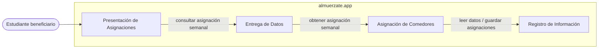
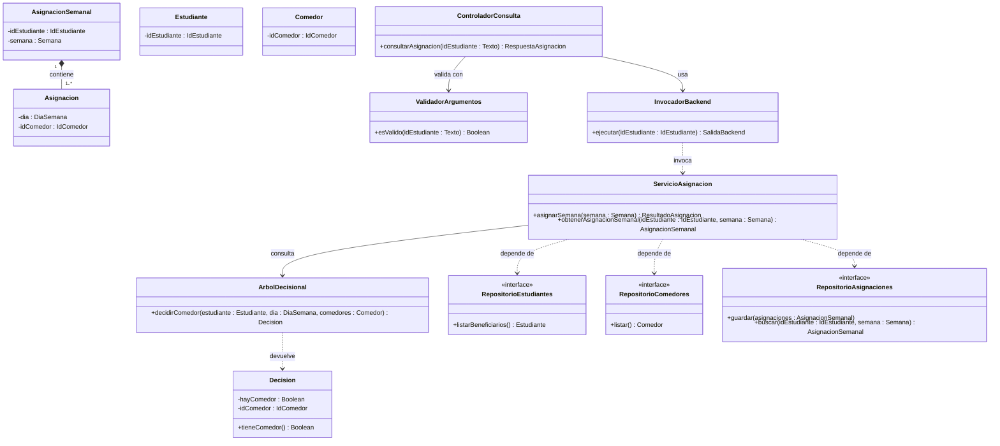

# almuerzate.app — Architectural & Detailed Design v1.0

| | |
|---|---|
| **Team** | Pendiente |
| **Members** | Pendiente |
| **Status** | Draft |
| **Date** | Pendiente |
| **Inputs** | `docs/requirements/`, Architectural Hypothesis v0.1 (Class 11), Detailed Design v0.1 (Class 12) |

> Alcance de esta versión: REQ-01. Los demás requerimientos se incorporan en versiones posteriores.

---

## 1. System Overview & Design Drivers

**System purpose**
> Asignar a los estudiantes beneficiarios un comedor para cada día de la semana, de forma automática y consistente, para que cada uno sepa dónde recibirá su beneficio sin tener que gestionarlo manualmente.

| Requirement / Use Case ID | Why it shapes the structure | Quality attribute, constraint or business rule involved |
|---|---|---|
| REQ-01 / Pendiente | La asignación semanal es el núcleo del sistema: la decisión debe vivir en un solo componente, separada de la visualización y de la persistencia. Cada estudiante debe terminar con un comedor para cada día, sin asignaciones parciales ni duplicadas. | Restricción (ADR-0004): la lógica de asignación (árbol decisional) corre en el servidor. Restricción (ADR-0005): acceso desde navegador. Calidad: integridad transaccional (ADR-0001). |

---

## 2. Architectural Design

### 2.1 System Context & Boundary

| Outside the system | Type (actor / external system / hardware) | How the system interacts with it |
|---|---|---|
| Estudiante beneficiario | Actor | Consulta desde el navegador el comedor que se le asignó para cada día de la semana |
| Sistemas externos | N/A: para REQ-01 no hay ningún sistema externo; todo lo que interviene lo construye y controla el equipo | N/A |

### 2.2 Components, Responsibilities & Capabilities



| Component | Main responsibility | Requirements / use cases supported | Provided capabilities | Required capabilities | Main dependencies |
|---|---|---|---|---|---|
| Presentación de Asignaciones | Muestra al estudiante su comedor para cada día de la semana | REQ-01 | Mostrar asignación semanal al estudiante | Consultar asignación semanal | Entrega de Datos |
| Entrega de Datos | Entrega al navegador únicamente los datos ya procesados que el estudiante necesita ver, y valida lo que recibe antes de pasarlo al backend (ADR-0002) | REQ-01 | Consultar asignación semanal | Obtener asignación semanal | Asignación de Comedores |
| Asignación de Comedores | Decide el comedor de cada estudiante para cada día y consolida la asignación semanal | REQ-01 | Obtener asignación semanal, asignar comedores de la semana | Leer datos de estudiantes y comedores, guardar asignaciones | Registro de Información |
| Registro de Información | Persiste y recupera estudiantes, comedores y asignaciones de forma transaccional | REQ-01 | Leer datos de estudiantes y comedores, guardar asignaciones, buscar asignaciones | Ninguna | Ninguna |

*Notas:*
- *Tecnologías (ADR): Entrega de Datos usa PHP (ADR-0002), Asignación de Comedores usa C++ (ADR-0004), Registro de Información usa PostgreSQL (ADR-0001), Presentación de Asignaciones usa HTML/JS/CSS con Tailwind (ADR-0003, ADR-0005).*
- *`Pendiente`: quién o qué dispara "asignar comedores de la semana" (REQ-06 habla de ejecución automática, pero el disparador no está definido). Por eso esa capacidad aún no tiene un solicitante en el diagrama.*

---

## 3. Detailed Design

### 3.1 Components selected (at least two)

| Component | Why it was selected (risk, complexity, centrality to the drivers) |
|---|---|
| Asignación de Comedores | Es el componente central de REQ-01: contiene la decisión de asignación y debe dejar a cada estudiante con un comedor por día. Un error aquí afecta directamente al requerimiento. |
| Entrega de Datos | Concentra los riesgos aceptados en ADR-0002: lanza un proceso del backend por solicitud y debe validar los argumentos para evitar inyección de comandos. |

### 3.2 Class Diagram(s)



*(`AsignacionSemanal` y `Asignacion` usan composición: una asignación diaria no tiene sentido fuera de su semana. No se usa generalización porque nada en este diseño es un tipo especializado de otra cosa. `Estudiante` y `Comedor` se muestran mínimos: sus atributos (horario, preferencia, capacidad, limitaciones) pertenecen a REQ-02 a REQ-05.)*

### 3.3 Class Responsibilities

| Class | Component it belongs to | Responsibility | Key collaborators |
|---|---|---|---|
| ServicioAsignacion | Asignación de Comedores | Coordina la asignación semanal: obtiene los datos, pide una decisión por estudiante y día, y guarda el resultado | ArbolDecisional, RepositorioEstudiantes, RepositorioComedores, RepositorioAsignaciones |
| ArbolDecisional | Asignación de Comedores | Decide el comedor de un estudiante para un día | Decision |
| Decision | Asignación de Comedores | Lleva el comedor elegido o indica que no hay comedor posible | Ninguno |
| AsignacionSemanal | Asignación de Comedores | Agrupa las asignaciones diarias de un estudiante en una semana | Asignacion |
| Asignacion | Asignación de Comedores | Representa el comedor asignado a un estudiante para un día | Ninguno |
| Estudiante | Asignación de Comedores | Identifica al estudiante beneficiario dentro de la asignación | Ninguno |
| Comedor | Asignación de Comedores | Identifica un comedor candidato dentro de la asignación | Ninguno |
| RepositorioEstudiantes | Registro de Información | Entrega los estudiantes beneficiarios (solo el contrato, detalles de almacenamiento ocultos) | Estudiante |
| RepositorioComedores | Registro de Información | Entrega los comedores disponibles (solo el contrato) | Comedor |
| RepositorioAsignaciones | Registro de Información | Guarda y busca asignaciones de forma transaccional (solo el contrato) | AsignacionSemanal |
| ControladorConsulta | Entrega de Datos | Atiende la solicitud del navegador y responde solo con los datos a mostrar | ValidadorArgumentos, InvocadorBackend |
| ValidadorArgumentos | Entrega de Datos | Rechaza argumentos que no tengan el formato esperado antes de llegar al backend | Ninguno |
| InvocadorBackend | Entrega de Datos | Lanza el ejecutable del backend con los argumentos validados y devuelve su salida | ServicioAsignacion |

### 3.4 Behavior of one key operation

```text
asignarSemana(semana):
    estudiantes = RepositorioEstudiantes.listarBeneficiarios()
    comedores = RepositorioComedores.listar()
    PARA CADA estudiante, PARA CADA dia de la semana:
        decision = ArbolDecisional.decidirComedor(estudiante, dia, comedores)
        SI NO decision.tieneComedor():
            agregar (estudiante, dia) a sinAsignar     // camino no feliz
        SINO:
            agregar Asignacion(dia, decision.idComedor) a la semana del estudiante
    guardado = RepositorioAsignaciones.guardar(asignaciones)   // una sola transacción
    SI guardado falla:
        RETORNAR ResultadoAsignacion(error, sin asignaciones parciales)
    RETORNAR ResultadoAsignacion(ok, sinAsignar)
```

*(`sinAsignar` queda como resultado normal para que lo atienda la gestión de casos aislados, REQ-06, fuera del alcance de esta versión.)*

---

## 4. Design Quality — Cohesion, Coupling, Information Hiding

| Question | Your answer, with evidence from your design |
|---|---|
| **Cohesion:** do the responsibilities inside each class or component belong together? | `ServicioAsignacion` solo coordina; la decisión vive en `ArbolDecisional` y el resultado en `Decision`. En Entrega de Datos, validar, invocar y responder están en clases separadas (`ValidadorArgumentos`, `InvocadorBackend`, `ControladorConsulta`). |
| **Coupling:** how far does a change in one element spread? Where are the strongest dependencies? | La dependencia más fuerte es `ServicioAsignacion` con los tres repositorios, pero se hace contra interfaces: cambiar el motor de almacenamiento no llega a la lógica. Un cambio en las reglas de decisión queda dentro de `ArbolDecisional`. |
| **Information hiding:** what did you keep private or internal, and why? | El detalle de almacenamiento queda tras los repositorios; la forma de ejecutar el backend queda dentro de `InvocadorBackend`. El navegador solo recibe la asignación ya procesada. |

**At least one real finding** (a problem you found in your own design) **and what you changed or would change:**
> Pendiente: el equipo debe aportar un hallazgo real encontrado en su propio diseño. No se inventa.

---

## 5. Design Decisions & Decision Record

### Decision A — Architectural

| | |
|---|---|
| **Context** | El backend con el árbol decisional ya está en C++ y corre en el servidor; el navegador solo debe visualizar la asignación (REQ-01). |
| **Decision** | Todo acceso del navegador a la asignación pasa por Entrega de Datos, que invoca el backend en el servidor y devuelve solo los datos necesarios para visualizar. |
| **Rationale** | Reutiliza el árbol decisional sin reescribirlo ni ejecutarlo en el cliente, y separa análisis (backend) de visualización (frontend). |
| **Trade-off accepted** | Cada solicitud lanza un proceso del backend, lo que puede penalizar el rendimiento con alto flujo de datos; los argumentos deben validarse para evitar inyección de comandos; el equipo debe aprender PHP. |

### Decision B — Detailed design

| | |
|---|---|
| **Context** | En una semana puede haber estudiantes y días para los que el árbol decisional no encuentre ningún comedor posible, y ese caso debe tratarse de forma uniforme. |
| **Decision** | `ArbolDecisional` siempre devuelve una `Decision`; "sin comedor" es un resultado normal (`tieneComedor() = falso`), no un error que interrumpa la asignación. |
| **Rationale** | Un caso sin comedor no detiene la asignación del resto; queda registrado en `sinAsignar` para la intervención manual de REQ-06. |
| **Trade-off accepted** | Quien llama debe revisar `tieneComedor()` explícitamente; si se olvida, un estudiante podría quedar sin comedor sin que se note. |

*(Decision B es una propuesta de diseño: el equipo debe confirmarla.)*

### ADR

**ADR file:** `docs/adr/0002-usar-php-como-conexion-frontend-backend.md` — records Decision A (ADR-0002 ya existe, estado Aceptado).

> Pendiente: la plantilla indica `docs/decisions/ADR-XXX-title.md` y los ADR del proyecto usan `docs/adr/NNNN-slug.md`. Confirmar cuál ruta es la oficial.

---

## 6. Traceability

| Requirement ID | Use Case | Component(s) | Class(es) |
|---|---|---|---|
| REQ-01 | Pendiente | Presentación de Asignaciones, Entrega de Datos, Asignación de Comedores, Registro de Información | ControladorConsulta, ValidadorArgumentos, InvocadorBackend, ServicioAsignacion, ArbolDecisional, Decision, AsignacionSemanal, Asignacion, Estudiante, Comedor, RepositorioEstudiantes, RepositorioComedores, RepositorioAsignaciones |

*(Presentación de Asignaciones no tiene clases: se implementa como página web sin lógica propia de diseño orientado a objetos en esta versión.)*

---

## 7. Optional — AI-Assisted Design Reflection

> Pendiente: el equipo debe indicar una recomendación de IA que haya aceptado, modificado o rechazado, y por qué.

---

## 8. Consistency Checklist

- [x] Every component in the diagram appears in the responsibilities table, and the other way around.
- [x] Every class belongs to an identifiable component.
- [x] Components are named by responsibility, not technology.
- [x] Nothing inside the system boundary is something you do not control.
- [ ] Provided and required capabilities match across components (falta definir quién solicita "asignar comedores de la semana").
- [ ] Both decisions name a real cost or limitation, and at least one has an ADR (Decision B pendiente de confirmar por el equipo).
- [x] The traceability table has no empty rows and no orphan components or classes (el caso de uso queda `Pendiente`).
- [ ] Diagrams render correctly on GitHub (verificar al subirlo).