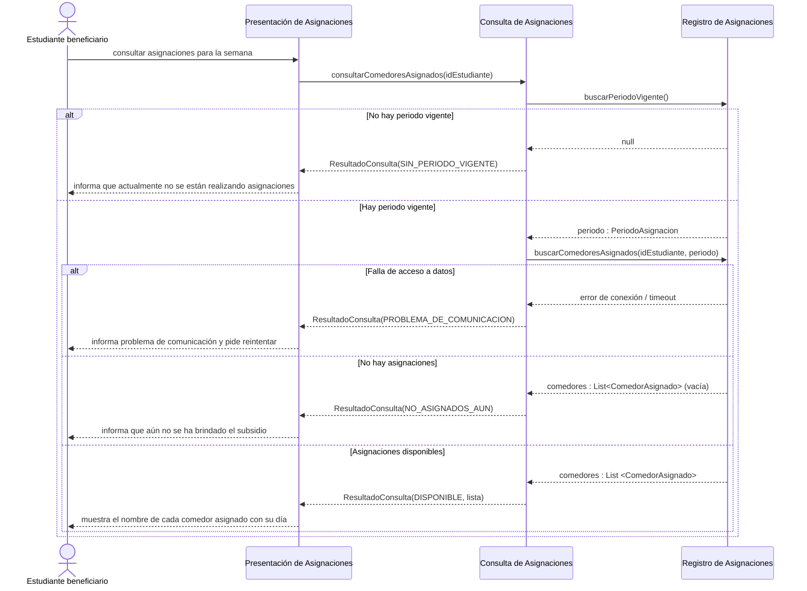
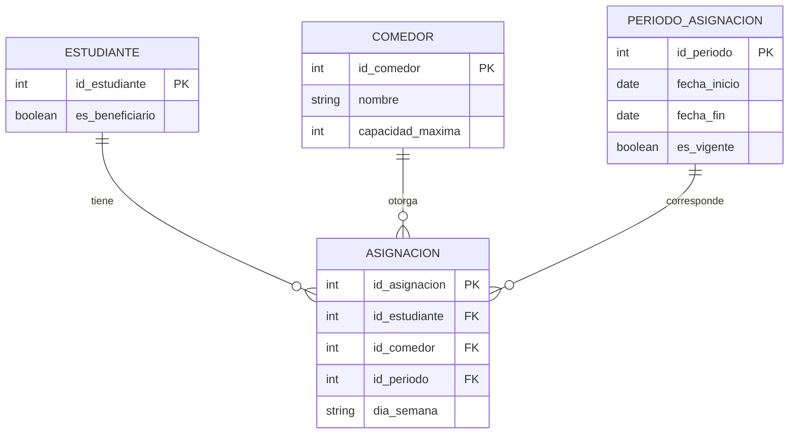

# Almuérzate — Interaction & Data Design v1.0

| | |
|---|---|
| **Team** | Almuérzate |
| **Members** | @amadodev07, @juanfpg1, @xedroc422, @alfredoquev, @julondono07 |
| **Status** | Draft |
| **Date** | 2026-11-04 |
| **Inputs** | `docs/design/01_Architectural_and_Detailed_Design.md`, Use Cases in `docs/requirements/` |

---

## 1. Behavior — Selected Use Cases

### 1.1 Ver comedores asignados — from requirement [REQ-10]

| Use Case step or flow | Message(s) in the diagram | Information exchanged | Operation defined in (Deliverable 1) |
|---|---|---|---|
| Main flow, step 1: estudiante consulta | `consultar asignaciones para la semana` | N/A | Interacción del actor con la UI (PA) |
| Main flow, step 2: sistema busca asignaciones | `consultarComedoresAsignados`, `buscarPeriodoVigente`, `buscarComedoresAsignados` | `idEstudiante`, `periodo`, lista de comedores | `ConsultaAsignaciones.consultarComedoresAsignados`, operaciones de `RepositorioAsignaciones` |
| Main flow, step 3: se muestran asignaciones | Último `alt` branch, final message | `ResultadoConsulta(DISPONIBLE)`, lista de `ComedorAsignado` | `PresentacionAsignaciones.mostrar` |
| Alternative flow: no hay periodo | Primer `alt` branch | `ResultadoConsulta(SIN_PERIODO_VIGENTE)` | `CatalogoMensajes.mensajePara` |
| Alternative flow: no hay asignaciones aún | Tercer `alt` branch | `ResultadoConsulta(NO_ASIGNADOS_AUN)` | `CatalogoMensajes.mensajePara` |
| Exception: problema obteniendo datos | Segundo `alt` branch | `ResultadoConsulta(PROBLEMA_DE_COMUNICACION)` | `CatalogoMensajes.mensajePara`, manejo de reintento |

## 2. Data Design

### 2.1 Principal information the system needs

| Information | Needed by (use cases) | Persisted? | Why (or why not) |
|---|---|---|---|
| Comedores | Asignar comedores (REQ-01), Ver asignaciones (REQ-10) | Yes | Es la infraestructura base; se necesita su aforo y nombre para mostrar |
| Estudiantes Beneficiarios | Asignar comedores (REQ-01) | Yes | Solo los beneficiarios reciben asignaciones; se asocian sus datos a los cupos |
| Periodo de Asignación | Asignar comedores (REQ-01), Ver asignaciones (REQ-10) | Yes | Determina si hay asignaciones vigentes para mostrar y delimita el cálculo |
| Asignaciones (Cupos) | Asignar comedores (REQ-01), Ver asignaciones (REQ-10) | Yes | Es el output central del sistema y debe ser inmutable y rápido de consultar para lectura (REQ-10) |

### 2.2 Data model

**Justification:** Relational (ADR-0001: PostgreSQL). Las entidades (estudiantes, comedores, periodos, asignaciones) tienen relaciones directas y estructuradas. Se requiere integridad transaccional (ACID) estricta para garantizar que el total de asignaciones nunca supere la capacidad del comedor.

| Entity / document type | Meaning in the system | Identifier | Constraints (required, unique, allowed values) |
|---|---|---|---|
| ESTUDIANTE | Representa a los usuarios del sistema | `id_estudiante` | `es_beneficiario` requerido (solo true recibe asignación) |
| COMEDOR | Instalación física que ofrece el servicio | `id_comedor` | `capacidad_maxima` requerida, debe ser > 0 |
| PERIODO_ASIGNACION | Ventana de tiempo (semestre/semana) activa | `id_periodo` | Solo puede haber un periodo con `es_vigente = true` a la vez |
| ASIGNACION | El cruce entre un estudiante y un comedor un día | `id_asignacion` | `dia_semana` limitado a [Lunes, Martes, Miércoles, Jueves, Viernes]. Un estudiante solo puede tener una asignación por día en un periodo. |

### 2.3 Data Ownership

| Information | Authoritative owner (component responsible for maintaining it) | Consumed by (uses it without owning it) | Access through |
|---|---|---|---|
| Asignaciones | Cálculo de Asignaciones (escribe vía Registro) | Consulta de Asignaciones | `RepositorioAsignaciones` |
| Periodo de Asignación | Administración (fuera del alcance actual) | Consulta y Cálculo de Asignaciones | `RepositorioAsignaciones` |
| Comedores | Administración (fuera del alcance actual) | Cálculo de Asignaciones | `RepositorioAsignaciones` |

### 2.4 Business rules and invariants enforced in data

| Business rule or invariant | Where it is enforced (component logic / data constraint / both) | How |
|---|---|---|
| BR-01: Asignación diaria | Both | Data: el campo `dia_semana` es un enum estricto de días hábiles. Un constraint UNIQUE (`id_estudiante`, `id_periodo`, `dia_semana`) evita duplicados. Logic: el algoritmo asegura asignar los 5 días. |
| BR-02: Solo en semestre académico | Logic | Component logic: Cálculo de asignaciones no se ejecuta fuera del intervalo establecido por los periodos vigentes. |
| El aforo real no puede superarse | Both | Data: constraint `COUNT(asignaciones por dia y comedor) <= capacidad_maxima`. Logic: El árbol decisional respeta el tope. |

---
## 3. Interface Contracts

### 3.1 `ConsultaAsignaciones.consultarComedoresAsignados`

**Interaction chosen** (from diagram 1.1, message `consultarComedoresAsignados` de Consulta de Asignaciones):

| Element | Specification |
|---|---|
| **Operation and purpose** | `consultarComedoresAsignados(idEstudiante)`: Determina el estado de las asignaciones de un estudiante en el periodo vigente y devuelve sus datos si aplica. |
| **Input (parameters and types)** | `idEstudiante`: Identificador único no nulo del estudiante (`IdEstudiante`). |
| **Output (successful result and data structure)** | `ResultadoConsulta`: Contiene un enum `EstadoConsulta` y, opcionalmente, una lista de 5 objetos `ComedorAsignado` (`dia`, `nombreComedor`). |
| **Preconditions** | El sistema base de datos está operativo. El ID del estudiante tiene un formato válido. |
| **Postconditions** | Se garantiza una respuesta tipada sin exponer excepciones crudas a la presentación. Nunca se altera el estado de la base de datos (ReadOnly). |
| **Failure outcomes** | Falla de conexión a base de datos (timeout/inaccesible): retorna `ResultadoConsulta(PROBLEMA_DE_COMUNICACION)`. |
| **Invariants and side effects** | Side effects: Ninguno. Es una operación pura de lectura. Invariant: Si el estado es `DISPONIBLE`, la lista interna siempre contiene 5 elementos (uno por día). |

**Testable examples**

| Case | Before | Request | Expected |
|---|---|---|---|
| Todo correcto | Existe periodo vigente, estudiante tiene 5 registros en base de datos. | `consultarComedoresAsignados(123)` | `ResultadoConsulta` con estado `DISPONIBLE` y lista de 5 comedores. |
| Sin asignación | Existe periodo vigente, estudiante no tiene registros. | `consultarComedoresAsignados(456)` | `ResultadoConsulta` con estado `NO_ASIGNADOS_AUN` y lista vacía. |
| Fuera de semestre | No existe ningún periodo marcado como `es_vigente = true`. | `consultarComedoresAsignados(123)` | `ResultadoConsulta` con estado `SIN_PERIODO_VIGENTE` y lista vacía. |
| Falla de Red / BD | La conexión al motor PostgreSQL falla. | `consultarComedoresAsignados(123)` | `ResultadoConsulta` con estado `PROBLEMA_DE_COMUNICACION` y lista vacía. |

---

### 3.2 `PresentacionAsignaciones.mostrar`

**Interaction chosen** (from diagram 1.1, message `consultar asignaciones para la semana` hacia Presentación de Asignaciones):

| Element | Specification |
|---|---|
| **Operation and purpose** | `mostrar(idEstudiante)`: Recibe la solicitud del estudiante desde la interfaz web, invoca a `ConsultaAsignaciones` y muestra los comedores asignados o el mensaje informativo correspondiente. |
| **Input (parameters and types)** | `idEstudiante`: Identificador único no nulo del estudiante beneficiario (`IdEstudiante`). |
| **Output (successful result and data structure)** | `void` (renderizado en interfaz web): Muestra cada `ComedorAsignado` (`dia`, `nombreComedor`) si el estado es `DISPONIBLE`, o el `String` retornado por `CatalogoMensajes.mensajePara(estado)` en otro caso. |
| **Preconditions** | El estudiante interactúa con la interfaz web y se dispone de un `idEstudiante` con formato válido. |
| **Postconditions** | El estudiante visualiza sus comedores asignados o el motivo de indisponibilidad sin recibir excepciones técnicas; ante `PROBLEMA_DE_COMUNICACION`, se habilita `reintentar(idEstudiante)`. |
| **Failure outcomes** | Si `ConsultaAsignaciones` retorna `ResultadoConsulta(PROBLEMA_DE_COMUNICACION)` o no responde, asume el estado `PROBLEMA_DE_COMUNICACION`, muestra el mensaje de `CatalogoMensajes` y pide reintentar. |
| **Invariants and side effects** | Side effects: Ninguno sobre datos persistidos (solo actualiza la vista en el cliente). Invariant: Presenta los nombres de comedores y días tal como llegan en `ResultadoConsulta`, sin transformarlos. |

**Testable examples**

| Case | Before | Request | Expected |
|---|---|---|---|
| Asignaciones disponibles | `ConsultaAsignaciones` retorna `ResultadoConsulta(DISPONIBLE, lista)` con 5 elementos. | `mostrar(123)` | Muestra el nombre de cada comedor asignado junto con su día (Lunes a Viernes). |
| Sin periodo vigente | `ConsultaAsignaciones` retorna `ResultadoConsulta(SIN_PERIODO_VIGENTE)`. | `mostrar(123)` | Muestra el mensaje de `CatalogoMensajes` indicando que actualmente no se están realizando asignaciones. |
| Sin asignaciones aún | `ConsultaAsignaciones` retorna `ResultadoConsulta(NO_ASIGNADOS_AUN)`. | `mostrar(456)` | Muestra el mensaje de `CatalogoMensajes` indicando que aún no se ha brindado el subsidio alimentario. |
| Falla o sin respuesta | `ConsultaAsignaciones` retorna `PROBLEMA_DE_COMUNICACION` o no responde. | `mostrar(123)` | Muestra el mensaje de problema de comunicación y habilita la opción para reintentar. |

---

### 3.3 `RepositorioAsignaciones.buscarPeriodoVigente`

**Interaction chosen** (from diagram 1.1, message `buscarPeriodoVigente()` hacia Registro de Asignaciones):

| Element | Specification |
|---|---|
| **Operation and purpose** | `buscarPeriodoVigente()`: Consulta en PostgreSQL el periodo de asignación activo (`es_vigente = true`) y retorna su intervalo de fechas. |
| **Input (parameters and types)** | Ninguno (`void`). |
| **Output (successful result and data structure)** | `PeriodoAsignacion` (`inicio : Fecha`, `fin : Fecha`) si existe un periodo vigente, o `null` si no existe ninguno activo (multiplicidad `0..1`). |
| **Preconditions** | La conexión con el motor PostgreSQL está operativa. |
| **Postconditions** | Devuelve a lo sumo una instancia de `PeriodoAsignacion` o `null` sin alterar el estado de la base de datos (ReadOnly). |
| **Failure outcomes** | Error de conexión o timeout en PostgreSQL: propaga el fallo de acceso a datos hacia `ConsultaAsignaciones`. |
| **Invariants and side effects** | Side effects: Ninguno. Es una operación pura de lectura. Invariant: En `PERIODO_ASIGNACION` solo puede haber un periodo con `es_vigente = true` a la vez. |

**Testable examples**

| Case | Before | Request | Expected |
|---|---|---|---|
| Periodo vigente activo | Existe un registro en `PERIODO_ASIGNACION` con `es_vigente = true`. | `buscarPeriodoVigente()` | Retorna `PeriodoAsignacion` con `inicio` y `fin` del periodo vigente. |
| Sin periodo vigente | Ningún registro en `PERIODO_ASIGNACION` tiene `es_vigente = true`. | `buscarPeriodoVigente()` | Retorna `null`. |
| Falla de Red / BD | La conexión al motor PostgreSQL falla o supera el timeout. | `buscarPeriodoVigente()` | Propaga error de conexión / timeout hacia el invocador. |

---

### 3.4 `RepositorioAsignaciones.buscarComedoresAsignados`

**Interaction chosen** (from diagram 1.1, message `buscarComedoresAsignados(idEstudiante, periodo)` hacia Registro de Asignaciones):

| Element | Specification |
|---|---|
| **Operation and purpose** | `buscarComedoresAsignados(idEstudiante, periodo)`: Recupera de PostgreSQL los comedores asignados por día de la semana para un estudiante en el periodo vigente dado. |
| **Input (parameters and types)** | `idEstudiante`: Identificador único no nulo del estudiante (`IdEstudiante`); `periodo`: Instancia no nula del periodo vigente (`PeriodoAsignacion`). |
| **Output (successful result and data structure)** | `List<ComedorAsignado>`, donde cada elemento contiene `dia : DiaSemana` y `nombreComedor : String` (multiplicidad `0 o 5`). |
| **Preconditions** | La conexión con PostgreSQL está operativa, `idEstudiante` tiene un formato válido y `periodo` corresponde a un periodo vigente existente. |
| **Postconditions** | Retorna una lista con 5 objetos `ComedorAsignado` (Lunes a Viernes) o una lista vacía si el estudiante no tiene asignaciones, sin alterar la base de datos (ReadOnly). |
| **Failure outcomes** | Error de conexión o timeout en PostgreSQL: propaga el fallo de acceso a datos hacia `ConsultaAsignaciones`. |
| **Invariants and side effects** | Side effects: Ninguno. Es una operación pura de lectura. Invariant: Un estudiante solo puede tener una asignación por `dia_semana` (`Lunes` a `Viernes`) en un mismo periodo; la lista retornada tiene `0` o `5` elementos. |

**Testable examples**

| Case | Before | Request | Expected |
|---|---|---|---|
| Asignaciones encontradas | Existen 5 registros en `ASIGNACION` para `id_estudiante = 123` en el `periodo` vigente. | `buscarComedoresAsignados(123, periodo)` | Retorna `List<ComedorAsignado>` con 5 elementos (`dia`, `nombreComedor`). |
| Sin asignaciones | No existen registros en `ASIGNACION` para `id_estudiante = 456` en el `periodo` vigente. | `buscarComedoresAsignados(456, periodo)` | Retorna `List<ComedorAsignado>` vacía (`0` elementos). |
| Falla de Red / BD | La conexión al motor PostgreSQL falla o supera el timeout. | `buscarComedoresAsignados(123, periodo)` | Propaga error de conexión / timeout hacia el invocador. |

---

## 4. Cross-Consistency & Changes to Deliverable 1

| Check | Result |
|---|---|
| Every participant in a sequence diagram is an actor, a component, a class or an external system from Deliverable 1 | Yes. Estudiante es actor. PA, CA, RA, CAL corresponden 1:1 a los componentes definidos en el Arquitectural Design v1.0. |
| Every message corresponds to a capability, operation or contract | Yes. Los mensajes mapean directamente a los métodos de `ConsultaAsignaciones` y `RepositorioAsignaciones` del Class Diagram. |
| Every entity or document type is reflected in the class diagrams, or the reason it is not is stated | Yes. `ASIGNACION` mapea a `ComedorAsignado`. `PERIODO_ASIGNACION` mapea a `PeriodoAsignacion`. |
| Every persisted information element has exactly one authoritative owner | Yes (Section 2.3). |
| The contract agrees with the sequence diagram and with the data model (same behavior in all three views) | Yes. `ResultadoConsulta` encapsula limpiamente el fallback de base de datos sin escurrir errores HTTP. |

**Changes made to Deliverable 1 because of this deliverable**
> Ninguno. El ejercicio de diseño del Deliverable 1, junto al ADR-0006 y las refactorizaciones de REQ-10 (eliminar exposición de códigos HTTP para manejar un error lógico de comunicación), nos dejaron con una arquitectura de responsabilidades claras que soporta el diseño de datos sin modificaciones.

---

## 5. Open Questions

> ¿Cómo visualiza exactamente el frontend la lista de "día: comedor"? (Reafirmando la Open Question técnica heredada de REQ-10).
> 
> ¿Qué componente del sistema es responsable de crear los periodos y marcar `es_vigente = true`? (Actualmente asumido como Administración, fuera del alcance de la entrega 1).

---

## 6. Optional — AI-Assisted Design Reflection

> El asistente AI reforzó que encapsuláramos el error de base de datos en un estado de dominio explícito (`PROBLEMA_DE_COMUNICACION`) en el contrato de la interfaz, en lugar de atrapar errores y lanzar excepciones. Esto lo aceptamos por completitud del principio KISS, evitando sobreingeniería en el manejo de fallas en la capa de presentación web (PHP).

---

## 7. Consistency Checklist

- [X] Two use cases from the project, each traceable to a Use Case written in the requirements.
- [X] Each sequence diagram shows the main flow and at least one alternative or exception flow.
- [X] No business behavior is invented: anything unspecified is marked as an assumption or Open Question.
- [X] Section 2.1 explains what is NOT persisted as well as what is.
- [X] The data model has identifiers, relationships and constraints, not only boxes.
- [X] Every piece of principal information has one authoritative owner, and consumers are listed (Section 2.3).
- [X] The contract defines input, output, preconditions, postconditions and failure outcomes.
- [X] Sequence, data model and contract describe the same behavior.
- [X] Diagrams render correctly on GitHub.
